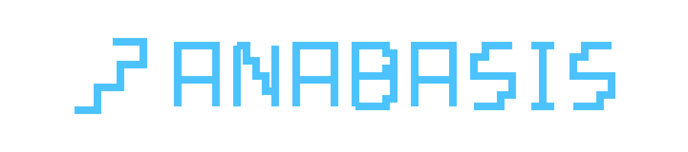
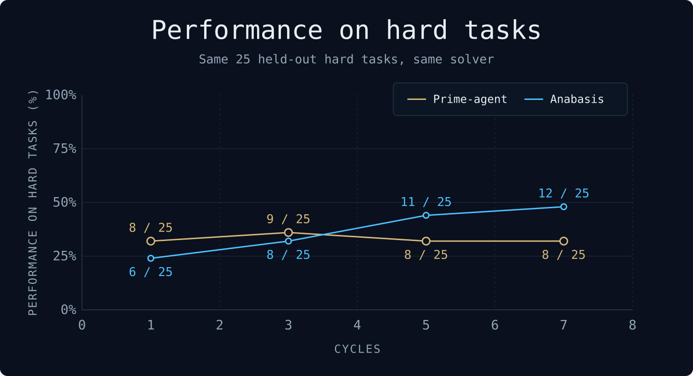

**I managed to automate myself.**

Introducing **Anabasis**, a system that builds an agent harness and its evaluation from a simple prompt for a Hard-to-Verify domain.

It researches the domain, builds tools and checks, and keeps a change to the harness only where a comparison on held-out tasks reads it as better.

## What it builds

Name the domain and what you want the agent to do, in one prompt as long as you like, and Anabasis works towards a tested harness for that request.
That includes researching the domain, setting up toolchains, writing domain-specific tools and defining how submissions should be checked.
The solver model stays the same throughout, so a difference between two harnesses comes from the harness instead of the model.

| Component | What does it contain? |
| --- | --- |
| **Built Harness** | A directory on pi's coding agent, named by its digest: an operating guide, tools of its own and installed programs, which a separate solver uses to solve and submit tasks in the domain |
| **Exam** | A public contract (rules with their sources, the answer format and, where the field has one, an objective), a hidden check for each rule and tasks with hidden values, all written by a separate Examiner |
| **Run evidence** | One append-only log: every solve with its trace, verdicts, Referee rulings, each comparison's terms and reading, promotions and the bill |
| **Handover** | The reference Harness as a directory that stands by itself, with the public rules and a closing report |

## How it works

```text
PROMPT → EXAM → TASKS → BUILD → SOLVE BOTH → JUDGE → PAIRWISE TEST → CLIMB or REBUILD or STOP
```

_Examine_: A separate Examiner drafts the exam from your prompt: the public rules with their sources, the answer format, one check for each rule, an objective where the field has one, and control answers with a known label. The host reads the draft without a model, putting every control answer through the checks twice, and the exam is frozen before the first solve. The Examiner then writes tasks with hidden values. The host holds a task out once its shape passes and it carries no answer of its author's, and solves none at that point: whether a task leaves the reference Harness room is the comparison's to read. At most half of what is held is released as practice, and a released task is never scored.

_Build_: The Builder starts from a minimal Starter Pack, pi's coding agent as pi releases it, researches the domain, sets up the required tooling and practises on released tasks until it freezes a new version of the Harness. It never sees a held-out task, a check or a hidden value: of a comparison it hears only the tally and the reading.

_Measure_: The frozen Harness and the reference Harness solve the same held-out tasks afresh, two solves a side by default. A Verifier runs each check in a walled cell, offline, and a Referee rules on every rejection before it counts. A task's score weighs validity at 0.6 and the objective at 0.3, the objective only between two valid answers. An exact paired sign-flip test over the tasks reads a step or none at 0.02: 6 tasks won to none, or 8 to 1 at equal margins. Beside every comparison the reference is read against itself (an A/A control), which shows how often noise alone would read a step.

_Iterate_: A step is promoted at once. The host then compares the new reference with the starter, drawing first the tasks held out since, and the promotion counts as confirmed only where that reading puts it above the starter. A campaign runs unattended to one of seven endings, among them its budget, your word and the stop rule: six eligible moves without a gain.

One limit to know: every check of a drafted exam is still the Examiner's own computation. A launch admits those checks on your behalf, and `--hitl` hands that back to you, with freezing the exam and each promotion.

## Results



After 7 cycles, **Prime-agent** solves 8 of the 25 held-out hard tasks correctly, while **Anabasis** solves 12.
Both use Claude Opus 5 at medium thinking and the same verifier; Anabasis is slower at 120 minutes per task and Prime-agent 45, however a lot of time is spent in CPU cycles using the real solver it built. The Anabasis count at cycle 7 includes one task passed on a re-solve with the submit time-left reply.

These are v1's results (v0.4.0); v2 has not repeated them yet.
[docs/plan.md](docs/plan.md) keeps v2's record: on 7 November 2026 it held 151 promotions, 12 of them confirmed against the starter and at most one in any campaign, against a bar of six in one campaign.

## Run it

We use **Bun 1.4.4** (Stable) and support macOS or Linux. Linux also needs `bubblewrap`.
On Ubuntu 24.04 and later, `bubblewrap` also needs unprivileged user namespaces, which AppArmor restricts by default: `sudo sysctl -w kernel.apparmor_restrict_unprivileged_userns=0`.
So first, if you haven’t already, please install Bun:
```sh
curl -fsSL https://bun.com/install | bash -s "bun-v1.4.4"
```
This example uses Claude for all four model seats.

```sh
git clone https://github.com/s-smits/anabasis.git
cd anabasis
cp .env.example .env   # set CLAUDE_CODE_OAUTH_TOKEN in it; `claude setup-token` prints one

# A run executes its tree's source, so it starts from a worktree of its own.
git worktree add --detach ../anabasis-trusses
cd ../anabasis-trusses
bun install --frozen-lockfile

bun --env-file=../anabasis/.env tools/d2/harness-builder.ts \
  --name trusses \
  --project steel \
  --prompt "Design lightweight steel roof trusses to Eurocode 3 within strict mass limits." \
  --budget 400 \
  --solver claude/claude-opus-5-5 \
  --builder claude/claude-opus-5-5 \
  --examiner claude/claude-opus-5-5 \
  --reviewer claude/claude-opus-5-5
```

- **Budget.** `--budget` is required: it caps the dollars the whole campaign may bill, priced from the tokens of each model turn at list price. No count of turns is a budget: a solve's 20 turns are a condition both sides of a comparison share, and the cost of a turn varies with what it reads and writes. A solve starts only while the budget holds a reserve for it (`--reserve`, 3 dollars) beside those in flight, and `bun .claude/skills/campaign-mechanics/scripts/bills.ts` prints what recorded solves billed against it.
- **Name and project.** `--project` is required when the campaign opens and groups campaigns; `--name` is the campaign. Use `--prompt-file` for a longer prompt.
- **Continuing.** Run the command again with the same `--name` and the campaign continues from its log, also after a kill, a crash or an evicted host. A session the kill cut is ended as killed and a new one opens with the notes and the harness the old one left; a comparison goes on under its own terms, keeping every solve that ended and solving again those that had not; nothing that reported is paid for twice. Run it from the checkout the campaign runs in: a comparison that began under one commit's setting is refused under another's, before any solve.
- **Seats.** Builder, Examiner, Referee (`--reviewer`) and solver can each use Claude (Claude Code or the API), Codex or OpenRouter, with their own model and effort.
- **Terms.** By default a comparison scores 24 held-out tasks, and a solve gets 20 model turns and 30 minutes; `--target`, `--solves`, `--solve-model-turns` and `--solve-minutes` name others.
- **Before you pay.** `--dry-run` prints the next move and makes none.
- **Credentials.** For Claude, `CLAUDE_CODE_OAUTH_TOKEN` (the process environment, or a file named with `bun --env-file=<file>`; Bun loads no env file by itself here) serves all four seats at once. `.env.example` lists every credential a seat reads.
- **Watching.** `bun run runs view <name>` prints the campaign as its log reads, and `bun run ui:deps` then `bun run ui:dev` serve a local, read-only page over the logs.

With nothing else set, Anabasis runs on this one machine and reaches for no other. `.env.runs.example` holds what your own machines add for `bun run runs`: the logins a run may take, the other hosts whose runs `runs status` shows, and the Python and table of tools `bun run runs sync` keeps on them.
`bun run runs` alone lists every verb, and `bun run runs search` also needs [ripgrep](https://github.com/BurntSushi/ripgrep) (`rg`).

## Take the Harness along

A campaign hands its reference Harness over as a directory that solves tasks without the campaign that built it: `harness/`, the public rules in `RULES.md` and the closing report in `REPORT.md`.
A campaign `bun run runs fresh` opens hands over into `data/harnesses/<its name>/` at each of its endings, and each handover replaces the one before.
By hand, from the checkout that ran it, `your-campaign` being the `--name` it ran under:

```sh
bun tools/d2/close.ts --name your-campaign --to data/harnesses/your-campaign
```

`--to` lies under `data/harnesses/`, which git ignores and every seat's wall denies, or outside the repository. `--harness <letter|digest>` hands over another Harness the campaign keeps.
Then solve tasks under the Harness as handed over, with nothing but a solver:

```sh
bun tools/d2/close.ts --name your-campaign --to data/harnesses/your-campaign --solve task-id[,task-id...] \
  [--solver openai-codex/gpt-6.1-terra --solver-effort high]
```

- **Tasks.** Each task id is one the campaign holds. A released task is the one to name for a quick check: a held-out task's answer then lies in the handover's log.
- **Solver.** The campaign's own, or the one `--solver` and the other setting flags name.
- **Solve** runs the solver confined, under the campaign's checks, with this checkout's solve and verifier code: a fresh solve instead of a replay of the measured run. It is recorded in `handover/log.jsonl`, which no reading of the campaign counts. It is a local evaluation instead of a capability claim: one solve is weak evidence.
- **Checks.** The handover holds no check, hidden value or answer, and the report names no task, so the folder can leave the exam side.
- **Host.** Bun 1.4.4 and the wall a run uses: Seatbelt on macOS, `bubblewrap` on Linux. Without the wall a case is a typed non-result, never an unconfined run.
- **Tools.** `.toolchain/` holds the tools the Builder installed, built for the operating system and architecture that installed them. Under `data/harnesses/`, a tree over 100 MB is copied once to `data/harnesses/.trees/<campaign>/` and linked to, so a handover at each ending does not copy it again.
- **Comparing.** To read a Harness against the starter or another system on many tasks, use the skill `compare-systems`.

## Contributing

`AGENTS.md` holds the system's invariants and a map of the tree; read it before changing a mechanism.

`bun run hooks:install` turns on the repository's commit and push hooks: the commit hook checks
format and lint on the staged files and scans them for secrets, and the push hook checks what the push adds
with `git diff --check`, the formatter and the secret scan. `ANA_PUSH_VERIFY=1 git push` adds
`bun run gate -- --static` on each pushed head: every step, with the tests near the head's own change in place of the suite.
`bun run land -- <top> --sanitize` proves each commit with its nearby tests and the top with the whole `bun run gate`.
The lint plugins beside oxlint's own rules (`anti-slop`, copied from dmmulroy/anti-slop, `ana` and the two `implicit-state` tiers)
are optional: their findings fail only `bun run lint -- --strict`, which the gate runs, or a run with `ANA_LINT_STRICT=1`.

Anabasis neither needs nor reads [dcg](https://github.com/Dicklesworthstone/destructive_command_guard). If you
run it, `.dcg.toml` holds three general allowances to copy into your own config, and says what they give up.

## Licence

MIT; see [LICENSE](LICENSE). Code copied or ported from other projects keeps its notices in
[THIRD_PARTY_NOTICES.md](THIRD_PARTY_NOTICES.md).
