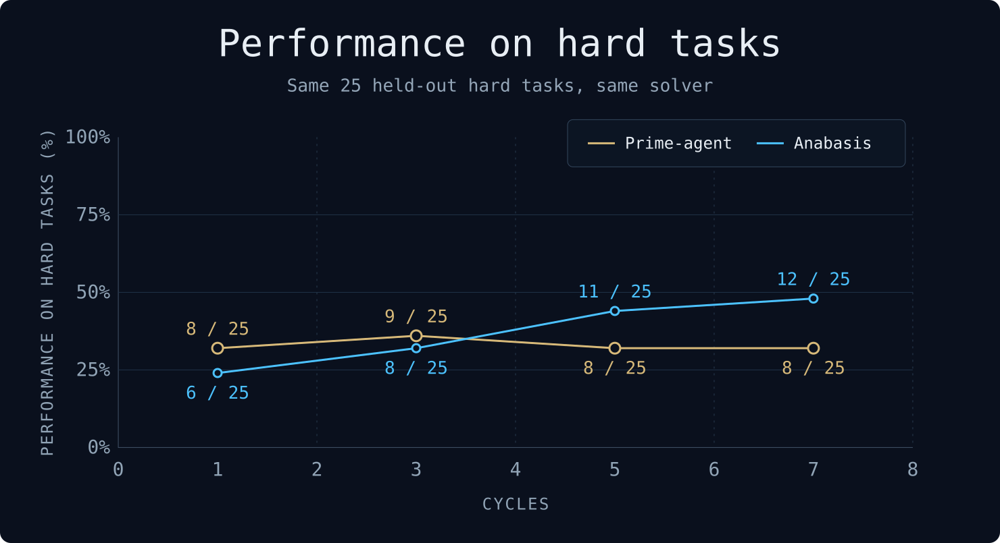

**I managed to automate myself.**

Introducing **Anabasis**, a system that builds an agent harness and its held-out evaluation suite from a single prompt for a hard-to-verify domain.

It researches the domain, assembles toolchains and verification checks, and promotes a change to the harness only when a controlled comparison on held-out tasks establishes a statistically significant gain.

## What it builds

Specify the target domain and task scope in a single prompt of any length, and Anabasis iterates towards an empirically tested harness for that domain. This includes researching domain conventions, installing toolchains, authoring domain-specific programs and defining verification rules. Holding the solver model fixed throughout ensures that any observed performance difference is attributable to the harness instead of the underlying model.

| Component | Contents |
| --- | --- |
| **Built Harness** | A self-contained directory built on pi's coding agent and identified by its content digest, combining an operating guide with installed programs used by a fixed solver to solve and submit domain tasks |
| **Exam** | A public contract (domain rules with their sources, the answer format and any declared objective), a hidden verification check per rule, and tasks with hidden ground-truth parameters, all authored by a separate Examiner |
| **Run evidence** | A single append-only JSONL log recording every solve trajectory, verifier verdict, Referee ruling, comparison specification and statistical reading, promotion event and token cost |
| **Handover** | The promoted reference Harness exported as a standalone directory alongside the public rules and a closing report |

## How it works

```text
PROMPT → EXAM → TASKS → BUILD → SOLVE BOTH → JUDGE → PAIRWISE TEST → CLIMB or REBUILD or STOP
```

_Examine_: A separate Examiner drafts the exam from the domain prompt: public rules with their citations, the answer format, one verification check per rule, a scalar objective where the domain defines one, and control answers with known validity labels. Host code validates the draft deterministically without invoking a model, running every control answer through the checks twice, and freezes the exam before any solve begins. The Examiner then authors tasks with hidden parameters. The host admits a task to the held-out set once its structure passes validation and contains no planted answer, without solving it at admission: whether the task provides gradient over the reference Harness is left for comparisons to measure. At most half of the held-out pool is released as practice tasks, and released tasks are never scored.

_Build_: Starting from a minimal Starter Pack (pi's coding agent as released), the Builder researches the domain, installs the necessary toolchain and iterates on released practice tasks until it freezes a candidate Harness. The evaluation boundary is strict: the Builder never sees held-out tasks, verification source code or hidden parameters, and receives only the aggregate tally and statistical reading of each comparison.

_Measure_: Both the frozen candidate Harness and the reference Harness solve the same held-out tasks afresh, with two rollouts per side by default. A Verifier executes each check offline inside an isolated sandbox, and a Referee rules on every reproducible rejection before it enters the tally. Per-task scores weight validity at 0.6 and the declared objective at 0.3, applying the objective only to break ties between two valid answers. An exact one-sided paired sign-flip test over nonzero task scores registers a step at significance level 0.02 (for example, 6 wins to 0 losses, or 8 to 1 at equal margins). Alongside every comparison, the reference Harness is evaluated against itself in an A/A control to monitor the empirical false positive rate.

_Iterate_: A candidate that registers a step is promoted immediately to become the new reference. On the next comparison, the host evaluates the new reference against the starter, sampling tasks held out since the promotion first; the promotion counts as confirmed only when that comparison places the reference above the starter. A campaign runs unattended until it reaches one of seven terminal conditions, including budget exhaustion, an operator stop or the stopping rule of six eligible moves without a gain.

One current limitation should be noted: checks in a drafted exam still rely on the Examiner's own computation. A standard launch admits those authored checks automatically on your behalf, whereas passing `--hitl` returns check admission, exam freezing and harness promotions to explicit operator approval.

## Results



After 7 cycles, **Prime-agent** solves 8 of the 25 held-out hard tasks validly, whereas **Anabasis** solves 12. Both arms use Claude Opus 5 at medium reasoning effort and the same verifier; Anabasis takes longer per task (120 minutes compared with 45 minutes for Prime-agent), largely due to CPU execution time inside the domain solver it constructed. The Anabasis count at cycle 7 includes one task passed on a re-solve using the submit time-remaining response.

These figures are from v1 (`v0.4.0`); v2 has not yet replicated them. [docs/plan.md](docs/plan.md) tracks v2's empirical record: as of 7 November 2026, it recorded 151 promotions, 12 confirmed against the starter and at most one confirmed promotion within any single campaign, against a milestone bar of six confirmed promotions in one campaign.

## Run it

Anabasis requires **Bun 1.4.5** (stable) and supports macOS and Linux. On Linux, `bubblewrap` is required for sandbox isolation. On Ubuntu 24.04 and later, `bubblewrap` also requires unprivileged user namespaces, which AppArmor restricts by default: `sudo sysctl -w kernel.apparmor_restrict_unprivileged_userns=0`.

Install Bun 1.4.5 if it is not already available:

```sh
curl -fsSL https://bun.com/install | bash -s "bun-v1.4.5"
```

In Claude Code, `/setup-anabasis` walks through these prerequisites on your machine and verifies each step without spending API credits.

The following example configures Claude for all four model seats.

```sh
git clone https://github.com/s-smits/anabasis.git
cd anabasis
cp -n .env.example .env   # set CLAUDE_CODE_OAUTH_TOKEN in it; `claude setup-token` prints one

# A run executes its tree's source, so it starts from a worktree of its own.
git worktree add --detach ../anabasis-trusses
cd ../anabasis-trusses
bun install --frozen-lockfile

bun --env-file=../anabasis/.env tools/d2/harness-builder.ts \
  --name trusses \
  --project steel \
  --prompt "Design lightweight steel roof trusses to Eurocode 3 within strict mass limits." \
  --budget 400 \
  --solver claude/claude-opus-5-5 \
  --builder claude/claude-opus-5-5 \
  --examiner claude/claude-opus-5-5 \
  --reviewer claude/claude-opus-5-5
```

- **Budget.** `--budget` is required and caps total campaign spend in US dollars, computed from per-turn token usage at list price. Turn limits are experimental conditions rather than budgets: a solve's 20 turns are held identical across both arms of a comparison, while per-turn cost varies with context size. A new solve launches only while the remaining budget covers a reserve (`--reserve`, 3 dollars by default) in addition to solves already in flight. Run `bun .claude/skills/campaign-mechanics/scripts/bills.ts` to inspect recorded spend.
- **Name and project.** `--project` is required when opening a campaign and groups related campaigns; `--name` identifies the campaign. Pass `--prompt-file` for longer domain prompts.
- **Resuming.** Re-running the same command with the same `--name` resumes the campaign from its append-only log after a signal, crash or host eviction. An interrupted Builder session is recorded as killed and a fresh session opens with the saved notes and harness; an interrupted comparison resumes under its original terms, retaining completed solves and retrying only unfinished ones so no completed work is paid for twice. Always resume from the original checkout: a comparison started under one commit's configuration is refused under another before any solve runs.
- **Seats.** The Builder, Examiner, Referee (`--reviewer`) and solver may each be assigned to Claude (Claude Code or API), Codex or OpenRouter with independent model and reasoning-effort settings.
- **Terms.** By default, a comparison evaluates 24 held-out tasks and each solve receives 20 model turns and 30 minutes; `--target`, `--solves`, `--solve-model-turns` and `--solve-minutes` override these defaults.
- **Dry runs.** `--dry-run` prints the next scheduled move without executing it or spending credits.
- **Credentials.** For Claude, `CLAUDE_CODE_OAUTH_TOKEN` (from the process environment or a file passed via `bun --env-file=<file>`, since Bun does not load `.env` automatically here) authenticates all four seats. `.env.example` documents every credential variable read by the seats.
- **Monitoring.** `bun run runs view <name>` prints a summary derived from the campaign log, and `bun run ui:deps` followed by `bun run ui:dev` launches a local, read-only web interface over the logs.

With no additional configuration, Anabasis runs strictly on the local machine. `.env.runs.example` documents optional multi-host settings for `bun run runs`: available logins, remote hosts displayed by `runs status`, and the Python environment and tool table synchronised by `bun run runs sync`. Running `bun run runs` lists all subcommands; `bun run runs search` additionally requires [ripgrep](https://github.com/BurntSushi/ripgrep) (`rg`).

## Take the Harness along

A campaign exports its reference Harness as a standalone directory capable of solving tasks independently of the campaign: `harness/`, the public rules in `RULES.md` and the closing report in `REPORT.md`. Any campaign opened with `bun run runs fresh` automatically exports into `data/harnesses/<name>/` upon reaching a terminal condition, replacing the previous handover. To export manually from the campaign's checkout (where `your-campaign` matches `--name`):

```sh
bun tools/d2/close.ts --name your-campaign --to data/harnesses/your-campaign
```

The `--to` destination must lie under `data/harnesses/` (which git ignores and every seat sandbox denies) or outside the repository. Pass `--harness <letter|digest>` to export a different kept Harness from the campaign.

You can then run isolated solves under the exported Harness using only a solver:

```sh
bun tools/d2/close.ts --name your-campaign --to data/harnesses/your-campaign --solve task-id[,task-id...] \
  [--solver openai-codex/gpt-6.1-terra --solver-effort high]
```

- **Tasks.** Each task identifier must belong to the campaign. Prefer a released practice task for a quick sanity check, because running a held-out task writes its answer into the handover log.
- **Solver.** Defaults to the campaign's solver unless overridden with `--solver` and related flags.
- **Solve.** Executes the solver inside the sandbox under the campaign's verification checks using the current checkout's solve and verifier code, producing a fresh solve instead of replaying the measured run. Output goes to `handover/log.jsonl`, which is excluded from all campaign statistics. Treat this as a local diagnostic check rather than a capability claim, since a single rollout is weak evidence.
- **Checks.** The exported directory contains no check source code, hidden values or answers, and `REPORT.md` names no tasks, so the handover can safely leave the exam side.
- **Host.** Requires Bun 1.4.5 and the platform sandbox (Seatbelt on macOS, `bubblewrap` on Linux). If the sandbox is unavailable, the solve returns a typed non-result rather than running unconfined.
- **Tools.** `.toolchain/` stores binaries installed by the Builder for the host operating system and architecture. Under `data/harnesses/`, any toolchain tree exceeding 100 MB is copied once into `data/harnesses/.trees/<campaign>/` and linked thereafter to avoid repeated copies across endings.
- **Comparing.** To evaluate a Harness against the starter or another system across a larger task set, use the `compare-systems` skill.

## Contributing

Read `AGENTS.md` for the repository invariants and directory map before modifying any mechanism.

Run `bun run hooks:install` to enable the repository's commit and push hooks. The commit hook verifies formatting, linting and secret scanning on staged files; the push hook checks added commits with `git diff --check`, the formatter and the secret scanner. Setting `ANA_PUSH_VERIFY=1 git push` additionally runs `bun run gate -- --static` on each pushed head, running all static checks together with tests adjacent to the change in place of the full suite. `bun run land -- <top> --sanitize` validates every commit in the stack with its nearby tests, whereas `--merge` or `--whole` runs the full `bun run gate` at the stack head. The custom lint plugins beside Oxlint's built-in rules (`anti-slop`, adapted from dmmulroy/anti-slop, `ana` and the two `implicit-state` tiers) are advisory in plain runs and fail only under `bun run lint -- --strict` (which the gate runs) or when `ANA_LINT_STRICT=1` is set.

Anabasis neither requires nor reads [dcg](https://github.com/Dicklesworthstone/destructive_command_guard). If you use it, `.dcg.toml` lists three general allowances you may copy into your own configuration along with the protections they relax.

## Licence

MIT; see [LICENSE](LICENSE). Code copied or ported from upstream projects retains its notices in [THIRD_PARTY_NOTICES.md](THIRD_PARTY_NOTICES.md).
