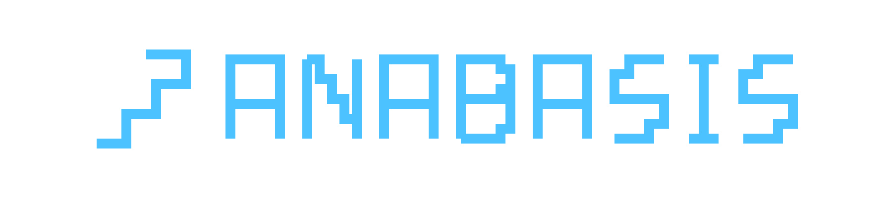
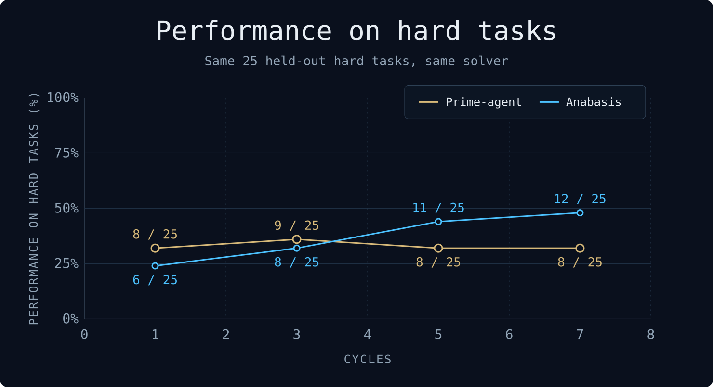

**I managed to automate myself.**

Introducing **Anabasis**, a system that builds an agent harness and its evaluation from a simple prompt for a Hard-to-Verify domain.

It researches the domain, builds tools and checks, and uses recorded results to guide further changes.

## What it builds

Name the domain and what you want the agent to do, in one prompt as long as you like, and Anabasis works towards a tested harness for that request.
That includes researching the domain, setting up toolchains, writing domain-specific tools and defining how submissions should be checked.

| Component | What does it contain? |
| --- | --- |
| **Built Harness** | A toolkit and operating guide, on pi's coding agent, that a separate agent uses to solve and submit tasks in the domain |
| **Correctness Model** | A public contract, task families with hidden values, known-correct and deliberately incorrect examples that test the evaluation, and executable checks, all written by a separate Examiner |
| **Run evidence** | One append-only log: recorded attempts, task outcomes, model/tool traces, Referee rulings and promotion decisions |
| **Handover** | The reference Harness as a directory that stands by itself, with the public rules and a closing report |

## How it works

```text
PROMPT → EXAM → BUILD → COMPARE → SETTLE → CLIMB or REBUILD or STOP
```

_Build_: The Builder starts from a minimal Starter Pack, pi's coding agent as pi releases it, researches the domain, sets up the required tooling and practises on released tasks until it freezes a new version of the Harness.

_Validate_: Before measurement, a separate Examiner writes the tasks and checks, and they must pass a predefined validation suite, including known-good and deliberately incorrect examples, plus a reference-solver check: a task is held out only where the reference Harness fails some, and not all, of three fresh solves. The Builder never sees a held-out task or a check.

_Measure_ & _Iterate_: The Built Harness and the reference Harness solve the same held-out tasks, a Verifier checks their submissions and a Referee rules on every rejection before it counts. A paired sign-flip test over the tasks reads a step or none, and a step read twice is promoted. The results inform further changes to the Harness or its evaluation, attempts at harder tasks, or a decision to stop.

## Results



After 7 cycles, **Prime-agent** solves 8 of the 25 held-out hard tasks correctly, while **Anabasis** solves 12.
Both use Claude Opus 5 at medium thinking and the same verifier; Anabasis is slower at 120 minutes per task and Prime-agent 45, however a lot of time is spent in CPU cycles using the real solver it built. The Anabasis count at cycle 7 includes one task passed on a re-solve with the submit time-left reply.

These are v1's results (v0.4.0); v2 has not repeated them yet.

## Run it

We use **Bun 1.4.3** (Stable) and support macOS or Linux. Linux also needs `bubblewrap`.
On Ubuntu 24.04 and later, `bubblewrap` also needs unprivileged user namespaces, which AppArmor restricts by default: `sudo sysctl -w kernel.apparmor_restrict_unprivileged_userns=0`.
So first, if you haven’t already, please install Bun:
```sh
curl -fsSL https://bun.com/install | bash -s "bun-v1.4.3"
```
This example uses Claude for all four model seats.

```sh
git clone https://github.com/s-smits/anabasis.git
cd anabasis
bun install --frozen-lockfile

bun tools/d2/harness-builder.ts \
  --name trusses \
  --project steel \
  --prompt "Design lightweight steel roof trusses to Eurocode 3 within strict mass limits." \
  --budget 400 \
  --solver claude/claude-opus-5-5 \
  --builder claude/claude-opus-5-5 \
  --examiner claude/claude-opus-5-5 \
  --reviewer claude/claude-opus-5-5
```

A second domain, in beta, opens the same way:

```sh
bun tools/d2/harness-builder.ts \
  --name firmware \
  --project esp32 \
  --prompt "Build a harness that writes firmware for ESP32, Raspberry Pi Pico and Arduino Uno, connecting sensors, displays and lights, where the code must compile." \
  --budget 400 \
  --solver claude/claude-opus-5-5 \
  --builder claude/claude-opus-5-5 \
  --examiner claude/claude-opus-5-5 \
  --reviewer claude/claude-opus-5-5
```

`--budget` is required: it caps the dollars the whole campaign may bill.
`--project` is required when the campaign opens; run the command again with the same `--name` to continue that campaign, or use `--prompt-file` for a longer prompt. `bun run runs view <name>` prints the campaign as its log reads.
Builder, Examiner, Referee (`--reviewer`) and solver can each use Claude, Codex or OpenRouter, with their own model and effort.
For Claude, `CLAUDE_CODE_OAUTH_TOKEN` (process environment or `.env`; `claude setup-token` prints one) serves all four seats at once.
`.env.example` lists every credential a seat reads; copy it to `.env`, which git ignores. `.env.runs.example` holds what your own machines add for `bun run runs`: the logins a run may take and the other hosts whose runs `runs status` shows.

## Take the Harness along

A campaign hands its reference Harness over as a directory that solves tasks without the campaign that built it: `harness/`, the public rules in `RULES.md` and the closing report in `REPORT.md`.
Hand over from the checkout that ran it: `your-campaign` is the `--name` it ran under, and the folder must be empty and lie outside the repository.

```sh
bun tools/d2/close.ts --name your-campaign --to ../my-harness
```

`--handover ../my-harness` on the campaign command writes the same at the campaign's ending.
Then solve a task under the Harness as handed over:

```sh
bun tools/d2/close.ts --name your-campaign --to ../my-harness --solve task-id
```

- **Tasks.** A task is a task id the campaign holds. A released task is the one to name: a held-out task's answer then lies in the handover's log.
- **Solve** runs the campaign's solver once, confined, from the folder the Harness was written to, under the campaign's checks, and prints how it ended. It is recorded in `handover/log.jsonl` beside the campaign's log, which no reading of the campaign counts. It is a local evaluation, not a capability claim.
- **Checks.** The handover holds no check, hidden value or answer: the report names no task, so the folder can leave the exam side.
- **Host.** Bun 1.4.3 and the wall a run uses: Seatbelt on macOS, `bubblewrap` on Linux. Without the wall a case is a typed non-result, never an unconfined run.
- **Tools.** `.toolchain/` holds the tools the Builder installed, built for the operating system and architecture that installed them, and is copied in full, its links as links. The Harness is opened before the command returns, and where it does not open as the Harness the campaign kept, nothing is left in the folder.
- **Code.** The handover runs this checkout's solve and verifier code over the handed-over Harness: a fresh solve, not a replay of the measured run.

## Contributing

`bun run hooks:install` turns on the repository's commit and push hooks: the commit hook checks
format and lint on the staged files and scans them for secrets, and the push hook runs `bun run gate`
over what the push adds.
The two lint plugins, `anti-slop` (copied from dmmulroy/anti-slop) and the repository's own `ana`
simplify catchers, are optional: their findings are counted on every run and fail only
`bun run lint -- --strict` or a run with `ANA_LINT_STRICT=1` in the environment.

## Licence

MIT; see [LICENSE](LICENSE). Code copied or ported from other projects keeps its notices in
[THIRD_PARTY_NOTICES.md](THIRD_PARTY_NOTICES.md).
