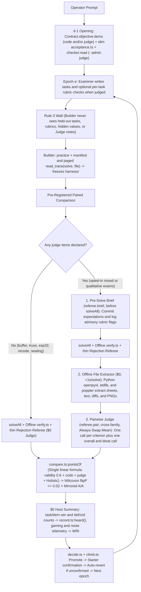

# v0.14 Plan: Unified Rubric, Pairwise Referee, and Cleanup

**Date (UTC):** `2026-11-24` · **Base:** `origin/main` (`781fa3cab`, `v0.13.2.1`) · **Stack tip:** `#1164` (`2d0b47efe`, `AGENTS.md` multi-domain generality), alongside open v0.14 work in `#1158` (WRI + external evaluation bridge and `bareSolver` pairing), `#1160` (Referee operational fixes), and `#1162` (deterministic `[0, 1]` rubric at `b7d314edc`).

Anabasis operates across three classes of domains:

1. **Verifiable constraint domains** (`buffer`, `truss`, `esp32`, `recode`, `seating`), in which offline code checks both feasibility and solution quality.
2. **Mixed, hard-to-verify domains** (`kernel`, `jobstat`), in which offline code verifies hard constraints and reproducible calculations, whereas patch cleanliness, methodological justification, and deliverable legibility are difficult to capture in frozen day-one TypeScript alone.
3. **Open-ended qualitative domains** (workplace briefs, analytical memos, and structured deliverables), in which offline checks enforce only basic file and schema integrity, while substantive quality depends primarily on judgement against task requirements.

Version `0.14` supports all three classes through **one Unified Rubric**, adds a cross-family pairwise Referee only when a contract declares judged criteria and the operator opts in, and removes existing code that spends budget without adding evaluation signal. All 12 core components stay intact, and verifiable domains continue to execute completely offline at `$0` pairwise Judge cost.

No implementation in Phases 1–3, no amendment to `AGENTS.md` §2.3 or Rule 10, no paid offline calibration (`$12–$15`), and no live proof run starts without explicit operator approval in [§7](#7-decisions-waiting-on-the-operator-agentsmd-3).

---

## 1. Empirical and Literature Grounding

### 1.1 Primary Repository Evidence
Measurements across `301` archived campaign logs and external JobBench runs establish four baseline facts:

| Area | Measured Reality | Source |
| --- | --- | --- |
| **Verifiable baseline (`buffer`)** | `44/44` drafted `buffer` runs use offline TypeScript evaluators (`209–258` lines, `4–7` binary checks, `0` submitted files, `0` hidden values, `0` `draft.unmeasured` flags, and a scalar cost objective). Recent `buffer` campaigns climb `3–7` promotions (`3,405/3,409` valid solves, `212/227 = 93.4%` of non-tied tasks separated by the scalar objective, `0/17` powered A/A false positives), with `referee.ts` invoked `1–2` times per campaign (`$0.12–$0.16`). | Archived `buffer` logs |
| **Open-ended stall (`jobstat`)** | Freezing one deterministic evaluator at domain opening (`d-1`) left binary validity headroom on only `13/2,200` tasks (`2/37` steps, `0/763` candidate rejections), pushed qualitative obligations into `"not measured"` disclaimers, lost `174` to `224` (with `16` ties) against Starter on tasks written after promotion, failed to exceed Starter's `262–360` out of `518` JobBench score spread (`0/12` promoted references), and missed `494` vacuous passes in a live run. | Archived `jobstat` logs and JobBench score table |
| **Builder deliverable blindness** | `src/solver/run.ts:judge` stores submitted `verdict.files` (`329/329` practice verdicts in a recent `jobstat` run), yet `src/builder/tools.ts:traceTool` renders only `verdict.answer`, leaving Builder unable to inspect spreadsheets, documents, or reports produced during practice. | `src/builder/tools.ts:traceTool` |
| **Earlier LLM judges and extra seats** | Earlier pointwise, tool-less judges hallucinated arithmetic and compile errors across `10,358` verdicts, vetoed only `5/1,411` passes (`0.35%`), and stalled on 50-control gates (`3/3` runs invalidated). Separate Repair Engineer (`4/74` decisions, `0` unique) and Diagnoser (`20/20` solver blame) seats did not improve outcomes; failed practice traces account for only `15/1,957` (`0.77%`) across `14` recent runs. | Archived v1/v4 logs and recent v2 logs |

### 1.2 Research Verification and Known Limits (2023–2026)
Each design choice in §2 is bounded by findings—and explicit failure limits—from evaluation literature:

| Design Choice | Supporting Evidence | Known Limit & Concrete Mitigation |
| --- | --- | --- |
| **Offline programmatic extraction + coarse visual check** | Tool-grounded verification beats static text-only judges on real artifacts (*Agent-as-a-Judge*, ICML 2025; *BankerVerifierBench*, arXiv:2611.22841). Visual-only VLM judges lose fine digits on dense spreadsheets due to image down-sampling. | Single-pass VLM chart judges exhibit up to `~70%` wider uncertainty on dense plots than on aesthetic tasks. Python (`openpyxl`, `sqlite3`, `pdftotext`) owns all numeric and table extraction; rendered PNGs serve strictly as a coarse visual/layout and corruption check. |
| **Pre-solve commit-first brief (`referee.brief`)** | Committing expectations before reading polished candidate prose reduces exploit acceptance sharply (*More Convincing, Not More Correct*, arXiv:2607.05904). | Without a gold answer, a commit-first judge can inherit its own errors and penalise valid alternative solutions. The brief therefore commits verifiable checklist expectations grounded in `publicInput` and `hidden` parameters—never a single rigid canonical answer key. |
| **Cross-family judging, isolated criteria, 3-level per-pass swaps** | Same-family judges exhibit substantial self-preference bias even on objective criteria (Panickssery et al., NeurIPS 2024; COLM 2026, arXiv:2604.06996). Batching criteria drops accuracy `20–30` points (*RuVerBench*, EMNLP 2026, arXiv:2606.29920). Coarse 3-level per-pass choices (`-1, 0, +1`) resist scale drift better than fine Likert scales. | Position swapping removes presentation-order bias only—it does *not* remove order-invariant verbosity or polish bias (*Length-Controlled AlpacaEval*, Dubois et al., COLM 2024). Length telemetry and the holistic counter-weight remain mandatory. |
| **Holistic counter-weight + climbing per-task rubrics** | Optimising against static checklists degrades rubric-free holistic quality (*Reward Hacking in Rubric-Based RL*, arXiv:2605.12474; *Rubric Dropout*, arXiv:2608.11669; *HealthBench*, 2025; *RaR*, 2025; *OpenRubrics*, 2025). | Prompt instructions to "penalise fluff" have weak effect on their own, and static rubrics get farmed over iterations. Pairing equal-weight holistic judgement (`W_H = W_J`) with per-task climbing rubrics and external transfer checks (*Rethinking Harness Evolution Eval*, arXiv:2607.12227) guards against both. |

---

## 2. Unified Rubric and Pairwise Referee Architecture



### 2.1 One Rubric Schema Without Mode Flags
`Contract.objective.items` (`src/kernel/contract.ts`, introduced in `#1162`) extends `RubricItem` into a discriminated union with no separate mode flag or domain-name check:

```ts
export type RubricItem =
  | { readonly id: string; readonly kind?: "code"; readonly weight: number }
  | { readonly id: string; readonly kind: "judge"; readonly weight: number; readonly criterion: string };
```

Two booleans derived directly from the contract control execution:

- **`hasJudge`** is true if any item declares `kind === "judge"`. When false (`buffer`, `truss`, `esp32`, `recode`, `seating`), neither the pairwise Judge nor the Holistic check runs, and evaluation follows the existing offline code path at `$0` extra cost.
- **`hasCode`** is true when `objective` is defined and either omits `items` (legacy scalar objective) or contains at least one `code` item. Only when **`hasJudge && !hasCode`** (qualitative exams with no offline code objective; distinct from validity-only contracts like `esp32`, where both booleans are false) does the host skip requiring an `objective` or `scores` export in `src/examiner/draft.ts:evaluatorFaults`, `src/kernel/check-child.ts`, `src/kernel/verify.ts:openVerifier` and `weightedRubric`, `src/kernel/acceptance.ts:acceptance`, and `src/referee/draft-audit.ts:refusal`, while keeping deterministic `truthChecks` as the structural feasibility floor.

**Contract weights and climbing per-task criteria (`Task.rubric`):**
- The frozen contract fixes the **weights** between offline code items (`W_C = sum of code weights`) and the judged block (`W_J = sum of judge weights`).
- On `hasJudge` exams, Examiner may attach `1..4` immutable, single-line, positively framed per-task criteria (`Task.rubric`, `20..220` characters each, unique IDs disjoint from `truthChecks` and `objective.items`) tailored to that task and epoch. When present, those `1..4` per-task criteria replace the contract's judge criterion descriptions for that task and average equally into weight `W_J`. When omitted, the Judge evaluates the contract's `judge` items using their declared `w_j` weights.
- Public domain rules and conventions (`Contract.rules`, `Contract.scope`) continue to state *what* good work looks like across the wall (`AGENTS.md` §1 wall item 1), while exact grading criterion phrasings and `Task.rubric` stay exam-side (matching how `evaluator.ts` source stays exam-side today). `contract.ts:objectiveLine` exposes only item IDs and weights; `src/solver/prompt.ts:publicView` already strips fields outside `{ taskId, family, publicInput }`, and `tools/d2/round.ts:sessionNamed` keeps passing full `TaskPackage` records into `BuildRequest` so practice verification still receives `hidden` values.
- Because Examiner authoring per-task `Task.rubric` criteria across epochs is an agent authoring part of a measurement instrument, it requires an explicit scoped amendment to `AGENTS.md` Rule 10 (requested in §7.3).

**Explicit `--admit-judge` opt-in preventing stray `judge` items on verifiable domains:**
- `src/kernel/acceptance.ts:acceptance` records every `kind: "judge"` item in `checker.read` with `instrument: "judge"`.
- A dedicated `judgeFaults` check (parallel to `authoredFaults` in `src/kernel/acceptance.ts`) faults any exam declaring `instrument: "judge"` items unless the operator explicitly passes the boolean flag `--admit-judge` on `tools/c/accept.ts` or at campaign launch (`tools/d2/campaign-terms.ts`). Unattended `authored: true` auto-admits authored code checks only—never `judge`. Unadmitted `judge` items always refuse the exam rather than being silently dropped or renormalised.
- When `hasJudge` is true, `src/referee/draft-audit.ts:reviewDraft` may attach a non-blocking note if a `judge` criterion appears directly computable in code, while blocking draft-audit rulings stay backed by mechanical verifier probes (`AGENTS.md` §2.3).

### 2.2 Single Linear, Non-Decreasing Scoring Formula (`src/kernel/compare.ts:pointsOf`)
Binary validity (`WEIGHTS.validity = 0.6`), objective weight (`WEIGHTS.objective = 0.3`), `GAP_FLOOR = 0.01`, and the exact one-sided Wilcoxon sign-flip test (`flipP <= 0.02`) remain unchanged.

**Vote alphabet (defined once):** Each individual orientation pass outputs a **3-level** vote in `{-1, 0, +1}`. Averaging both orientations under unconditional `Always-Swap Mean` (`(pass1 + pass2) / 2` in canonical `right - left` orientation) therefore yields a **5-level** mirrored score `d` in `{-1, -0.5, 0, +0.5, +1}`.

**Composite objective delta `g(f, o)` for a valid-vs-valid pair `(f, o)`:**
Let `W_C = sum_{i in code} w_i` and `W_J = sum_{j in judge} w_j`. Let `d_judge` be the unweighted mean of the task's `Task.rubric` mirrored scores when `Task.rubric` is present, or `(1 / W_J) * sum_{j in judge} w_j * d_j` otherwise. When `W_J > 0`, the host appends one rubric-free Holistic mirrored score `h` in `{-1, -0.5, 0, +0.5, +1}` at weight `W_H = W_J`:

- **Verifiable (`W_J = 0`):** Uses the existing `gainOver` path (`M(f) - M(o)` on unit-scale `[0, 1]` rubrics; relative `gainOver` on legacy scalar objectives in `compare.ts`). Zero Judge calls.
- **Mixed (`W_C > 0` and `W_J > 0`):** Because continuous offline code deltas are typically `0.05–0.20` whereas judge votes step by `0.5` or `1.0`, one scale factor `JUDGE_STEP` aligns one full judge win (`+1`) with a `JUDGE_STEP` (`0.25`) code delta:
  ```text
  g(f, o) = ( sum_{i in code} w_i * (s_i(f) - s_i(o)) + JUDGE_STEP * W_J * (d_judge + h) ) / ( W_C + 2 * W_J )
  ```
  *(Under a declared `1:1` `W_C:W_J` contract, the denominator is `W_C + 2 * W_J`, giving equal `1:1:1` nominal shares to code, judged criteria, and holistic before `JUDGE_STEP` converts ordinal judge votes onto the `[0, 1]` code scale.)*
- **Qualitative (`W_C = 0` and `W_J > 0`):** Because no code term exists and Wilcoxon `flipP` is scale-invariant, `JUDGE_STEP` is omitted (`scale = 1`), keeping `g(f, o)` across the full `[-1, +1]` range without pushing small wins toward `GAP_FLOOR`:
  ```text
  g(f, o) = 0.5 * (d_judge + h)
  ```
  *(With `4` equal-weight criteria and `h = 0`, the smallest single-item mirrored win `0.5` gives `0.5 * (0.5 / 4) = 0.0625`, comfortably above `GAP_FLOOR = 0.01`; on mixed `1:1:1` with `JUDGE_STEP = 0.25`, the same single-item win gives `0.25 * (0.5 / 4) / 3 = 0.0104 > 0.01`.)*

**Properties and Monte Carlo baseline (`5,000` trials, `n = 24`, `solves = 2`, `flipP <= 0.02`, strong primacy bias, `JUDGE_STEP = 0.25`):**
Before `GAP_FLOOR` thresholding and `1e-9` snapping, `g(f, o)` is linear, non-decreasing in every component, and odd-symmetric (`g(o, f) = -g(f, o)`). Reproducible Monte Carlo tooling (`promotion-tuner/scripts/simulate-scoring.ts`) will be committed in Phase 0a to re-verify both `JUDGE_STEP = 0.25` and `0.50` under the exact 3-level per-pass alphabet; initial `5,000`-trial runs gave:
- Verifiable (`W_J = 0`): `1.94%` null A/A false-step rate (`<= 2%`).
- Mixed (`1:1:1`): `1.64%` null A/A, `100%` power on `+0.25` pure-code gains, `99.98%` on mixed gains, `0/5,000` (`< 0.06%`) escape on code-vs-judge scale attacks (`-0.10` code / `+0.30` judge / `-0.20` holistic, vs `13.1%` without `JUDGE_STEP`), `0/5,000` (`< 0.06%`) severe bloat escape, `1.38%` mild bloat escape.
- Qualitative (`W_C = 0`): `1.90%` null A/A, `95.96%` real-gain power, `0/5,000` (`< 0.06%`) severe bloat escape, `1.54%` mild bloat escape.

**Deterministic valid-only pairing (`compare.ts:pairsOf`, `round.ts`):**
Validity comparisons retain `solves × solves` cross-pairing (`solves * (n_F - n_O)`). When `hasJudge` is true, valid solves per arm are sorted deterministically by `sha256(comparison:task:solveId)`, paired into `m = min(n_F, n_O)` disjoint valid-vs-valid pairs, and scaled by `(n_F * n_O) / m`. Under the default `solves = 2`, this yields `2` A/B pairs plus `1` blind mirrored A/A pair `(old_0, old_1)`, plus `1` additional blind `aa-fresh` pair `(fresh_0, fresh_1)` on starter confirmation comparisons so `climb.ts:starterNoiseLine` preserves hybrid parity—without dropping valid pairs on `[F, T]` vs `[T, F]` splits and without finish-order dependence. Judge signs negate whenever Thue-Morse `halves: "mirrored"` swaps orientation.

### 2.3 Three-Step Cross-Family Referee Pipeline (`hasJudge` Only; `2` Additive Log Events)

Cost estimates below assume default `solves = 2`, `32` tasks per comparison (`96` total pairs across `2` A/B + `1` mirrored A/A per task), and at most `4` rubric criteria plus `1` Holistic check per pair (`5` checks per pair).

1. **Pre-Solve Task Brief (`referee.brief`, once per task before `solveAll`, `effort: medium`):**
   - Inputs: operator prompt, contract, public input, hidden task data, and `task.rubric` (strictly no `acceptedAnswers` or `task.feasible`).
   - Outputs: grounded factual expectations (`itemAnchors`), expected deliverable scope (`antiBloatBaseline`), and **non-blocking** advisory rubric flags (`contradicts-spec`, `unheld-duty`, `unverifiable`, `compound-item`, `negative-ban`, `duplicates-code`, `duplicates-holistic`) routed to `record.ts:heard()` and WRI. Keeping pre-solve flags strictly non-blocking honours `AGENTS.md` §2.3 without introducing prose-opinion task removal.
   - Estimated cost: `~$1.02` per `32`-task comparison on `openai-codex/gpt-6.1-sol` (included in the `~$11.20` total and `~$0.60/task` reserve).
2. **Offline File Extractor (`$0`, `< 1 s/solve`, offline sandbox, `<= 15 s` hard cap):**
   - Uses only tools already installed on hosts: `ana-python` (`openpyxl` with `read_only=True`, capped at `100,000` cells per sheet and `500` consecutive empty rows; `PIL`), Python stdlib (`zipfile` + `ElementTree` for `.docx`, `json` for `.ipynb`, `sqlite3` in read-only mode for `.db`, plain UTF-8 `.csv`/`.md`/`.py`, comment-stripped `diff` stats for `kernel`), and `pdftoppm`/`pdftotext`/`pdfinfo` (verifying `poppler-utils` on Linux runners). Benchmarked on `24` real multi-file JobBench solves: **`p50 = 37 ms`, `max = 257 ms`** (`+ ~0.5 s` for `.pdf` PNG rendering).
   - Classifies `.xlsx` formula cells into `cachedEvaluated`, `uncachedFormula` (`15/25 = 60%` of real Python-written formula workbooks return `None` under `data_only=True`; treated as normal), `formulaError` (`#REF!`, `#DIV/0!`, `#VALUE!`, `#NAME?`, `#N/A`, `#NUM!`, `#NULL!`), and `zeroRefFormulaCount` (constant formulas such as `=ROUND(42.17, 2)`).
   - Produces a structured dossier: `750 B` head, `750 B` tail, `2×750 B` `sha256`-seeded mid-document slices, length and `proseToNumericTokenRatio` metrics, numeric spot-checks against `publicInput.files`, `extractionFault`, and at most `3` `sha256`-deduplicated `<= 1024px` PNGs per solve (used strictly for coarse visual layout and corruption checks).
   - Reused directly by Builder's paged `read_trace(solve, file, from)`.
3. **Stateless Pairwise Judge (`referee.pair`, `effort: low`, prefix-cached, `0` `referee.turn`):**
   - **Cross-family and vision guard:** Refuses `hasJudge` campaigns if `--reviewer` shares a model family with `--solver` or lacks multimodal image input, enforced both at launch (`tools/d2/campaign-terms.ts:validateOpening`, `tools/d2/harness-builder.ts:served`) and after drafting (`draft.ts`, `openCampaign`, `checkpointCommand`). Locks `reviewer: { model, effort }` and weights in `comparison.started` and `src/kernel/condition.ts:settingId` (omitted when `!hasJudge`).
   - **Isolated calls and `Always-Swap Mean`:** Evaluates each criterion in its own stateless call plus one multimodal Holistic call (never sees `task.rubric`; pure cosmetic polish = `0`). Runs both A/B and B/A orientations unconditionally (Pass-1 Slot-1 counterbalanced via `sha256`) and records `score = (pass1 + pass2) / 2`. Estimated total (`referee.brief` + `referee.pair`) across `32` tasks / `96` pairs: **`~$11.20` per comparison** on `openai-codex/gpt-6.1-sol` (`~$5.60` on `gpt-6.1-terra`).
   - **Zero-cost tie diagnostics:** When `pass1 === 0 && pass2 === 0`, the Judge emits `tieKind: "both-strong" | "both-weak" | "mixed"`, and the host labels `pass1 * pass2 < 0` as `"swap-disagreed"`. A deterministic host fold surfaces compact per-task (and, where contract items are used directly, per-item) counts (`<= 80` words/wake) into `record.ts:heard()`, without adding an extra LLM call. `referee.pair` omits `codeDelta` and `combinedDelta` so `compare.ts:pointsOf` stays the sole scoring owner.
   - **Transport and Codex resilience:** Calls `backends().streamSimple(...)` (`src/agent/backends/models.ts`) with explicit `isRetryableAssistantError` backoff at concurrency `6–8`. Fixes `src/agent/backends/codex-auth.ts:codexAuthStatus` for the 5-minute pre-expiry window in which `codexLogin.modify()` throws while `codexAuthStatus` reports `"ready"`, adds expired Codex login strings to `src/kernel/solve.ts:nonRetryableProvider`, and extends `src/agent/backends/claude.ts:resetOf` to parse OpenAI/Codex rate-limit delays (`try again in ...`, `resets_in_seconds`, `Retry-After`, `resets_at`) so Judge `429`s retry independently without aborting valid solves (`src/solver/run.ts`).

### 2.4 Wall Safety, Pool Growth, Metering, and Builder Practice
- **Wall safety and pool growth (`reports.ts` vs `compare.ts`):** `src/kernel/compare.ts:informative` reads composite gains (`|g| >= GAP_FLOOR`), while `src/kernel/reports.ts:addReportReadings` (`room`) stays reference-only and `src/kernel/reports.ts:poolOf` skips `easy`/`exhausted` auto-closure when `hasJudge` is true (`test/wall-practice.test.ts` stays byte-identical; `buffer` keeps its `5–11` mid-run closures). Disabling auto-closure means judged tasks remain in the pool rather than retiring on `code` saturation; frontier sampling still prioritises newest-epoch tasks (`1` retained per `3` frontier tasks). If pool growth later dilutes sampling on long judged campaigns, retirement can be keyed strictly to reference-only mirrored A/A `both-strong` ties without reading candidate outcomes.
- **Metering and resumable judging:** Register `referee.brief` and `referee.pair` in `src/kernel/log.ts:EVENT_KINDS`, `src/kernel/meter.ts:BILLED_KINDS`, and `src/kernel/trace.ts:SEAT_ENDS.referee`; credit `isString(event.data.comparison)` inside `meter.ts:billedIndex`. Judge incrementally inside `round.ts:drain` (reserving `pendingJudgeTasks * judgeReserve`, awaiting in-flight calls), run resumable `judgeLeft()` over all non-`disputed` tasks with `>= 1` valid solve per arm (including `"unclear"` `aside` tasks that `settleReading` may later restore in `src/campaign/settle.ts`), guard with `judgeReserve` (`~$0.60`, covering brief + pairs per task, not `solve.reserve` `$3`), include judge reserve in `src/campaign/admission.ts`, and fall back to `code`-only in `settle.ts` if human labels void all valid pairs. Cap repeat `unclear` rulings per check and task in `src/referee/referee.ts` (matching `#1160`'s `reusedDefectRuling`).
- **Builder deliverable visibility (`src/builder/tools.ts:traceTool`):** Default `read_trace(solve)` prints a `< 300 B` manifest of submitted files (avoiding raw `shownFiles()` Office XML dumps, which inflate one `.xlsx` + one `.docx` (`51 KB`) to `51.5 KB > RESULT.bytes (50,688)`). Optional `read_trace(solve, file, from)` pages plain-text files or serves the `$0` Offline File Extractor summary. Domains with `code` items keep scalar `bandOf` (`$0` practice judge); on `hasJudge && !hasCode` domains, practice judging stays off unless a live run stalls for `>= 3` consecutive Epoch 1+ `no-step` comparisons at `100%` pass despite `read_trace`.

---

## 3. What v0.14 Removes

Every item is verified against `#1164` (`2d0b47efe`) and the `301`-log archive sweep (`AGENTS.md` §0.3, Rules 12–13):

| Target (`file:symbol`) | Verified Evidence | Action |
| --- | --- | --- |
| **`try_reference`** (`src/examiner/write.ts:tryReferenceTool`, `src/examiner/prompt.ts:39-43`, `test/examiner-try.test.ts`) | Across `301` archived logs, `17,250/18,503` (`93.2%`) Examiner reference solves—and `7,808/8,623` (`90.6%`) on `buffer`—returned `valid` (`3,572/3,636 = 98.2%` on recent `try_reference` runs, burning up to `14.1%` of total `buffer` spend). Hiding objective values also caused valid `buffer` tasks to be dropped until `no-room`. `record.ts:heard()` already reports reference outcomes, turns, and measures. | **Remove globally** (`~150` prod LOC, `-84` prompt words, `~250` test LOC), keeping `prompt.ts` edits inside `AGENTS.md` §2.1's `20–30%` drift cap. |
| **`draft.unmeasured` and `"not measured"` clause** (`src/examiner/draft.ts`) | `0/99` drafted `buffer` runs, zero campaign readers (`tools/wri/drafted.ts` only); caused unasked disclaimers on `buffer` and encouraged dropping qualitative duties on `jobstat`. | **Remove** `draft.unmeasured` and the `"not measured"` prompt clause (preserve read compat in `tools/wri/drafted.ts`). |
| **Duplicated sensitivity loops and unused prose notes in `src/kernel/acceptance.ts`** (`453` nonblank LOC) | `deliverableReading` and `probeReading` (`~100` lines) duplicate swap, hidden-value, and deliverable-strip plumbing; prose notes fired in `0/99` `buffer` runs (`1/301` logs overall). Keep `flatRubricNotes` (passed to `reviewDraft` in `tools/d1b/draft.ts`) and all hard sensitivity faults. | **Rewrite to `~270–290` nonblank LOC (`-37%`)** with mutation verification, preserving all `17` live import contracts. |
| **Low-value `src/builder/` tooling and memory clutter** (`src/builder/tools.ts:previewTool`, `PRACTICE_NOTE_AT`, zero-solve `recordText`; `src/builder/memory.ts:HOME_NOTES` `SCRATCHPAD.md` and `TIMELINE` `ContextBudget.ts` wrapper) | `preview_harness` had `5` calls across `7` campaigns (`0` in recent `buffer` and `jobstat` runs); `HANDOVER` names only `MEMORY.md` (though `keepMemory` currently reads `SCRATCHPAD.md` if present and `fitContextToBudget` takes `TIMELINE`); `PRACTICE_NOTE_AT` was ignored across `329` practice solves. | **Remove** `previewTool`, zero-solve `recordText` lines, and `PRACTICE_NOTE_AT`; simplify `memory.ts` to read `MEMORY.md` with a plain bounded slice. |
| **Stale production `unbilled` branches and duplicate `ladder !== true` filters** (`src/campaign/comparison.ts`, `src/campaign/handover.ts`, `tools/d2/round.ts`; `src/campaign/round.ts`, `src/kernel/reports.ts`, `src/examiner/record.ts`) | Legacy `unbilled` reads remain owned by `src/kernel/compare.ts:scoresIn` and `tools/wri/folds.ts`; `ladder !== true` is duplicated across readers. *(Keep `src/campaign/settle.ts` `budgets` guard and `src/kernel/log.ts` `"diagnosis.recorded"` per `AGENTS.md` §5.2.)* | **Remove** stale production `unbilled` branches and centralise `ladder !== true` in `reports.ts`. |

### Explicit Non-Goals
- No pointwise tool-less Judge, Repair Engineer, or Diagnoser.
- No per-solve agentic LLM dossiers, LLM-written per-task probe scripts, or in-campaign LLM meta-judges.
- No heavy new host dependencies (`libreoffice`, `soffice`, `python-docx`, `pdfplumber`; `0/229` JobBench `.xlsx` files use native `xl/charts/`).
- No post-hoc rubric rewrites (`AGENTS.md` Rule 4) and no unanchored meta-evaluation.

---

## 4. Phased Delivery Plan

### Open Stack Context
The current stack carries seven PRs to unify onto `origin/main` (`#1158`, `#1159`, `#1161`, `#1163`, `#1164`, plus mid-stack `#1160` and `#1162`). Of these, four form the direct v0.14 evaluation foundation: `#1158` (WRI + external eval bridge and `bareSolver` pairing), `#1160` (intra-comparison `check-defect` reuse and bounded Referee previews), `#1162` (deterministic `[0, 1]` rubric), and `#1164` (`AGENTS.md` multi-domain generality).

### Phase 0 — Prerequisites and Standalone Offline Calibration Prototype
1. **Phase 0a (`$0`, model-free prerequisites):**
   - **Close the four verified review findings on `#1162`:**
     1. In `src/kernel/check-child.ts`, replace recursive freezing with an iterative `deepFreeze` scoped strictly to rubric evaluation requests so deeply nested task inputs cannot overflow the call stack, and attach the active `itemId` to timeout faults so stalled rubric items are attributed unambiguously.
     2. In `src/kernel/verify.ts`, validate `heldCheck` consistently, reject rubric item IDs that collide with `truthChecks`, and enforce all-or-nothing `validScores` parsing so malformed score maps cannot yield silent averages.
     3. In `src/kernel/contract.ts`, bound the maximum-to-minimum item weight ratio at `1e12` to prevent floating-point absorption; in `src/kernel/compare.ts` and `src/kernel/acceptance.ts`, snap unit-scale deltas within `1e-9` to zero and trigger `flatRubricNotes` only when at least one sensitivity probe passed (`probePassed > 0`).
     4. In `src/examiner/record.ts`, separate `OBJECTIVE.id` faults from ordinary check faults when classifying `SCORE_FAULT` rows, and restrict per-item reporting to `currentReports` so legacy ladder events do not pollute current epoch means.
   - **Add reproducible scoring simulation and verifier cases:** Commit `promotion-tuner/scripts/simulate-scoring.ts` (reproducing all Monte Carlo figures for `JUDGE_STEP = 0.25` and `0.50` under the 3-level per-pass alphabet) and `system-path-simulation/cases/rubric-and-verifier.md`.
   - **Deliver the read-only Starter Pack alignment review:** Audit top promoted kept harnesses against `src/harness/starter.ts` without modifying starter files prior to operator approval.
   - **Unify and rebase the open stack:** Upon operator approval, run `republish.ts --onto-main` to align `#1158`–`#1164` cleanly onto `origin/main`.
2. **Phase 0b — Standalone Offline Calibration Prototype (`58` judged pairs, `0` live solves, `$12–$15` cap):**
   - **Prototype location:** A standalone calibration folder under `studies/` prototyping the Offline File Extractor, Pre-Solve Brief, and Stateless Pairwise Judge *before* touching `src/`.
   - **Dataset (`46` automatic ground-truth pairs + `12` operator spot-label pairs):**
     - `20` JobBench multi-format pairs (converting external JobBench pointwise rubric scores to pairwise direction whenever `|score_A - score_B| >= 5%` of total points: `12` high-spread `>= 15%` and `8` narrow `5%–15%`, spanning `.xlsx`, `.docx`, `.pdf`, `.ipynb`, `.png`, and `.db`);
     - `12` blind A/A pairs (`6` JobBench same-arm rollouts + `6` archived campaign `old_0 vs old_1`; true difference `0`);
     - `14` synthetic adversarial pairs (`2` cosmetic polish, `4` heavy and middle-document bloat, `4` zero-reference `.xlsx` formulas and corrupted PNG charts, `2` cross-task template stuffing, and `2` self-attestation contradictions; target composite `<= 0`);
     - `12` archived `jobstat` pairs graded against clean `101–117`-character atomic Epoch 0–3 rubrics for quick operator spot-labelling.
   - **Dual-model run (`Always-Swap Mean`):** Run `openai-codex/gpt-6.1-sol` (`~$6.70`) and `openai-codex/gpt-6.1-terra` (`~$3.40`), comparing `JUDGE_STEP = 0.25` versus `0.50` off-policy before Phase 2 locks constants.
   - **Gate:** Must clear every prototype bar in [§5A](#a-phase-0b-prototype-calibration-gate-must-pass-before-phases-23) before Phases 2–3 or `AGENTS.md` amendments proceed.

### Phase 1 — PR A (`I1`, Targeted Removals + Extractor + Paged `read_trace`)
*(Approximate balance: `-~550` LOC removed across `try_reference`, `acceptance.ts`, `builder/`, `draft.ts`, and `unbilled` branches; `+~350` LOC added for the Offline File Extractor and paged `read_trace` -> net `-~200` LOC.)*
- Execute all verified removals in §3 and rewrite `src/kernel/acceptance.ts` (`453 -> ~270–290` nonblank lines under mutation testing).
- Build the production `$0` Offline File Extractor (promoted from the Phase 0b prototype), wire manifest and paged `read_trace(solve, file, from)` in `src/builder/tools.ts:traceTool` under Rule-3 wall tests, and cap repeated `unclear` Referee rulings per check and task in `src/referee/referee.ts`.

#### Implementation record (2026-11-24T22:03Z)
Phase 0a and the removal half of PR A are present in source on `claude/v014-impl`, stacked directly above `#1162`. Where the implementation departs from the plan above:
- **Stack order.** `#1160` and `#1162` sit at the top of the stack, above `#1166`, rather than mid-stack; placing them lower would have restacked every PR above them.
- **`1e-9` delta snap.** Not applied. Unit-scale objectives already pass through `GAP_FLOOR`, so a second near-zero threshold would be a second owner of the same decision (rule 12).
- **`unclear` cap.** Implemented as reuse instead of a counter: a later rejection whose blocking checks match an earlier `unclear` ruling's checker verdict in the same comparison reuses that ruling without a Referee session (`reusedRuling`).
- **`unbilled` branches.** Removed from `tools/d2/round.ts`; kept in `src/campaign/handover.ts`, whose readers still receive comparisons recorded without `differences`.
- **`acceptance.ts`.** One probe runner with the three hard faults and the gated `flatRubricNotes`; prose notes removed. The result is 375 nonblank lines, short of the 270–290 target; further cuts remain open. A mutant removing the `probePassed` gate fails `test/acceptance.test.ts`.
- **Rest of PR A.** The Offline File Extractor and paged `read_trace` (`0a50557c6`), `simulate-scoring.ts`, `cases/rubric-and-verifier.md` (`96745c314`) and the Starter Pack review (below) are present in source.

#### Starter Pack alignment review (2026-11-24T23:03Z, read-only)
The final promoted guide of the three most-promoted campaigns per domain (19 guides across `jobstat`, `buffer`, `job`, `recode`, `kernel`, `esp32`, `truss`) was read against `src/harness/starter.ts`:
- The Starter's section skeleton survives: `Working with them` in 14 of 19, `Programs and tools` and `Domain notes` in 13 of 19. Its two `Working with them` lines survive in 1 of 19; Builders rewrite them with domain method, as intended.
- The host-only `## Validity and score` heading (added on 2026-11-17) is kept by 15 of 15 promoted guides from campaigns whose source carried it, so none of those exports ships campaign paths. Of the 45 recent promoted guides without it, every one forked from a numbered pull request was forked below `#921`, the lowest that carries it; the unnumbered ones were not dated against it.
- Every reviewed harness ships programs (19 of 19). Guides on `jobstat` run 10–28 KB against 1–5 KB on verifiable domains.
- Recommendation: no Starter change for v0.14. The Starter stays identical across domains, and nothing about judging belongs in it, since the rubric stays exam-side.

### Phase 2 — PR B (`I1`): Unified Rubric Schema, Linear Scoring, Wall Split, Guards, and Codex Fixes
- Extend `src/kernel/contract.ts:RubricItem`, gate code-export checks on `hasJudge && !hasCode`, add `instrument: "judge"` + `judgeFaults` + `--admit-judge` enforcement, add `Task.rubric` validation (`packageFault`) and thread `...keyIfDefined("rubric", task.rubric)` across all five task-reconstruction sites (`history.ts:contentOf`, `history.ts:proposalsOf`, `write.ts:instanceOf`, `write.ts:admitDraft`, `write.ts` task list builder; `tools/d2/exam.ts:stageExam` already spreads `...task`), and register `referee.brief` and `referee.pair` in `log.ts`, `meter.ts`, and `trace.ts`.
- Add `reviewer` and weight locking to `comparison.started` and `condition.ts:settingId`, enforce launch + post-draft cross-family and vision checks, and apply the Codex pre-expiry, `nonRetryableProvider`, and generalised `resetOf` fixes.
- Implement the linear scoring formula and `sha256` valid-only disjoint pairing in `src/kernel/compare.ts`, apply the `hasJudge` auto-closure guard in `src/kernel/reports.ts:poolOf`, add `code`-only fallback in `src/campaign/settle.ts`, and add `promotion-tuner` replay support.
- **PR B merge gate (§5B):** Bounded exhaustive `test/compare-exhaustive.test.ts`, `0` flipped comparisons across `300+` archived logs (`promotion-tuner`), byte-identical `test/wall-practice.test.ts` and `test/builder-led.test.ts`, and negative-control tests confirming exams without `--admit-judge` fail closed at `$0`.

### Phase 3 — PR C (`I1`): Cross-Family Referee, Examiner Climbing, and `AGENTS.md` Amendment
- Add a pairwise-judging module under `src/referee/` implementing Pre-Solve Brief (advisory flags only), Offline File Extractor reuse, and Stateless Pairwise Judge via `backends().streamSimple` (`Always-Swap Mean`, 3-level per-pass votes, multimodal Holistic, `$0` `tieKind`, concurrency `6–8`, backoff).
- Wire Pre-Solve Brief prior to `solveAll`, incremental judging inside `round.ts:drain`, resumable `judgeLeft()` over all non-`disputed` tasks with valid solves on both arms (including `"unclear"` `aside` tasks), judge reserve in `admission.ts`, non-blocking `computable-in-code` notes in `draft-audit.ts`, mechanical `tieKind` + flag summaries in `record.ts:heard()`, and concise positive rubric guidance in `src/examiner/{draft,write,prompt}.ts` (within `AGENTS.md` §2.1's `20–30%` editable-core drift bound).
- Apply the operator-approved `AGENTS.md` §2.3 and Rule 10 amendment covering `--admit-judge` contract items and per-task `Task.rubric` criteria.
- **PR C merge gate (§5B):** Scripted rehearsals (`system-path-simulation`, Tier-2 `faux/script`) across verifiable (`buffer`, `$0` Judge, `0` judge events), mixed (`jobstat`, crash-resume mid-`judgeLeft`, `settle.ts` `aside` restore, Codex `429` backoff), and qualitative (`hasJudge && !hasCode`) seeds, followed by `bun run gate` and an independent full-diff review.

#### Implementation record (2026-11-24T23:03Z)
PR B (`763f7ad81`, `14a1907f1`, `c43504c8d`) and PR C (`2bea90027`, `408811986`, `cc76026eb`, `96745c314`) are present in source on `claude/v014-impl` and its child branch. Where the implementation departs from Phases 2 and 3:
- **Producer-dependent PR B items moved to PR C** (rule 13): registering `referee.brief` and `referee.pair`, locking the judge's weights and reviewer in `comparison.started`, the cross-family refusal, the `poolOf` guard and the code-only fallback each landed with the judge that gives them a reader.
- **`settingId`.** Unchanged. The `begin()` terms lock already refuses a changed judge term on resume, and judging alters no solve condition, so a second lock would be a second owner (rule 12).
- **Vision guard and multimodal holistic.** Not built. The judge reads answers through the Offline File Extractor's text dossier (`dossierOf`: head, two `sha256`-seeded middle slices, tail), so no image input reaches it.
- **Code-only fallback.** Realised in the fold rather than in `settle.ts`: a pair without votes scores by `pointsOf`'s code path.
- **Judging placement.** `judgeLeft()` runs after `ruleLeft()` inside `solveAll`, judging every valid pair the `sha256` pairing names on the main and mirrored readings, rather than incrementally inside `drain`. A missing vote stops the comparison before its report and resumes from the log; a cap reached while judging reads not-scored.
- **Admission.** A judged comparison sets `$0.60` a scored task against the cap before sizing its solves (`JUDGED_TASK_DOLLARS`).
- **Brief flags.** A fixed set of seven reasons (`FLAGS`), read into `heard()` per task. The draft audit adds no separate computable-in-code note, since `duplicates-code` carries it.
- **Cross-family check.** Enforced at opening on the reviewer's and solver's model family names (`validateOpening`); the post-draft re-check was not needed because the judge term is locked per comparison.
- **Transport.** Judge sessions run through `runRefereeSession`, inheriting its retry and limit handling, rather than a separate `streamSimple` client.
- **PR C merge gate.** Model-free simulation (`.ana/wri/2026-11-24-v014-judge-sim/predictions.md`): `runs replay` read 282 of 282 logs identically at both commits; promotion-tuner replay over 269 campaigns, 553 readings and 217 promotions showed 0 flips; a scripted rehearsal on a seeded `buffer` campaign read `step` (p 0.004) at both commits with 0 judge events; the 9 wall suites `seat-view.ts` names pass (162 of 162). No archived contract carries a judge item, so the judged path is proved without a model through `test/round.test.ts` and `test/judge.test.ts`, and reaches a rehearsal only once an operator-admitted judged campaign exists.
- **Review fixes (2026-11-24T23:24Z).** Two independent reviews of PR B and PR C were checked at source.
  - **Fixed:**
    - Judging that spends the cap down after the last vote no longer marks a fully judged comparison capped.
    - A kill during judging stops the comparison for a rerun instead of recording `check-defects`.
    - A pair the judge leaves unfinished is still billed (`judge: null`).
    - `judgingOf` locks `step` in the terms.
    - Answers reach pair sessions between nonce markers.
    - Briefs are keyed on the task's content digest, not `taskId`, and brief flags must name real criteria.
    - `pairsReported` passes the judge weights, so every downstream reader scores judged pairs with their votes. Before this, `informative` read `code = 0` exams as having no room.
    - A judged valid pair always counts as informative.
    - `objectiveLine` gives the Builder and the solver judged items by id and weight only, as §2.1 states; the Examiner keeps the criterion text.
    - `familyOf` compares vendors.
    - Every new test fails on the code it replaces.
    - Replaying the tree against its parent gives 0 steps gained and 0 lost over 283 candidate comparisons, and 0 of 12,392 tasks differ.
  - **Kept as planned:**
    - The 3 KB dossier and the separate `referee.brief` (§2.3, §6 item 4). Phase 0b's agreement gate is their stated falsifier.
    - `unadmitted` reads author-decided checks alone: judge admission is campaign-level (`opening.judged` → `--admit-judge`), and `close.ts` words its line for authored checks.
    - Concurrent sessions of one pair share a reader id, and the pair event closes them as one unit for billing.
    - Judging pairs only the reference's mirrored halves, not `aa-fresh`.
- **Not done.** `pdftotext` is absent on the helper Macs, so `.pdf` answers extract with a fault there; the `AGENTS.md` amendment below awaits approval; Phases 0b and 4 are paid and await the operator.

### Phase 4 — Live Proof Runs and External Transfer Gate *(Operator-Gated)*
- Launch one fresh `jobstat` campaign (mixed domain, cross-family `--reviewer`, `--admit-judge`) alongside one fresh `buffer` control campaign (verifiable domain without `--admit-judge`, confirming `$0` Judge spend and zero regression) at the proved stack head with pre-registered predictions.
- Evaluate promoted `jobstat` references on paired external transfer (`runs bench --pi` against `--arm pi:base` `bareSolver`, plus periodic budget-matched parallel-sampling checks) and `programs-of:<digest>` ablation (testing `.toolchain/` programs without the written guide).

---

## 5. Verification Gates and Live Watchlist

### A. Phase 0b Prototype Calibration Gate *(Must Pass Before Phases 2–3)*

| Check | Pass Bar | Action on Miss |
| --- | --- | --- |
| **Ground-truth and human agreement** (`20` JobBench + `12` `jobstat` pairs) | Directional agreement on non-ties `>= 80%` (acknowledging ~`±14` pt 95% CI at `n = 32`); severe reversals (`+1` vs `-1`) `<= 5%`. | Tune commit-first prompt, extractor excerpts, or cross-family model (`gpt-6.1-sol` vs `terra`). |
| **Exploit resistance** (`14` synthetic pairs) | Composite score `<= 0` on `>= 12/14` (`85.7%`) synthetic pairs overall, including `>= 7/8` of the bloat and `.xlsx`/chart pairs. | Adjust `JUDGE_STEP`, `W_H`, or extractor ledger off-policy before Phase 2 locks constants. |
| **Swap stability and position symmetry** (`12` A/A + `32` A/B pairs) | Per-item `swapReversalRate` (`pass1 * pass2 < 0`) `<= 15%`; across all non-tie per-call votes on the `12` blind A/A pairs (`~96–120` calls), Slot-1 win share within the two-sided `95%` binomial interval around `50%` (`p >= 0.05`); `>= 80%` of moderate human gains survive `Always-Swap Mean`. | Audit rubric phrasing or model calibration before building PR B/C. |
| **Extractor speed and hygiene** | Extraction `<= 5 s/solve` (`p90 <= 1 s`), `0` false errors on uncached Python `.xlsx` formulas, and `poppler-utils` verified on Linux runners. | Harden parsers before PR A merges. |

### B. PR A / B / C Merge Gates *(Model-Free)*
- **Legacy replay and wall identity (PR B):** `0` flipped comparisons across `300+` archived logs (`promotion-tuner`); `100%` byte-identical `test/wall-practice.test.ts` and `test/builder-led.test.ts`.
- **Verifiable negative control (PR B/C):** Absence of `--admit-judge` refuses contracts declaring `kind: "judge"` items at `$0`; scripted `buffer` rehearsal logs `$0.00` Judge spend and `0` judge events.
- **Exhaustive scoring and lifecycle proof (PR B/C):** Bounded exhaustive `compare-exhaustive.test.ts` plus scripted rehearsals across verifiable, mixed, and qualitative seeds (`bun run gate`).

### C. First Live Proof Runs (`jobstat` Mixed + `buffer` Control)
- **Honesty:** Target `0` A/A steps across `10` post-promotion comparisons (`AGENTS.md` §1); any single one-sided A/A false step on `noise` (`old_0 vs old_1`) or `aa-fresh` triggers an immediate audit (since `α = 0.02` expects ~`2%` noise over many comparisons). Also investigate if `itemSwapReversalRate > 20%` overall (or `> 35%` on any task or contract criterion).
- **Gaming and drift (`$0` host fold + WRI Lane 24):** Investigate if `rubricHolisticDisagreementRate > 25%`, if `>= 50%` of candidate wins arise solely from Holistic (`code <= 0 && judge <= 0 && holistic > 0`), if `codeJudgeCorrelation r > 0.80` (indicating duplication of Layer 0), or if `crossTaskTemplateOverlap > 15%`.
- **Rubric hygiene and `buffer` control:** Investigate if advisory brief flags exceed `25%` of tasks. On `buffer` (without `--admit-judge`), confirm `$0.00` Judge spend, `0` judge events, `>= 2` confirmed promotions, and no regression against historical `buffer` climbs.
- **Economy:** Keep Judge spend `<= $14` per comparison (`gpt-6.1-sol`) or `<= $7` per comparison (`gpt-6.1-terra`), post-solve judging tail `<= 5 min`, and `0` judge-starved `not-scored, capped: true` endings.
- **External transfer falsifier:** Promoted `jobstat` references must confirm on `written-after` tasks and beat `bareSolver` (`--arm pi:base`) on `runs bench --pi`; flat external transfer despite internal judge gains falsifies the hybrid judge and triggers revert.

---

## 6. Key Design Trade-Offs and Falsifiers

1. **Zero-flag Unified Rubric + linear `W_H = W_J` formula (`JUDGE_STEP` only when `W_C > 0`):** Keeps verifiable domains (`buffer`) offline at `$0` while aligning discrete judge votes to `[0, 1]` code deltas on mixed domains and preserving full `[-1, +1]` resolution on `W_C = 0` domains. *Would overturn:* Phase 0b calibration showing no `JUDGE_STEP` simultaneously protects mixed tasks from scale attacks and clears `>= 12/14` exploit pairs.
2. **Global `try_reference` removal:** `301`-log archive sweep showed `93.2%` (`17,250/18,503`) Examiner reference solves—and `90.6%` (`7,808/8,623`) on `buffer`—returned `valid` (`98.2%` on recent `try_reference` runs, burning up to `14.1%` of `buffer` spend). *Would overturn:* a post-removal `buffer` control run experiencing Epoch-0 or post-promotion `too-hard` supply collapse attributable to losing `try_reference`.
3. **Deterministic `--admit-judge` opt-in + non-blocking brief flags:** Stops stray `judge` items on `buffer` deterministically without introducing prose-opinion refusals in `draft-audit.ts` or `referee.brief` (`AGENTS.md` §2.3). *Would overturn:* opted-in campaigns in which Examiner places `> 20%` trivially computable checks into `judge` items or authors `> 15%` broken task rubrics despite advisory flags.
4. **Offline File Extractor + two Judge events (`referee.brief`, `referee.pair`) over agentic dossiers or meta-judges:** Reuses existing owners (`verify.ts`, `record.ts`, `read_trace`, WRI Lane 24) rather than adding extra LLM session layers. *Would overturn:* Phase 0b failing `80%` agreement specifically because real deliverables require interactive file browsing or per-task scripts.

---

## 7. Decisions Waiting on the Operator (`AGENTS.md` §3)

1. **Phase 0a and 0b Go-Ahead (Immediate):** Approve completing `#1162`'s four review fixes, reproducible scoring script (`simulate-scoring.ts`), and read-only Starter Pack review (`$0`), together with building and running the **Phase 0b Offline Calibration Prototype** under `studies/` (`46` automatic ground-truth pairs + `12` small `jobstat` spot-label pairs, dual-run on `openai-codex/gpt-6.1-sol` and `gpt-6.1-terra`, under a `$12–$15` cap with payer account named)?
2. **Stack Unification and Rebase (`republish.ts --onto-main`):** Approve unifying the seven open PRs (`#1158`, `#1159`, `#1161`, `#1163`, `#1164`, `#1160`, `#1162`) plus this plan PR onto `origin/main` (`781fa3cab`)?
3. **`AGENTS.md` §2.3 and Rule 10 Amendment (Gated on Phase 0b Pass):** Approve amending `AGENTS.md` §2.3 and Rule 10 strictly when `--admit-judge` is passed so that (a) a cross-family tool-assisted Referee may score blinded valid pairs onto pre-registered rubric items and (b) Examiner may author immutable per-task `Task.rubric` criteria across epochs under that opt-in, while verifiable domains without `--admit-judge` stay `100%` offline and promotion statistics remain solely in `compare.ts`?
   *Proposed text, awaiting approval (not applied):* in §2, item 3, append "Under `--admit-judge`, a cross-family Referee session may vote on blinded valid answer pairs against pre-registered `judge` rubric items; code still owns the pairing, the swap, the weights and every statistic (`src/kernel/compare.ts`)." In §8, rule 10, append "Under `--admit-judge`, the Examiner may author a task's `rubric` criteria with the task; they are frozen with it and never edited after its first solve."
4. **Global `try_reference` Removal (PR A):** Confirm removing `try_reference` **globally** (recommended given `93.2%` valid rate across `18,503` Examiner reference solves in `301` logs and up to `14.1%` spend on `buffer`) versus removing it only on judged exams?
5. **Separate `written-after` Confirmation Follow-Up:** Confirm leaving `climb.ts:againstStarter` unchanged in Phases 1–3 and evaluating non-negative `written-after` confirmation in its own archive-replayed §3 pull request?
