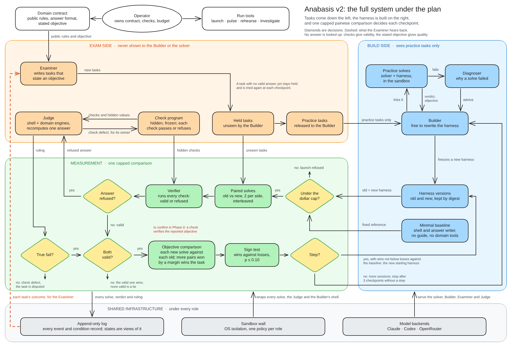

# Anabasis v2: plan after the v1 review

9 October 2026 · Stijn Smits

This is the repository's copy of the plan, at its revision 414 of 9 October, which read the stack at PR #92. The text is the plan's. What is the repository's is marked as a repository note or as the building session's: the note under the figure, the table of phases where the plan embeds its roadmap, the level column of the fix plan, which each pull request moves for the rows it names, the building session's findings on single rows, and the rows it added (B1 to B7). The plan has since been rewritten as a design document, its revision 515, which keeps every row's number and test; this copy stays at the revision that orders the work row by row.



*Repository note.* The figure was drawn for the text of 8 October and has not been redrawn. Six things in it are no longer the plan. The box "Minimal baseline" is the Starter Built Harness, which is also what the Builder forks and the first reference harness. The operator owns no contract and no check: the Examiner drafts the contract and writes and repairs the checks, and the operator freezes or refuses and labels answers blind. The contract states no objective, and the Examiner's tasks state none, until Phase 3 is built. Two valid answers are even, so there is no objective comparison between them. A step does not move the reference harness, which is promoted only by the operator's word. And the figure has no Harness Builder: the owner of a campaign that the plan has since added.

v2 keeps its independent exam. One query names one domain, and a campaign builds one harness for it. First the tasks are set up. The Builder then forks the Starter Built Harness and builds a new harness on it, and the two are compared on tasks the Builder never saw. That first comparison also shows how the starter does by itself, and so how much room there is to improve. Every comparison is pairwise and at a fixed compute budget, on validity first and on a measured objective only when validity leaves too many ties. No agent is built to find answers. The plan takes three things from v1: staged sizing, Builder freedom, and one Builder conversation that is kept by compaction. This version was revised on 9 October after an independent review and the discussion that followed it. It was then synced with the repository, last at PR #81: every item says whether it is built, how and where. A second review, of the system's connections, followed the same day. It showed what the plan lacked most: a Harness Builder that owns a campaign from the query to the harness. Its loop is now a skill that a session follows with the operator, and its controller is in work. The section "Fix plan" gives the working order from here, row by row.

v2 keeps its independent exam. The operator's prompt names one domain, and a campaign builds one harness for it. First the tasks are set up. The Builder then forks the Starter Built Harness and builds a new harness on it, and the two are compared on tasks the Builder never saw. That first comparison also shows how the starter does by itself, and so how much room there is to improve. Every comparison is pairwise and at a fixed compute budget, on validity first and on a measured objective only when validity leaves too many ties. No agent is built to find answers. The plan takes three things from v1: staged sizing, Builder freedom, and one Builder conversation that is kept by compaction. This version was revised on 9 October after an independent review and the discussion that followed it. It was then synced with the repository, last at PR #92: every item says whether it is built, how and where. A second review, of the system's connections, followed the same day. It showed what the plan lacked most: a Harness Builder that owns a campaign from the query to the harness. Its loop is now a skill that a session follows with the operator, and the first owners of its controller are in source, not yet run with a model. The section "Fix plan" gives the working order from here, row by row. The section on the process states one campaign from the prompt to the harness, move by move, and sets the source at PR #92 against it. The plan reads in three parts: how a campaign is meant to run (the terms, the process, the correctness model and the Harness Builder), where the source stands (the table that closes the process, and the section on where v2 stands), and what is done next (the fix plan and the decisions). The phases keep the order in which the design was first laid out.

## Terms

Each term below has one meaning throughout this plan and in the system figure.

| Term | Meaning |
| --- | --- |
| Solver | The model that runs inside a Built Harness and answers tasks. |
| Harness | Also called the Built Harness: the guide and tools the solver works with. This is what the system builds and improves. |
| Harness Builder | The owner of one campaign, from the query to the harness: a controller in code that reads every step's handover and admits the next move, and the Builder inside it. Its loop is a skill since PR #80 and the first owners of its controller are in source since PR #84; a session and the operator carry each step through the run commands. |
| Builder | The agent that changes the harness. It is the inner agent of the Harness Builder. Each session opens with its notes, the list of failed practice solves and each comparison's tally. One conversation across sessions is planned and not built. |
| Examiner | The agent that drafts the contract, writes the checks and the tasks, and repairs checks. It is the only author on the exam side. |
| Campaign | Everything that is run for one query: one domain, one contract, one correctness model and one log. A campaign builds one harness. |
| Contract | The one public document of a campaign: the rules, each with an id and its source, and the answer format. The Examiner drafts it. It is frozen once the readings that use no model pass, and the operator may refuse it. Today the freeze is the operator's flag. |
| Correctness model | Everything that decides whether an answer is valid: the instrument, the check program, the controls and each task's hidden values, and the objective function once one is added. The name is v1's. |
| Check | A hidden program that tests one rule of a task and returns pass or reject. The checks of a domain form the check program. |
| Instrument | The field's own tool that computes the facts a check compares: an analysis engine, a compiler, a simulator. It exists before the campaign: the system installs it and pins it by digest, and no part of the system writes or changes it, neither the Builder nor the Examiner. |
| Control | An answer with a known label, used to test the checks: one the checks must accept, or a one-fact change of it that a named check must reject. A control belongs to a check, not to a task. |
| Verifier | The host code that runs the correctness model on one answer, inside the sandbox. |
| Compute budget | The limit one solve runs under: a number of the model's own turns, told to the solver and held by the host. A time limit on each command bounds what one turn can hold, and a time limit on the whole solve stands far behind. Both harnesses get the same budget, and its size follows the reference harness's own solves (the process). |
| Valid answer | An answer that passes every check and was submitted within the compute budget. |
| Rejection | An answer that at least one check rejects. It is a true fail when the answer is wrong, and a check defect when the answer was correct. |
| Judge | The agent that recomputes a rejected answer to decide whether the rejection was right. It also audits a sample of valid answers. |
| Hand label | A person's verdict on one rejected answer, true fail, check defect or unclear. A label of the drawn sample is written before any ruling is seen, and only those measure the Judge. A label made while settling a comparison is written beside the Referee's ruling. A label stands over a Judge's ruling, and no repair may contradict one. |
| Objective | The quantity a task asks the solver to optimise, such as mass. It is added only if validity leaves too many ties (Phase 3). The host computes it from the answer, and a value the answer reports about itself is not used. |
| Held-out task | A task the Builder never sees. Only held-out tasks are scored. |
| Practice task | A task released to the Builder for trying out changes, by a seeded draw. Once released it is never scored. |
| Reference harness | The harness a new version is compared with. It is the Starter Built Harness until a step is promoted. |
| Starter Built Harness | The harness every campaign starts from: pi's coding agent as pi releases it, with its four tools in one working directory, and no guide or domain tools yet. The solver's answer is a file, which the host's submit sends. The Builder forks it in its first session, and it is the first reference harness. |
| Comparison | The reference harness and a new harness solve the same held-out tasks. Each task is a win, a loss or a tie for the new harness. |
| A/A comparison | A comparison of one harness with itself on separate solves. It should show no step, and its tie share measures the noise. |
| Tie | A task on which neither harness wins. Ties are left out of the test. |
| Step | A comparison in which the new harness wins significantly more tasks than it loses. |
| Round | One Builder session followed by one comparison. |
| Checkpoint | Several Builder sessions followed by one comparison. As built, the checkpoint command runs the comparison only, between two kept harnesses. |
| Trace | The record of one solve: every model turn and every tool call with its result. |
| Session | One bounded stretch of Builder work, with limits on time, turns and practice solves. A session ends with a frozen harness version. |
| Diagnoser | The agent that read one failed practice trace and named the first wrong step, the likely cause and what would prove that diagnosis wrong. Withdrawn on 11 October (`docs/simplify.md`, E1, PR #205): 20 of 20 of its readings named the solver. |
| Operator | The user: the person who writes the prompt, owns the budget and may steer. A session that runs the commands stands in for the Harness Builder, never for the operator. |
| Query | The operator's one prompt. It names the domain and may be as long as the operator likes: scope, standards, what matters and what is left out. It is public, so every seat may read it, and it is fixed when the campaign starts. |
| Move | One step of a campaign, of seven kinds: open, draft the exam, write tasks, build, compare, settle, decide. Code admits a move before it starts, and the move leaves its handover in the log. |
| Setting | Who solves and under which limits: the solver, its effort, and the limits on time and turns. It is recorded once in the log. A comparison is read only beside others of the same setting. |

**The figure's words.** The system figure uses plainer words for eight of these terms: a test for a check, the grader for the correctness model, a known-answer case for a control, a wrong answer for a true fail, a grader error for a check defect, a verdict for a ruling, a significant gain for a step, and baseline and candidate for the reference harness and the new one. The plan and the source keep their own words.

## The process

One campaign is a loop of seven moves over one log. Code admits and chooses every move, and a model works inside five of them. The operator gives the prompt and a budget, and may steer between moves (the Harness Builder's section says when). With no word from the operator the campaign keeps going until one of its endings. This section states the process as it is meant to run, and the table that closes it says how far the source goes. Three of its defaults amend decisions that were settled earlier, and they wait for the operator's word: the exam frozen by rule, a step promoted by rule, and one total budget in place of a cap for each comparison.

| # | Move | Who works | What it takes | What it leaves in the log |
| --- | --- | --- | --- | --- |
| 1 | Open | Code | The operator's prompt, a total budget and the models | The campaign, with the prompt, the budget and the setting on record |
| 2 | Draft the exam | The Examiner, then code | The prompt and the field's public standard | A contract with a source for each rule, one check a rule over the field's own engine, and its controls. Code runs the readings that use no model, and freezes the exam when they pass |
| 3 | Write tasks | The Examiner, then code | The frozen contract, one outcome for each task so far, and those tasks counted by family, or in one total where a family counts one task | Held-out tasks whose package passed the gate. A seeded draw releases a few for practice |
| 4 | Build | The Builder | The harness it starts from, the practice tasks, each practice result, and the tallies so far | A frozen harness version |
| 5 | Compare | Code, with the solver | The reference harness, the new one, the scored tasks and the budget, all logged before the first solve | A report: the tally, the reading, and each harness by itself at every budget |
| 6 | Settle | The Judge, and a person's labels where given | The comparison's rejected answers | A ruling for each. A task whose rejection is no true fail is set aside, and a check ruled defective goes back to move 2 |
| 7 | Decide | Code | The report, and the campaign so far | The next move by the table below, or an ending |

**The budget follows the reference.** A comparison can show a gain only where the reference still fails some of the time. The first comparison runs at the full limit, with a ladder of shorter budgets fixed beforehand, and its reading at the full limit counts like any other. Its solves of the starter set the budget of the comparisons that follow, by a rule fixed before it ran: the longest budget of the ladder at which the reference is valid on at most half its solves. The rule is applied again at each promotion, to the promoted harness's own solves in the repeat, because a promoted harness passes more than the one it replaced. A changed budget is a new setting, so no earlier comparison is read at it. A harness that wins at a shorter budget must still not lose at the full limit or against the starter, since a budget can favour a harness that is quick and solves less. Where no budget of the ladder leaves room, the tasks have to change. The reference is read against itself once in each setting, which gives the noise that every tally has to exceed. From the second comparison on, the budget is told to the solver and enforced.

*Amended on 11 October.* There is no ladder and no reading at a shorter budget (`docs/simplify.md`, A1 and A2, PRs #193 and #194): a campaign runs at the one budget its setting names, and a comparison without room has other tasks written.

*Amended on 10 October, by the operator's word.* The order is the other way round: the tasks come first and the budget is the fallback. A comparison without room has the Examiner write tasks the reference harness fails, and a promotion has the tasks changed once before anything is built against the new reference; the budget's rung is taken only once as many Examiner sessions in a row as the campaign's patience held out nothing (`harder`, `src/builder/decide.ts`, PR #167). The reason is on record: with the budget first, t-10 climbed in turns, a harness answering in 2 where the starter took 3, on tasks both answered at the full limit. A step on tasks the reference fails is the climb; a step at a shorter budget on the same tasks is the budget's.

**How move 7 decides.** The reading says whether the new harness won. Each harness's own share of valid answers says why, and that decides who works next. The two fractions are proposed here and are the operator's to set.

| What the report shows | What it means | The next move |
| --- | --- | --- |
| A reading at or under the trigger (2-0 at 0.25) | One draw | Compare the same two harnesses again on fresh solves. Until 11 October the reference was read against itself beside it, once a setting (`noiseRead`); that is the operator's `--noise` on a checkpoint since (`docs/simplify.md`, B1). A step read once is such a reading |
| The step and its repeat together clear the level (4-0 at 0.10) | A step | Read it once at the full limit, where it must not lose. Promote the harness, have tasks written that it fails (since 10 October; the budget rule was first), read them by the control, and build against the new reference |
| No step, and the reference is valid on more than three solves in four | The tasks leave no room at this budget | Write tasks that leave room (F52). The budget rule is the fallback, once as many Examiner sessions in a row as the campaign's patience held out nothing (since 10 October; the order was the reverse) |
| No step, and neither harness is valid on one solve in four | The tasks are too hard, or the budget too short | Lengthen the budget. Otherwise write other tasks |
| No step, with room | The harness did not help | Build again, once the next comparison has tasks to untie: the next row comes first, and tasks written since the comparison are compared on before anything is built. The Builder is told the tally |
| The start check refuses the next comparison, because too few tasks would be left untied | Supply | Write tasks. Where the reference passes nearly all of them, the third row applies first |
| Nothing was scored | Supply, or the cap | Write tasks, or give the move a larger share of the budget |
| The comparison stopped on check defects | The exam is at fault | Repair the checks in move 2, grade the logged answers again, and compare once more |
| The session left nothing new | No change | Build once more. It counts towards the stop rule |
| Tasks are set aside | They wait for a ruling or a label | Go on without them |
| The host was over its cores while the solves ran | Its times cannot be compared | Read the comparison in turns alone, or compare again on a quiet host |

**The table met live.** On 9 October the buffer campaign reached the third row. The figures are the runs session's post of 17:51Z, and the log was not read for this plan. Round 2 compared a new harness with the promoted harness of round 1 and read no step: 1 task won, 1 lost and 6 tied, with each harness valid on 15 of 16 solves. Read at the two turn budgets fixed beforehand, the new harness lost 3 tasks to none and 1 to none. The launcher then refused a third round for too few untied tasks, also after one more Examiner session of 12 tasks, and a second such session is running. So the source has the refusal, and its way out today is more tasks of the same kind. The process asks first for the budget to be set again from the promoted harness's solves, and for other tasks only where no budget leaves room.

**The endings.** A campaign ends in one of seven ways, each said in its last event: the budget is spent; three comparisons in a row since the last step left room and read no step, counting only a harness that a session changed; the exam was not accepted in three drafts; the tasks could not be made to leave room; the environment failed, which can be resumed; the operator stopped it; or its control read a step, the reference against itself, which stops every comparison against that reference until the operator leaves the cause on record (`--cause`, 12 October) and can then be resumed. What it hands over is the reference harness as it then stands, the starter where no step was promoted, with a closing report: each step and the comparisons behind it, and what a person's labels did and did not audit.

**The climb, read as epochs.** Added on 10 October, when the operator put the question at the top: does the system climb, and everything else follows from that. An epoch runs under one reference harness, from the opening or a promotion to the next promotion. The climb is a chain of epochs in which each promoted harness answers tasks the one before it failed, so the tasks of each epoch are harder than the last's in the one sense the system measures: the starter answers fewer of them. `epochsOf` (`src/builder/climb.ts`, PR #168) reads a log so, and `runs view` prints one row an epoch: its tasks held out, sessions, comparisons, and what the reference and the starter answered of its tasks. No campaign on record has a third epoch. t-4, t-9 and t-10 each have a second: a promoted harness, two or three tasks held out since, and three sessions that changed nothing (B9, B11). t-4's second epoch holds the one reading of its kind: the promoted harness valid on 18 of 18 solves of its three new tasks and the starter on 0 of 36, which is what the next epoch's tasks should read.

A simulation with a script in each seat (`test/climb.test.ts`, by `ANA_CLIMB=1`, PR #168) runs the loop over the fixture pack: a task's difficulty is a base, a harness's strength is a number its guide carries, a Builder session raises it by two, a solve passes where base ≤ strength, and an Examiner asked for room writes tasks above the reference's strength. It proves the controller's part of the climb and nothing of a model. Nine runs found four readers standing in the way of a second promotion, each a reading made for one campaign on record and wrong for the next (B13), and with them fixed it promotes twice, at strength 5 and 7, on tasks of bases up to 9 and 11. What stopped its third epoch is the draw of the scored set, which is a decision below.

**The process against the source at PR #92** (`4f4f54e`, 9 October).

| Move | In the source | Level | What is missing |
| --- | --- | --- | --- |
| 1 Open | Yes. A campaign opens over a stored v1 pack, or from a prompt with one total budget in dollars, of which each move's cap is what is left (`tools/d2/harness-builder.ts`, PR #99 and PR #101). The setting is recorded once (PR #85) | Proved without a model; a campaign from a prompt ran on a test host with a paid model | A paid campaign from a prompt on the operator's host |
| 2 Draft the exam | In part. For a pack the contract and the checks are read from a v1 bundle. For a prompt an Examiner session drafts the rules with a source for each, the checks, the first tasks and the controls (`src/examiner/draft.ts`, PR #101), and the readings without a model decide whether the draft stands (`tools/c/accept.ts`). The freeze is the operator's flag, or the campaign's under `--unattended` | The readings: exercised live. The draft: proved without a model | A repairer for a check, an engine behind a drafted check, a search for a rule's source (F31 to F33) |
| 3 Write tasks | Yes. Examiner sessions, the gate, the outcomes told, the seeded release | Exercised live | Tasks that leave room, on request (F52) |
| 4 Build | Yes, inside a round, and by itself since PR #87. A session opens on its notes, its fails and the tallies | Exercised live inside a round | One conversation, the facts restated, the opening served again (F17, F18, F27) |
| 5 Compare | Yes. One start check since PR #84. Budgets are read after the fact and the reference against itself | Shown in an outcome, on one pack | The rule that sets the budget (F5, F28), and the start check's defects (F42 to F45) |
| 6 Settle | In part. The Referee rules, tasks are set aside, a person's labels settle them | Exercised live | The Judge, an audit of passes, blind labels, a route for a repair (F23 to F25, F31) |
| 7 Decide | Yes. One function names the move that follows, with its reason, or an ending (`decide`, PR #99), one command makes it, and a word the operator leaves is read at the next move's boundary (`tools/d2/word.ts`) | Exercised live: the table ran t-2 and t-3 (10 October, Linux container, a paid model in every seat) from a prompt to the ending `stop` with one `--admit` typed by hand, and read a word at a boundary (F50). Two of its rows were put in order on that record: tasks to untie before a session (PR #124), and a comparison on tasks written since before anything is built (PR #126). On t-4 (3 solves a side) it set the budget twice, read a step at 2 told turns, repeated it, found no loss at the full limit and wrote `harness.promoted` itself, then asked for room and stopped after three sessions that changed nothing | A paid campaign on the operator's host (F26, F28) |
| Endings | Yes. Six typed endings as the log's last event, and what a campaign hands over: the reference harness as a folder that stands by itself, the public rules and a closing report (`tools/d2/close.ts`, PR #105), and a solve from the handed-over folder (`--solve`, PR #122) | Exercised live: four campaigns from a prompt ended `stop` or `exam` in the Linux container on 10 October (t-1 to t-4); t-3's handover (the starter) and t-4's (the promoted harness ae24505b) were written outside the repository and a task solved from each | Done: t-4's promoted harness answered a task from its handover (F51) |

So the middle of the process runs, and its two ends do not. Moves 3 to 6 have run with real models, and a step was read and repeated on one pack. The entrance from a prompt needs an author for the checks first, so it stands in the fix plan's Step 5 (row F53). Its gate, a promoted step, was met on buffer on 9 October. The decision of move 7 is the part that makes the campaign autonomous, and it is the fix plan's Step 4.

**Against the skill a session follows.** The source's own account of the loop is the skill `run-improvement-campaign` (PR #80): walk, choose, prove, predict, launch, watch, read, decide. Its order is this process's. Its walk of eight links asks what the decision table asks: the supply of tasks, the checker, the reference's room, the session, the size of the tally, the host, the repeat, and room again after a promotion. Three things differ. The skill's choice of the next experiment is a session's judgement, where move 7 is a table in code. The skill leaves four changes to the operator's word each time: a freeze, a promotion, a change of what a solver is given, and the stop of a live run. This process gives the first two a default and a veto, makes the third a new setting, and keeps the fourth for the operator. And the skill starts from a campaign that exists and closes in a handover file, so it has no entrance from a prompt, no total budget and no ending of its own.

## Why v1 did not climb

v1 never completed one full improvement cycle, which it called a climb step. Across 83 runs and 357 batteries (a battery is one test set), no failure was both genuine and reproducible. A step was defined as a true fail, meaning the solver's answer was wrong and the check was right to reject it; then a change to the harness in response; then the same task solved; then a harder battery that the solver again fails in part.

| Problem | What v1 recorded |
| --- | --- |
| The test was bounded by its author's ability | The Builder wrote each task and had to solve it first, so no task was harder than what the Builder could already do. The solver, a model of the same class, then solved it too: 265 of 299 batteries were passed in full. |
| Label noise in the test | When a task was failed, the check was usually at fault. 36 of 47 rehearsal misses came from a faulty check or instrument, and 17 of 22 fails that were counted as limits were disputed. |
| High variance between repeated solves | On truss there were 2 fails in 59 repeated solves, and both passed when solved again. One failed solve therefore says little. |
| Harder tests became broader instead of deeper | When a probe of 5 to 8 tasks was enlarged to 25, the added tasks passed in 10 of 13 cases. The cause was not isolated. After a difficulty raise, the median solve time was only 1.07 times the previous one. |
| Failures were rarely acted on | A genuine fail led to a change in the harness about once in six chances. |

- **The one change that made tasks harder:** several requirements that share one limit. This took pass counts from 22 of 23 down to 7 of 20 and 2 of 23.
- **Interventions that had no effect:** a Builder at higher reasoning effort than the solver (6 of 6 passed, twice), a different model solving another model's tasks (9 of 10), hiding the grading instrument from the solver (12 of 12 and 20 of 21), and using rehearsal solves as a filter (895 of 939 passed).
- **Choosing the answer first did not help either.** Six tasks were built around a chosen answer, at a size where greedy and a 12,000-move local search failed. The solver passed all six in 2.5 to 26 minutes. Six limits were reset from longer searches, of 45 minutes to 3.4 hours, and the solver passed 5 of the 6.
- **The recorded explanation:** the public rules let the solver check its own candidate, "so it wrote a search and ran it until the checks cleared".
- **What was reliable:** the passes. An independent Judge overturned only 5 of 1,411.
- **What was never tested:** tasks whose answer already exists in the field, and a second author for the test. An answer builder for the second was written on 30 September and never ran. v2's Examiner is that second author.

These figures come from v1's notes as summarised by the operator on 8 October. PR #55 adds an account of v1 to v2's repository (`docs/v1.md`).

## Where v2 stands

The plan's account of where v2 stood at PR #91 and at PR #168, with the three reviews of
9 October, is `docs/plan-history.md`; the present is the source at the stack's head, the fix
plan's level column and the climb plan below.

## The climb plan of 10 October, 22:15

Written by the building session at PR #176 (`a77051f`), with buffer-a/b/c and one ablation arm running on the Mac. It is the working order from here and supersedes the ordering of the fix plan below where the two disagree; the fix plan keeps the level of each row. Everything in it reads the log before any account.

**What the day settled.**

1. Ties are the obstacle, not the test: 76 wins, 3 losses, 110 ties on record. A candidate that unties a task wins it 96% of the time, so a step is "enough untied tasks": 3 at 0.20, 4 at 0.10.
2. The target moves the odds more than the level. At that win rate and a tie share of three in four, a step and its repeat come through 8% of the time at target 8 (0.20), 55% at target 16, 85% at 24, and the repeated A/A false step stays near 1% ("Statistical power and cost", the table at p = 0.96). Loosening 0.10 to 0.20 at target 8 bought 1% to 8%; doubling the target buys more, at less risk.
3. Buffer is saturated on validity: public rules plus an exact engine make every solvable task a search, and seven/buffer's comparisons against its promoted harness read 1-1-6, 1-0-11, 2-0-10. It regains room only with an objective.
4. Readings on the Mac are provisional: sessions share the host `/tmp`. C's Builder reused another run's scratch, the ablation arm's Builder read buffer-b's file while it ran, two of A's practice solves wrote one `/tmp/c.json`, and a comparison's two sides share one `/tmp`. No held-out leak was found in 48 logs; the mechanism is open. Fork A has no wall self-probe.
5. buffer-a, -b and -c are three experiments: A `ae66f1d` (the old table, patience 3), B `4ad8d5f` (the budget-first order), C `f78d500` (tasks first, the climb readers, the epoch draw). Only C can take the room path after a promotion.
6. The level is not pinned at a campaign's opening unless `--level` was named; a tree upgrade changes a running campaign's test.
7. The loop through three epochs is proved without a model (climb-11: 24 moves, 2 promotions, 0 non-results; at target 8 with #171). Four readers that stood in the way are fixed (#168, B13).
8. The step rule stays the sign test, ties dropped (the paired sign-flip test since 12 October, which is the sign test where every task is won or lost by as many pairs; the repository note of that date), with the repeat on fresh solves and the full-limit reading before a promotion, and since 23:00 it is read in two stages on the operator's word ("2-0-4 should climb"): a comparison at or under the trigger (0.25: 2-0, 4-1, 5-2, 7-3) buys the repeat and promotes nothing, and the step and its repeat read together, wins and losses summed, clear the level (0.10: 4-0, 6-1, 7-2, 9-3). At sixteen tasks of which three in four tie: 82% of harnesses that win 96% of the untied are promoted (55% by two readings at 0.20), 31% at a win rate of 0.75 (14%), and 3.3% of pairs of equal harnesses (0.9%), by exact enumeration (`chanceOfPromotion`, `src/kernel/size.ts`), the repeat held to an untied task that it does not lose. The other rules read the 22 recorded comparisons identically; their numbers are in "Statistical power and cost".

**Goal and the five factors.** Working means one campaign, one domain, real models, two promotions, the second read on tasks the first promoted harness lost; then the same in a second domain. What each factor is, how it is measured and its bar are `AGENTS.md`'s ("The five success factors"); this table keeps the recorded value, which lives here and nowhere else.

| # | Factor | Number | Now | Bar |
| --- | --- | --- | --- | --- |
| S | Supply | Informative tasks in a comparison's scored set: the reference valid on some solves and not all, or on none while another harness was | Most comparisons on the Mac to 11 October left no room (`roomOf`); the Examiner holds out a few tasks a session | At least 4 before each comparison |
| M1 | Climb | Pairs the starter loses per epoch, by validity or by objective, the two reported apart; promotions per campaign | 1 promotion in 3 of 10 Linux campaigns; 0 second promotions; 2 to 4 in simulation | At least 2 promotions in one real campaign, the starter losing more pairs each epoch; then a second domain |
| M2 | Honesty | False-step rate: the reference against itself, at the campaign's level | 0 steps in 6 controls, which bounds the rate at about 39% (one-sided 95%) | 0 in the next 10; the A/A tie share above that of comparisons that read a step |
| M3 | Verdicts | Referee rulings against blind labels; passes audited. Diagnoser accounts: withdrawn at PR #205 (11 October), which removed the seat after 20 of 20 of its readings named the solver | 0 labels (packets of 18 and 22 wait); 6 passes read, 0 wrong. Withdrawn with the seat: 8 of 8 diagnoses of 10 October blamed the solver, one naming an engine the Starter lacked | At least 10 labels a kind; 3 in 4 defects caught, at most 1 in 10 true fails voided; 3 passes a comparison audited. Withdrawn with the seat: the Diagnoser's lean measured |
| W | Worth | Effect size: the reference's valid share against the new harness's at the full limit. Transfer: the same harness on tasks written after it was frozen. Cost: dollars and Builder sessions a promotion | The six Mac promotions were read on 2 to 4 untied tasks each; no harness read on tasks written after it; the second promotion has cost everything spent since the first | None set: the operator's decision |

M3 moves only when the operator labels. A promotion on the objective alone counts for M1 and is named as such.

**The levers, in order of gain per dollar.**

| # | Lever | What it does | Cost | Decides |
| --- | --- | --- | --- | --- |
| L1 | Target 16 (24 where the host allows), 2 solves a side, a quarter of the scored set reserved for the epochs before the newest | Power: 8% to 55% an attempt at tie share 0.75; a regression visible | About $1.30 billed a 16-task comparison on Sonnet; one small change for the reserve | The operator's word on the reserve; the rest is flags |
| L2 | A scalable domain (exact cover, colouring, SAT, subset sum, LP): the Examiner plants a solution and grows the instance until the promoted harness fails at the full limit | Room by construction; rule 9 intact (plant, do not solve) | Prompts exist; about $5 billed an epoch. Since 12 October the Examiner's prompt has it plant an answer, put it to `try_answer`, and grow the task by requirements that bear on the limit the answer meets, never by size alone; the gate refuses a task that carries the planted answer whole, in its public input or hidden values, so the witness serves the feasibility gate and reaches no solver (`src/examiner/prompt.ts`, `src/examiner/session.ts`) | The operator: which domain |
| L3 | The objective: an optional `objective` in the evaluator (a number and a direction), computed on the accept controls at acceptance, admitted like any authored computation, pairing two valid answers with a margin; reported apart from validity | Ties between valid answers become wins; buffer regains room | One pull request, a rehearsal, one control | The operator: on, and the margin (1%) |
| L4 | Epoch 0 from an engine harness: after the first Builder session, `promote.ts --harness <its digest> --yes --despite "epoch 0"`; the Starter stays the lower reference | The first epoch stops measuring set-up time | One command | The operator, a campaign at a time |
| L5 | Several sessions before one comparison (`--sessions 2`) | The candidate accumulates before it is read | Builder dollars | The operator, a campaign at a time |
| L6 | The Builder sees what it fails: the release after a control takes the tasks the reference failed; `practice` under the reference | Room is useless unpractised | Small | Code |

Not pulled, since each buys steps that are not climbs: a looser level; dropping the repeat; telling the Examiner a share or a zone; a target "within x% of the best known", which is a reference answer (rule 9); a Starter with the engine in it, which moves the yardstick.

**Tonight, on the Mac (reads, no new code).** Read A, B and C each against its own commit, in turns, marked provisional until the `/tmp` isolation lands. The one result: if C promotes, does its room Examiner hold out at least 3 tasks and does the control read the reference valid on fewer than 3 in 4 of them? Did C's Builder after the promotion practise on a task the control showed the reference failing? The ablation arm on C's own code is stopped; the one at 0.20 runs for the path after a 3-0. The two label packets, with the diagnoses. No campaign moves tree, and no worktree is added or removed on the Mac while campaigns run (#169 is not landed there).

**Code, in order, one pull request each on the top, proved without a model first.**

| # | Change | Why | Done when |
| --- | --- | --- | --- |
| C1 | Pin the level at the opening (`terms.level`, the default folded in, as `limit` is) | A tree upgrade must not change a campaign's test | Opened at 0.10 and run from a 0.20 tree, a campaign reads 0.10 |
| H1 | A `TMPDIR` a session and a solve, inside the home or the cap, on macOS as on Linux; a probe step: a canary under one policy's tmp is refused under another | A comparison's two sides and concurrent runs share `/tmp` | The probe line in every wall start; a wall test; the 48-log negative claim recorded with its grep  Linux half proved without a model at PR #185 (11 October UTC): a wall test (`test/command.test.ts`) shows each command's `TMPDIR` under the solve's volume, the host's `/tmp` and a canary in it hidden behind an empty private one, and nothing of one command's `/tmp` or `TMPDIR` left for the next or for the host; no source changed, since the command wall had overmounted `/tmp` and bound the command's own tree since 9 October. The Seatbelt half, the probe line and the 48-log claim stay the Mac's |
| C2 | A quarter of the scored set for the epochs before the newest, each epoch's tasks held out since the last comparison first and then by hash (`scoredSet`, since 12 October) | #171 scores no old task once the newest epoch fills the target, and the control reads the starter, not the last reference | A `scoredSet` test; the climb simulation still promotes at target 8 |
| C3 | Reword #175's justification to cost; move #176's comment block into "Statistical power and cost" here, one line left in `compare.ts` | Rule 4's spirit; commented-out code is source nobody runs | This plan holds the table. The comment block moved at PR #212 (11 October); three lines stand in `compare.ts` |
| L3 | The objective, as above | Ties to wins | `compare.test.ts` pairs on the objective when both answers are valid; an A/A rehearsal reads no step; one real control. Present in source at PR #184 (10 October, 11 October UTC): `brief.objective` and the evaluator's `objective`, verified after the checks pass; `--margin` a term of the comparison; the acceptance reading lists it for `--admit objective`; the draft declares it; a practice result tells the Builder its measure. Proved without a model: `verify`, `compare`, `acceptance`, `draft` and `round` tests. No rehearsal and no control yet |
| C4 | Diagnoses into the blind packets; `agreement` reads them. Withdrawn at PR #205 (11 October): the Diagnoser is removed, so no diagnosis is written to put in a packet; 20 of 20 of its readings had named the solver | M3 | The packet writer and the reader |
| C5 | `practice` under the reference | The Builder buys the fact itself; no host table | The tool, and the byte-identical wall test |
| C6 | A side reading of the newest candidate against the previous one on shared tasks, same-condition solves only, the overlap printed; to the Builder a tally at most | A regression from B to C visible; the trigger for any restart | A reader with a test, read on a real log once #171 has one |
| C7 | Import a handed-over harness into a campaign's `states/` under its digest | L4 without a Builder session | `keptAs` opens it. Present in source at PR #186 (11 October UTC): `tools/d2/import.ts`, kept as a session keeps a state, recorded as `harness.imported`, the closing report naming the origin of a promoted import; proved without a model in `test/campaign.test.ts` |
| C8 | Restart from the reference, at most once an epoch | Only if C6 shows a regression in a real log | A simulated campaign shows it firing once and the stop holding |

Not built: pooling across comparisons; a host-written diagnosis table. Since 12 October the step rule is the paired sign-flip test over each task's difference in pair wins (the repository note of that date).

**The one funded run, R1.** A scalable domain (exact cover or LP; t-9's or t-4's prompt), the Linux container at `main` (`524c589`, PRs #219 and #221, which hold #167 to #171 and C1), alone on the host: `--target 16 --solves 2 --sessions 2 --level 0.1 --trigger 0.25 --patience 6`, the step read in two stages since PR #183, Sonnet at high effort in every seat, about $30 billed (a 16-task comparison about $1.30; t-10's whole first epoch billed $4.00). After the first Builder session its engine harness is promoted as epoch 0 with `promote.ts --harness <its digest> --yes --despite "epoch 0"` (L4). L3 is in the source since PR #184 and is not required for the first attempt. Predictions before the first solve: a step and its repeat against the epoch-0 reference within three comparisons (55% an attempt at tie share 0.75); the room Examiner after that promotion holds out at least 3 tasks the reference is valid on fewer than 3 in 4 of; a second promotion within $30 billed; a post-promotion tie share above 0.9 means L3 or another domain, not the level. After it: R1's domain with L3 on (the post-promotion tie share under a half); t-11 as planned; one buffer campaign with L3 on at target 16 after H1.

**Predictions for the night of 10 October, resolved by the counts.** C reads a step against the starter at 0.10 in its first two comparisons: likely. C promotes tonight: one in three. C's room Examiner finds room on buffer: less than even; if not, buffer is saturated on validity and R1 is the test. A and B: a first-comparison step plausible, and after any promotion both go down the budget ladder and show nothing about room. The 0.20 arm lands a 3-0 in fewer than half its comparisons; the re-read of all five campaigns at both levels flips at most 1 in 5 readings. The share of unchanged Builder sessions after a no-step under #140 is under a half.

**It works when** M1 is at least 2 promotions in one real campaign with the starter losing more pairs each epoch; M2 is at 0 steps over the next ten controls; M3 is at its bar on at least 10 labels a kind (the diagnoses withdrawn at PR #205). Then the same in a second domain. Until then every claim says "a step at 0.10 past a trigger of 0.25, N tasks, this setting, provisional on the Mac until H1".

## Fix plan

This section is the working order from here. It gathers every fault found on 9 October: by the two reviews, by the building session's plan check and by the comparison with v1. Each row says what is wrong, what the fix is and what shows that it is done. The phases further down keep the design. This section says what is done next, and its level column is where status is kept.

**How status is kept.** Each row carries one level, and the word "built" is not used for it:

| Level | Meaning |
| --- | --- |
| Planned | In this plan only |
| Present in source | The code is in the tree at a named commit, with its live reader |
| Proved without a model | A test holds it with its nearest hostile case, or a replay of recorded logs does, or a rehearsal on a seed |
| Exercised live | An event in a real run's log shows that it did its work there |
| Shown in an outcome | A reading that moved, repeated once on fresh solves |
| Withdrawn | Analysis, a review or a run showed that it does not work. The row stays, with the reason |

The ladder is v1's own. Since PR #80 the repository states its four middle levels in these words, in the skill attribution-and-proof and in section 9 of AGENTS.md, and this plan uses the same words. A pull request names the rows it moves, and a sync of this plan changes the level column and little else. No second file tracks it.

**Where the built parts stand on that ladder today:**

| Part | Level | On what evidence |
| --- | --- | --- |
| Comparison in code | Shown in an outcome, on one pack | Buffer: a step read and repeated on each starter, 5-0-2 then 7-0-0 on the old one and 4-0-3 twice on the new one. Recode and truss read no step at the full limit |
| Round and checkpoint | Exercised live | Rounds on buffer, recode and truss and two buffer checkpoints, 9 October |
| Launch refusals | Exercised live | A real launch was refused on 9 October |
| Dollar cap | Exercised live | Every round of 9 October ran under one |
| Rulings by the Referee, and settling | Exercised live | Buffer: 15 and 25 rejections, all ruled. Recode: only 2 of 6 carry a ruling |
| The Examiner told outcomes | Exercised live | Sessions wrote 2, 3 and 6 tasks, and every proposal passed the gate |
| The Starter as pi's coding agent (PR #70) | Exercised live | Buffer and recode: every solve ended by `submit` with a verdict. No solver called `read` or `edit` in 34 buffer solves |
| The reference against itself (`--noise`) | Exercised live | Buffer `g1`: no step, 2-0-5, on a loaded host |
| Turn budget, told and enforced (PR #74) | Proved without a model | Three turns and no fourth, on the Linux wall. Recode's second round is reported to run at 15 told turns, with no report yet |
| Builder notes, fail list and tally (PR #73) | Proved without a model | Live in the second rounds from PR #80, with no report yet |
| Do-nothing control, the operator's word for a check, the logged prediction (PR #75) | Proved without a model | On a fixture pack. The launches from PR #80 were not refused, so both checkers have a reading |
| The rule for tasks nobody answers (PR #76) | Proved without a model | Tests |
| What a Builder is told of limits and of an untried harness (PR #77) | Proved without a model | Tests |
| The Diagnoser reads the guide (PR #78) | Proved without a model | Tests |
| A loaded host named by the reader (PR #79) | Proved without a model | Tests |
| Compaction in both modes | Proved without a model | Carried from v1. No v2 run has shown a Builder keeping its facts across one |
| The loop as a skill (PR #80) | Present in source | A procedure, which the runs session follows |
| The contract for coding sessions (PR #81) | Present in source | Open. Its statements were checked against the tree, and its lint habits against the linter |

**The order.** Step 0 needs no code and runs beside Step 1. Nothing after Step 2 is paid for before Step 0 has passed. Every row below stands at "planned" unless its last column says otherwise. Row F52 of Step 4 is taken up beside Step 1, because the buffer campaign waits on it.

*Repository note.* The level column is the repository's, in the ladder's words. A pull request that moves a row changes its level here and names the row in its account. The column "Stands" beside it is the plan's own account at that hour, and is left as the plan wrote it. "Proved without a model" is on the Linux command wall unless a row says otherwise: nothing above PR #71 has run on macOS. Rows F7, F9, F10, F12, F13, F16 and F17 stand "exercised live" on two campaigns of 9 October over the repository's fixture pack (one rule, one check), in a Linux container, with Sonnet 5.5 at high effort in every seat (PR #95): each mechanism met its trigger in a log a model wrote, which says that it did its work there and nothing about a harness or a real pack. Of F17 the line at the end of each tool result was exercised, on 19 of 19 results in five sessions; none of their 14 turns ended without a call, so its continuation has had no trigger. Rows F17 to F19 are PR #93, which the plan had not read.

### Step 0: run what exists

The operator's, with no new code. The rewritten starter has met real models since these rows were written. The commits above it run in the second rounds, which have not reported.

| Row | What is wrong | Fix | Done when | Stands, 9 October 17:00Z | Level |
| --- | --- | --- | --- | --- | --- |
| F1 | No suite above PR #71 is on record on macOS, and GitHub starts no CI job: it reports that the account's payments failed or its spending limit is reached | Mend the billing, which is the operator's. Until then run both CI jobs by hand at the commit that is launched from | Both jobs pass at that commit | PRs #70 and #71 were run by hand on both jobs and #71 is green: 681 pass on macOS, 655 on Linux. Campaigns have since run on the Mac at #92 (`dc00675`), #100 (`5ba696c`) and #107 (`26f3aa2`), and no suite or CI job did there. In a Linux container the static steps pass at every head from #99 to #117, and the suite at #117 (`bb2b588`, 10 October) gives 831 passed, 30 skipped and 3 failed of 864, the three needing what a container lacks | Planned |
| F2 | No real pack has met the new checker reading, and every check of buffer and recode reads as a fault | Run `tools/c/accept.ts` on both campaigns, admit each check by name, and freeze | A launch is no longer refused, and the do-nothing answer is rejected on every task of both packs | The launches from PR #80 were not refused, so both checkers have a reading. Whether each check was admitted and frozen is not on record here | Planned |
| F3 | The new stack had met no model when this row was written (9 October, PR #80) | Rehearse a round and a checkpoint on a seeded copy (`bun run runs rehearse`) | Both rehearsals finish and report | The rehearsals are in the suite (`test/runs-rehearse.test.ts`, and the campaign command over seeds in `test/harness-builder.test.ts`). Live: on the Mac the second buffer campaign at #92 read a step and its repeat, and buffer and recode opened at #107 under the campaign command on 9 October; on a Linux test host five campaigns ran at #94 to #107 (live-1 to live-5 in the handover of 10 October), the last reading a step of 9-0-3 at 3 told turns | Exercised live |
| F4 | Every result on record was read on the old starter | One round on buffer on the rewritten starter, with `--predict` | Gate G0: a tally, and the starter's valid answers at the limit and at shorter budgets | Exercised live on PR #70, at an eight-minute wall: a step of 4-0-3, repeated, with the starter valid on 5 of 14 and 3 of 14 solves. No reading at a two-hour wall on the new starter, and no logged prediction, since `--predict` came with PR #75 | Exercised live |
| F5 | The turn budget has no size, and no noise reading exists for the new starter | Read the reference against itself (`--noise`), and take the turn count at which the starter is valid on about half its solves | The size and the tie share are written into the compute-budget decision | Half done. The starter against itself read no step, 2-0-5, under a host load of 47 to 80 on 12 cores, so it wants one repeat on a quiet host. In turns, read after the fact: buffer 2-0-5 at 8 and 3-0-4 at 5, recode 5-0-2 at 15. No size is decided | Planned |
| F6 | The Judge's bar cannot be read without labels | Draw the blind sample of stored rejections (`tools/c/rejections.ts --draw`) and label it | Labels exist for ten rejections of each kind, or the shortfall is known | Not on record here | Planned |

### Step 1: the Harness Builder holds a campaign's state

The building session's. Code only, and no model. Rows F7 to F12 and F14 were published on 9 October as PRs #84 to #89, F15 as PR #90, and F13 with F16 as PR #92. Together #84 to #89 add 1,474 source lines and remove 545, and PR #90 removes 641. The third review read #84 to #89 independently: each row's own test is met at function level, and rows F42 to F48 are what it found. None of these pull requests has met a model.

| Row | What is wrong | Fix | Done when | Stands, 9 October 18:00Z | Level |
| --- | --- | --- | --- | --- | --- |
| F7 | The setting and the scored set are typed again on every command, and a mismatch is only a note | Record them once in the log. A command reads them, and a differing flag refuses (`tools/d2/setting.ts`) | A command without flags runs under the recorded setting, and a differing one refuses | Present in source (PR #85), proved without a model at function level. Open: the record is written before the command's own refusals (F44), `prepare.ts` ignores the recorded tasks (F47), and `--new-setting` carries nothing over. Since 11 October there is no `--new-setting` and no reading by setting id (`docs/simplify.md`, A4, PR #198): a setting is recorded once and does not change | Exercised live |
| F8 | A promotion writes no event, so a later command without `--reference` is read against the starter | A promotion is an event that the operator confirms, and a comparison reads its reference from it | After a promotion, a comparison without the flag is read against the promoted harness | Present in source (PR #86), proved without a model: `tools/d2/promote.ts` writes `harness.promoted`, and `--reference` defaults to `promoted`. Buffer's round-1 harness wants one run of it | Proved without a model |
| F9 | Whether a comparison may start is decided in two places, and a command started directly skips the launcher's refusals | One function decides it and both call it. A rehearsal's exemption is named (`tools/runs/launch.ts`, `src/builder/round.ts`) | `tools/d2/round.ts` started directly on an unread checker refuses | Present in source (PR #84, `src/builder/admission.ts`), proved without a model. Open: an id that a lone session already started passes unasked (F42), and the launcher and the command differ for a continued comparison (F45). Since PR #211 the command alone asks it: the launcher went (`docs/simplify.md`, D2) | Exercised live |
| F10 | The stop rule is printed, and nothing acts on it | A launch after three checkpoints without a step is refused unless the operator overrides it | The fourth launch refuses, and an override is logged | Present in source (PR #84), proved at function level. No test passes `--past-stop` through a command. What the rule counts is now a decision (F48) | Exercised live |
| F11 | A task that waits for a label is scored again when `--tasks` names it | The comparison refuses it (`src/builder/round.ts`) | A named task that waits for a label refuses the comparison | Present in source (PR #84), proved without a model | Proved without a model |
| F12 | No command runs a Builder session without a comparison | A session move of its own, under the same cap | Two sessions and one checkpoint run in a rehearsal | Present in source (PR #87, `tools/d2/session.ts`). Its own test needs a wall and was skipped in the review. Open: the cap is not validated on this path (F43). The command is a second copy of the round's glue, where a flag would do | Exercised live |
| F13 | Nobody holds the whole campaign, and the one reader of it was built for investigation | A campaign view as one function, which returns each step's handover and the admissible next move from one reading of the log. The existing pulse prints it on its status line and the admission asks it. No new command and no second status printer | The view of a rehearsed campaign names the same next move that the launcher admits | Present in source (PR #92): `src/builder/handover.ts` is the one reading. The same pull request adds a verb of its own, `runs view`, and the pulse does not read the handover. Whether the verb stays is the operator's | Exercised live |
| F14 | A budget can be read in four units, and two are used | Keep the model's turns and seconds. Drop prompts and CPU seconds as units, and keep CPU as a reported figure (`src/kernel/compare.ts`) | The report holds no unread count | Present in source (PR #88), proved without a model. Open: settling an older comparison re-reads a budget in a dropped unit at the full limit (F46) | Proved without a model |
| F15 | Dead ends: three event kinds, three functions of `src/kernel/history.ts`, and modules without an importer | Confirm each by search, then remove it | Typecheck and lint pass without them | Present in source (PR #90), which removes 641 source lines. The runs session counted none of the three kinds in 25 campaign logs | Proved without a model |
| F34 | The size policy is run by no script, CI job or hook. Run by hand at PR #80 it reported 98 findings | Run `tools/loc/source-policy.ts` in CI once the tree is clean, or remove the policy | CI runs it and it passes, or the file is gone | In part. At PR #129 (10 October) the authored tree is clean: the 79 unused exports are gone (#127), `round.ts` and `wri/read.ts` are split by role and eight functions over 115 lines are split at a seam. Two findings remain, both functions of upstream's copies under `vendor/`, which the operator decides on (exclude the tree from the policy, or leave the findings). Not run by CI | Present in source |
| F35 | CI runs the plain lint, which leaves the two repository plugins advisory. A strict lint reports 11 findings in 7 files | Clear them, then make the lint step of CI strict | CI's lint is strict and passes | The 11 findings are cleared (10 October): two helpers inlined, two positional booleans made a word, three filter-map pairs made one pass, one conditional spread made `keysIf`, two return types left to inference, and one test's chained assertion answered in the ledger. The lint step of `.github/workflows/ci.yml` is `bun run lint -- --strict`. No CI job has run it, since none starts (F1) | Present in source |
| F36 | Five lint rules name owners that v2 does not have, and two override blocks of `.oxlintrc.json` name trees it does not have | Retune each rule to v2's owner with a fixture for each side, or remove it. Drop the two blocks | No rule's message names an absent path | Present in source (10 October): `no-hand-spelled-git` names the skills' owner and, for `src`, says the owner belongs in `src/meta` beside `host-tool.ts`, with a message fixture for each tree; `no-lifetime-outside-owner` names `stageCommandIsolation` and the two signals of `src/meta/subprocess.ts`; `no-hand-read-controller-evidence` is removed with its test, so `ana` has 39 rules; the two blocks are gone. The other two rules already named present owners | Present in source |
| F41 | The first record of a campaign that already ran could name another setting than its solves ran under. The row is the building session's own | The first record is held to what the log's last test-side solves ran under, and the refusal prints the flags | A first record that differs refuses | Present in source (PR #89), proved without a model. Open: it is skipped for any id the log already holds (F42) | Proved without a model |
| F42 | A comparison passes the start check unasked under any id the log already holds a start of. Since PR #87 a lone session writes such a start, so a session and then a round by hand under one id compares with no check: on an unread checker, and past the stop rule (`entered`, `src/builder/admission.ts`) | The exemption is for a comparison that itself began. A session's start exempts a session only | After a lone session `b-2`, a round `b-2` by hand on an unread checker refuses | Planned. Found by two reviewers, and read in the source | Proved without a model |
| F43 | A lone session with a cap that is no positive number runs uncapped: a cap typed with a dollar sign reads as no number, and no practice solve is refused. A round refuses the same cap | One check of the cap wherever it is read (`capNamed`, `tools/d2/round.ts`) | A cap or a reserve that is no positive number refuses a session before it starts | Planned. Found twice, and read in the source | Proved without a model |
| F44 | The setting, and an override of the stop rule, are written before the command's own refusals, so a refused command leaves a record. A mistyped task id is recorded, and the corrected command is then refused as another setting | Record after the last refusal | A round refused for a mistyped task leaves the log as it was | Planned. Found twice, and read in the source | Proved without a model |
| F45 | The launcher asks the whole start check again for a comparison continued from its log, where the command exempts it. A checkpoint that disputed a task cannot be relaunched | One answer for a continued comparison | A stopped checkpoint relaunches under its id | Planned. Reported by one reviewer. The launcher went at PR #211, and the command's answer is the one | Proved without a model |
| F46 | Settling an older comparison rebuilds its terms in the two units that are left. A recorded budget in CPU seconds becomes an unnamed row that reads the full limit, and the settled report overwrites the budgets | A settling keeps the terms on record, or refuses a comparison it cannot read | A settled report holds the budgets its comparison began with | Planned. Reported by one reviewer | Proved without a model |
| F47 | `prepare.ts` reads the recorded target and not the recorded tasks, so it can release for practice a task the record names to score. A release cannot be taken back | It reads the recorded tasks | `--practice` never releases a recorded scored task | Planned. Reported by one reviewer | Proved without a model |
| F48 | The stop rule binds since PR #84, and it counts repeats, controls and comparisons either side of a changed setting as checkpoints without a step. Three repeats of one harness stop a campaign | Decide what counts: the proposal is comparisons of a harness that a session changed, under one setting | The count is stated in this plan and held by a test | Planned. The operator's decision | Proved without a model |

### Step 2: the Builder's side of the Harness Builder

The building session's. F16 is in PR #92: the Builder's opening message takes its fails and its tallies from the campaign's one reading. F17 to F19 follow. Each pull request of Steps 1 and 2 also corrects the lines of `AGENTS.md` that it makes false, as that file asks, and PRs #84 to #89 did.

| Row | What is wrong | Fix | Done when | Level |
| --- | --- | --- | --- | --- |
| F16 | The Builder's opening message has a reader of its own (`src/builder/past.ts`), which is how v1's four readers began | It reads through the campaign view of F13, with the Builder's filter | The tally and the fails of the opening message equal those of the view | Exercised live |
| F17 | Between turns the Builder is told only that `finish` has not been called | A continuation at every turn boundary restates the goal, the session's limits with what is left of them, and the next action, as v1's did (`src/builder/prompt.ts`). *Building session, 9 October:* in the seven sessions on record every one of 365 turns ended in a tool call, so a message between turns was never sent. PR #93 ends every tool result with the standing facts, and answers a turn without a call with the continuation, less v1's line on the next action: the host states facts and the Builder chooses | The text stands in every turn of a rehearsed session | Exercised live |
| F18 | A session whose opening was compacted cannot get its facts back | A read-only tool returns the opening facts and the campaign's history again | The tool's answer equals the opening message | Proved without a model |
| F19 | Nothing proves what crosses to the Builder | A test: a change to a hidden value, to a check or to which held-out task was won leaves every message the Builder sees byte-identical. Whether v2 has it was not checked. *Building session, 9 October:* it had not: `test/builder.test.ts` asserted that three named details were in no message. Since PR #93 the suite holds the test, with its hostile case | The test fails when a held-out detail is added to a Builder message | Proved without a model |
| F20 | No run has shown a Builder keeping its facts across a compaction | Nothing to build beyond F17 and F18. Both modes are pinned and logged already | A live session that compacted still names its tasks and its limits afterwards | Planned |

### Step 3: trust in a rejection

The building session's, with the operator's labels.

| Row | What is wrong | Fix | Done when | Level |
| --- | --- | --- | --- | --- |
| F21 | Two commands write the same label packet, and a label does not say whether it was blind | One packet writer, and one label record that says when the label was written: before any ruling, or while settling (`tools/d2/settle.ts`, `tools/c/rejections.ts`) | `tools/c/repaired.ts` reads labels of both kinds from one place | Planned |
| F22 | The bar is read once, on a draw of 20 in all | Ten of each kind before it is read, and read again over all blind labels after every comparison. Until it is cleared, every ruling waits for a person (`src/review/agreement.ts`) | The bar refuses on nine labels of a kind, and the switch holds a ruling back | Planned |
| F23 | No blind labels are added after a comparison | The host draws up to 10 ruled rejections, at most five of them ruled check defects, before the operator sees a ruling | A draw after a rehearsed comparison shows no ruling | Planned |
| F24 | The Referee has no shell, reads the check program first and is unmeasured | The Judge, as one pull request: a shell and the engines under a sandbox policy of its own, a first ruling before it sees the check's code, no knowledge of the harness, and a count of its disagreements per check (`src/review/referee.ts`) | Its rulings clear the bar on the labels of F6 and F23 | Planned |
| F25 | Nothing audits an answer that passes | The Judge recomputes a random sample of accepted answers in every comparison and reports. Until F24 the operator reads three valid answers per comparison | A report names the sample and what was found | The interim half: `settle.ts --passes N` draws N of a comparison's passes by the comparison's id, writes a packet each for a person, records the labels once (`pass.labelled`, `readPasses` in `tools/d2/settle.ts`) and the closing report names the sample and what was found. The draw, the labels and the report are tested in the climb test (`test/harness-builder.test.ts`). Live, 3 of the 22 passes of t-2's comparison g-2 (10 October, Linux container) were drawn and read with exact arithmetic by the building session, a model: all three sound. No label was recorded, since the label is a person's. The Judge's half is F24 | Exercised live (the draw and the packets); the labels wait for a person |

### Step 4: the loop

After F4 has passed and Steps 1 and 2 are done.

| Row | What is wrong | Fix | Done when | Level |
| --- | --- | --- | --- | --- |
| F26 | Nothing chooses the next move. The source names the moves that may start (PR #92), and a session picks one by the skill's walk, with the operator | Move 7 of the process in code: one function takes the campaign's reading and returns one move, by the decision table. One command runs it, at first when the operator confirms | A rehearsed campaign runs from set-up to an ending on that command alone, and the move it names is the decision table's | Proved without a model |
| F27 | A session deletes its transcript, so a campaign has no single conversation | One process keeps the Builder's session between moves, as v1's `BuilderConversation` did. It resumes only while the system prompt, the tools and the backend are unchanged, and a throw or a restart opens a fresh session on the notes | A live checkpoint of three sessions runs in one conversation, with a compaction logged and the facts intact | Planned |
| F28 | Three rules of the process have no owner: the budget set from the first comparison, the repeat on fresh solves, and the reading at the full limit before a promotion | They become rules of move 7 | A promotion is refused without the repeat and the full-limit reading, and the second comparison of a campaign runs at the budget the rule set | Proved without a model |
| F29 | Three moves wait for a person: the freeze, the promotion and going on past the stop rule | The freeze and the promotion are made without waiting, the main mode since the operator's word of 12 October, and `--attended` is the veto for one campaign, kept in its opening so a reopen without the flag still waits, until `--no-attended` gives it back (`opening.attended`, `src/builder/opening.ts`); going on past the stop rule still takes `--past-stop` | A campaign runs unattended to a typed ending | Proved without a model |
| F49 | A campaign has no total budget. A cap is typed for each move, and nothing sums them | The total is recorded when the campaign opens, and each move's cap is taken from what is left | A move that would pass the total is refused, and the budget's end is an ending | Proved without a model |
| F50 | The operator can steer only by running a command | A word is left for the campaign and read at the next move boundary: a stop, which with the same command run again is a pause, the budget, or other tasks (`tools/d2/word.ts`, `campaign.word`). It is logged, never waited for, and the event that acts on it names it. Left out: a refusal of a promotion and a change of setting, which stay commands of their own, and a public note, which would be the operator writing to every seat after having seen the held-out tasks | A note left during a comparison changes the move after it and nothing in it | Exercised live: on t-3 (10 October) a budget word left during a Builder session (`campaign.word`, event 45) was answered at the next boundary by `campaign.opened` with the new total (`answers: [45]`), and the session it was left during ran on under the old one |
| F51 | A campaign has no ending of its own and hands nothing over. A kept harness stays a folder under the campaign | A typed ending as the last event, a closing report, and the reference harness exported as a directory that runs by itself | An ended campaign names its ending, and its harness solves a task outside the campaign's folder | Exercised live: `close.ts --solve <task id>` (PR #122) solves one task of the campaign under the harness in the folder it was written to, in a log of its own; on t-3 (10 October) the handover, which held the starter since nothing was promoted, was written outside the repository and a released task solved from there passed. On t-4 the promoted harness ae24505b was handed over the same way and a solve from the folder answered an unbounded task with its ray: the done-when is met |
| F52 | When the reference passes nearly everything, nothing asks for tasks that leave room. The start check refuses a comparison with too few untied tasks, and more tasks of the same kind tie the same way. Buffer stands there since its second round. The Examiner is told outcomes and no target, by design | First the budget rule of the process, applied to the promoted harness, which needs no new task. Then v1's one working lever, which needs no tool: tasks in which several requirements share one limit, asked for as a property of the task and never as a share of passes. A shell with the field's engines for the Examiner is a decision of its own | After such a session the reference is valid on fewer than three in four solves of the new tasks, and the start check admits the next comparison | The table asks an Examiner session for tasks that leave room where no budget does (`room: true`, #100, #103); the session is told nothing of it, by design, and reads the same opening as any other, where each task's outcome stands. Live, on the second campaign from a prompt on the test host (9 October, #103 to #107): three such sessions, x-2 to x-4, after which the starter was valid on 22 of 22 and 24 of 24 solves at 10 told turns. The done-when is not met: no session asked for room has yet brought the reference under three in four. On 10 October three more campaigns from a prompt in the Linux container (t-4 exact linear programming, t-9 exact cover, t-10 graph colouring) each promoted a harness after a step read twice at 2 or 3 told turns, asked the Examiner for room, released one of its tasks for practice, and ran three Builder sessions that changed nothing, since every practice solve passed; the campaign then stopped (F48) with the room tasks never compared on. Whether they left room is unmeasured in all three. From 10 October the table reads such tasks by a control before any Builder session, the starter against the promoted harness on them, and brings practice up from the ones the reference failed (`onReference`, `toPractise`, `referenceFailed`); the Examiner has `try_answer` and a walled shell, so a task's feasibility rests on the checks and not on hand estimates; and every Examiner session reads the operator's brief beside the rules. Since 12 October the Examiner's prompt names the lever as such, several requirements that share one limit, beside plant-and-grow and that size alone is no growth (`src/examiner/prompt.ts`); no session has run on it yet. | Exercised live for the sessions; the control and the release by outcome proved without a model (`test/decide.test.ts`, `test/harness-builder.test.ts`); the done-when open |

### Step 5: the exam writes and repairs itself

After F24 has cleared its bar.

| Row | What is wrong | Fix | Done when | Level |
| --- | --- | --- | --- | --- |
| F30 | The checker's identity is said to live in every task version, so that a repair changes every task. This was reported and not verified. *Building session, 9 October:* it holds. `taskVersion` hashes the sha256 of every file of the check program into each task's version (`src/kernel/task.ts`), and a task's state, its solves' conditions and a comparison's scored set all name that version | Verify it. If it holds, name the checker in the setting, so that a repair is a new setting and the tasks keep their states | Decided and recorded before F31 starts | Planned |
| F31 | No role writes or repairs a check | Bring commit `410aee3` back: an Examiner session that writes one rule with its check and patches a check ruled defective. The host adopts a patch on the fixed test, with three tries | A check defect from a comparison is repaired without a person, and a hand label still blocks a wrong repair | Planned |
| F32 | The checks of buffer and recode have no engine behind them, and truss lies outside the repository | The Examiner rewrites them thin over the field's tools. The truss pack is supplied, its engine crash becomes a non-result, and its controls are rebuilt | No check needs `--admit` | Planned |
| F33 | No public rule cites a source | A source on each rule of the contract, which the host checks | A contract without it refuses the freeze | Present in source |
| F53 | A campaign cannot open from a prompt. It opens over a stored v1 pack that four flags name, and three packs exist | Move 1 and move 2 of the process: one command records the prompt with its public files, the total budget and the models. An Examiner session then drafts the contract and the checks (F31 to F33), and the readings that use no model freeze them | A campaign in a fourth domain opens from a prompt and reaches its first comparison with no file written by hand | Proved without a model |
| F54 | A session the provider fails holds out no task and leaves no harness, and the table reads it as the exam's: six Examiner sessions of one campaign crashed in a row on a provider's session limit, each under a new id within minutes, and the campaign ended `no-room` with "the tasks could not be written" (buffer pr193, 11 October); another lost a Builder session the same way (buffer-a) | A crashed session is not idle, and three sessions in a row the provider failed end the campaign on its environment (`crashedRun`, `src/builder/ground.ts`; `CRASHES`, `src/builder/decide.ts`), with what the last crash said and the word to run the command again by the campaign's name, after which the count starts afresh | A campaign ends `environment` on the third crashed session, and run again goes on to a session | Present in source (PR #214), proved without a model |
| F55 | A second step was a mode of its own: after a promotion the table had the tasks changed once whatever the promoted harness had answered, and the Examiner session it started was told, in a paragraph no other session saw, that the tasks leave no room (`--room`). The operator's word (11 October): a second step is one of many, and nothing in the system says "now do a second step" | The reference's room is read from the last comparison it was in, whichever side it took (`roomOf(report, side)`), so a promoted harness valid on half its tasks is built against on them and one valid on nearly all has the tasks changed, by the same row at every epoch; every Examiner session is asked the same thing in its system prompt, tasks the reference fails, and the `room` flag goes from the table, the command and the prompt | The table names no move a promotion alone starts, and an Examiner's opening is the same bytes whether or not a harness was promoted | Present in source (PR #220), proved without a model |
| F56 | Every live Examiner session of 9 and 10 October proposed one batch of one to three tasks in three turns and finished, of twelve tasks and two hundred turns it had, so a campaign paid a session's opening six times for what one could have written, and the Examiner's pace, not its ability, bounded the second epoch | A first `finish` while the host has not the tasks it needs is declined once, with the need and no count (`MORE`, `src/examiner/session.ts`), and the system prompt says to propose in rounds; the second `finish` ends the session, as does the host once it has its tasks | A session that proposed one batch and finished goes on to a second batch; one that held out what the host asked for ends at its first finish | Present in source (PR #220), proved without a model |
| F57 | The exam's foundation was written from memory. The session that drafts an exam had `draft_exam` and `finish` alone: asked for each rule's source "named precisely enough to look up", it could look nothing up, and it could not run its own check program on its own controls before it put a draft. Every drafted exam that promoted (t-4, t-9, t-10) was drafted so | The drafting session gets the walled home the task-writing session has: `bash`, `read` and `write` in a capped root of its own under the solver's command wall, built by one owner for both sessions (`inExaminerWall`, `examinerShell`, `src/examiner/shell.ts`). `draft_exam`, `finish` and the host's reading of a draft are unchanged. The `bash` description says what the shell is, that the home starts empty and is closed to the repository, what the wall's probe found of the network, and that a draft enters the exam through `draft_exam` alone; it names no way to research. Its commands are in the log as the session's calls (`draft.call`), and a stop releases its root. On the Linux host the wall's commands reach no network (row B16), so a drafting shell there computes and cannot look up | A scripted drafting session runs a command in its home, reads it back, and its draft stands, while a read of the repository and a write beside it are refused (proved without a model); a live draft's log shows calls before its first `draft_exam` (exercised live) | Present in source (PR #225), proved without a model |
| F58 | A repeat re-solved its first stage's tasks: the scored set is the contract's draw over the held-out tasks, which is the same set while the supply is, so the repeat guarded against the noise of a solve and not against a lucky draw of tasks. The p183 campaign's repeat solved the same 12 task versions for 15 dollars and 53 minutes (the Mac's investigation, 11 October; `docs/next.md`, question 9) | A checkpoint that is the repeat of a first stage, the pair's last report having cleared the trigger, draws the held-out tasks that stage did not score first, within each epoch by the same hash, and its tasks only where the epoch holds too few others (`firstStageOf`, `scoredSet`, `src/builder/round.ts`). A round is never a repeat, `--tasks` is unchanged, and the summed reading (`readTwice`) is unchanged | A repeat on a campaign that holds other tasks scores none of its first stage's that it need not, and one that holds exactly the target scores the same set | Present in source (PR #226), proved without a model |
| F59 | The Examiner's facts were not true, found by the review of the buffer runs of 11 October. It was told the campaign's default wall, 120 minutes, where every solve ran under 8 (`examine.ts` opened the campaign with no setting); an exhausted task was said to be "answered by both harnesses" where the fold reads the reference's own solves; a task the objective still separated closed all the same; its session was asked for a literal 12 new tasks where the campaign was short 9, and a first `finish` was declined with a need that could be untrue; the home it had spent its first minutes building an engine in, and what it said at its `finish`, went with the session; and in a stored-pack campaign the first session built on three practice tasks and then waited on an Examiner session between itself and the comparison | The budget's minutes are the recorded setting's, or the campaign's `--solve-minutes` term before one is recorded; the exhausted line says what the fold does and names no second harness; `exhausted` spares a task the objective separated (`separated`, `TalliedIn`); the campaign command names the session's count from what the campaign is short of its target and its practice (`examTasks`); the home of a session that did not crash is carried whole into the next session's (`keepHome`, `seedHome`, under `examiner-home/` beside the log) and the last `finish` note opens it (`lastNote`); the opening says of each held-out task whether a valid answer is on record (`feasibleTasks`), and of a task whose last comparison was between two other harnesses that the reference's own record is older or none (`earlier-reference`); before any comparison the supply row is asked before the first session (`onReference`) | A scripted campaign short of its target has tasks written before its first session and tells the Examiner the campaign's wall and the shortage; a task the objective separates is not exhausted where the same task without one is; a second session opens with the first's note and is seeded with its home (proved without a model) | Present in source, proved without a model |
| F60 | The Examiner heard of each task the reference harness's side alone, valid in every solve, some or none, and nothing of the other side or of the tally: it could not tell a tie both harnesses answered in every solve, which leaves no room, from one neither answered in any, which is too hard, infeasible or wrongly checked, nor see whether any of its tasks had told two harnesses apart (the operator's review of the Examiner's feedback, 11 October) | Beside the lines, the tasks counted by family with a total (`counts`, `src/examiner/record.ts`), read in the same pass and from the same record of each task as its line (`standingsOf`, `lastRead`, `src/kernel/reports.ts`): told apart by the comparison's own tally and by which side, tied with both valid in every solve, tied with neither valid in any and of those how many have a valid answer on record, tied otherwise, set aside; with the solves a side they rest on and rule 6's sentence. No harness is named, and no task's result on the other side is told. The system prompt says a task the reference answers in none is where a better harness could show only where a valid answer is on record. On the operator's decision of 11 October, which reverses the rule that the author hears one outcome a task and no count; untested. Against it would count the tasks the next Examiner sessions hold out falling more than three in four into one family where the exam held two or more, or the share of scored tasks tied with both harnesses valid in every solve not falling between the last comparison before a session was told counts and the comparison after the third such session (both thresholds the building session's proposal) | The counts agree with the lines for one log; a tie both harnesses answered and one neither answered fall apart; a tie nobody answered with a valid answer on record falls apart from one without; a task the objective told apart counts as told apart; a task last compared between two other harnesses, one in practice and one refused are in no count; a Builder's messages are byte-identical (proved without a model) | Present in source, proved without a model |

### Added by the building session

Faults the building session knew of that the plan's rows do not hold, found while it read the plan against the source and the recorded runs on 9 October. They are numbered apart from the plan's rows, so that the plan's numbering stays its author's. Until this copy was brought to revision 358 they stood here as F34 to F41, which the plan has since given to rows of its own: pull request #83 and its commit name B7 as F40. The setting of an earlier campaign stood here as B8 until the plan took it up as its own row F41 in revision 414.

| Row | What is wrong | Fix | Done when | Level |
| --- | --- | --- | --- | --- |
| B1 | Four of the six harnesses that went to a comparison told the solver in their guide that time was short, and under the truss harnesses all 16 rejected answers were submitted with the harness's own check failing, at a median of 21% of the wall | The Builder is told that the host gives the solver its limits and what is used of them, and that a guide says nothing of time or turns (PR #77) | A kept guide of a live session names no time | Proved without a model |
| B2 | In both truss sessions the harness that went to the comparison was one no practice solve had run | `practice` says when the last solve is gone, and `finish` says once that the harness changed since the last practice solve or does not open (PR #77) | A live session keeps a solve for the harness it finishes with, or finishes twice | Proved without a model |
| B3 | The Diagnoser was asked whether a guide had misled a solver and was shown no guide: 12 of 12 live diagnoses named the solver | Its packet holds the guide the solve ran under and what the solve used of its limits (PR #78) | A live diagnosis names the harness where a guide line led the solver wrong | Proved without a model |
| B4 | A reading made on a loaded host carried no mark of it: one harness answered the same tasks in a median of 105 s under a load of 31 and of 40 s under a load of 6 | A solve's start holds the cores, and the reader names a comparison made over them and loads that moved between comparisons (PR #79) | `LOAD MOVED` or `HOST LOADED` stands beside a reading made so | Proved without a model |
| B5 | `prepare.ts --tasks` confirms that a stored accepted answer still passes today's verifier and writes nothing, so a pack task's feasibility is not on record for the rule of PR #76 | The confirmation is logged, and counts as a valid answer on record | A confirmed task never waits for a label | Planned |
| B6 | After F13 and F16 the investigation's reader is still a reader of its own: the campaign view cannot be read from `tools/`, where `tools/wri/read.ts` lives | Its rows and the triggers that restate a handover read the campaign view | `tools/wri/read.ts` folds no comparison, session or task set for itself | Planned |
| B7 | The repository's copy of this plan was a revision behind, with notes of its own | It is the plan's revision, and a pull request moves the level of the rows it names | No second file tracks status | Present in source |
| B8 | From 9 to 10 October `HARNESS.md`, the Builder's system prompt and `check_harness` told the Builder to leave `agent/tools.ts` empty while the solver had the shell, a tool beside a program being "the same thing built twice". That is a second limit in a prompt, of the kind section 2 of `AGENTS.md` forbids, and under it no harness of ten campaigns declared a tool. The operator wants tools of the harness's own measured for what they save a solve in tokens; nothing told the Builder what a solve cost | The three texts state what a tool and a program each cost a solve and leave the choice to the Builder; `practice` reports each solve's tokens read and written beside its time and turns (`usedText`). In t-4, t-9 and t-10 a promoted harness's solve read 8,600 to 13,200 tokens over two turns, nearly all of it the prompt read twice, so in those domains a tool has at most the command's 100 to 200 output tokens to save; where a solver iterates (the starter: 2.3 to 3.2 turns, 400 to 1,260 output tokens a solve) there is more for a bounded tool result to save, which the done-when measures | A checkpoint of a harness with tools of its own against the same programs without them reads tokens a valid answer beside its tally, on fresh solves | Present in source; the tokens line proved without a model (`test/builder.test.ts`) |
| B9 | Four faults of the loop after a promotion, named by the runs session's assessment of 10 October and by t-4, t-9 and t-10: the Examiner's tasks tie because it cannot run anything and estimates feasibility by hand; a comparison is made on 6 tasks where 12 are asked, and a harness came one win short three times; after a promotion the Builder practises on tasks it passes, changes nothing, and the stop rule ends the campaign with the Examiner's tasks uncompared; no session rereads the operator's brief | The table reads tasks held out since the last comparison by a control, the starter against the reference, before a Builder session (`onReference`); it holds a comparison to the target it scores, with the Examiner writing more first (`toTarget`); a release takes the unanswered tasks first, then half of the ones the reference failed (`referenceFailed`), and practice is brought up by as many again after a control with room; the Examiner has `try_answer`, which runs the checks on an instance with an answer of its own, and `bash`, `read` and `write` in a walled home (`examineWalled`); every Examiner session opens on the operator's brief beside the rules | A campaign from a prompt reads a step against a promoted harness, with the control and the release on its record | Proved without a model: the climb test runs promotion, an Examiner session, the control and the next Examiner session scripted (`test/harness-builder.test.ts`); the rows and the tool are tested (`test/decide.test.ts`, `test/examiner.test.ts`); the shell was run under Bubblewrap by hand on 10 October |
| B10 | A wall denied the worktree a command ran in and the operator's home, and not the repository's other worktrees: on 10 October an Examiner's shell, run by hand under Bubblewrap on the Linux container, read a sibling worktree's `.ana` log, every hidden value of that campaign in it. No recorded solve or session did; each campaign ran in a worktree of its own, and every tree held another's log | Every wall denies the repository's other worktrees with it (`otherTrees`, `src/verify/solve-sandbox.ts`; `worktreesOf`, `tools/d2/campaign.ts`), and the policy's identity names them. Clones that are not worktrees of one repository, as the strangers' were, stay open to each other | A sibling worktree's log is refused to a solve's shell in a live run | Proved without a model (`test/solve-sandbox.test.ts`), and by hand under Bubblewrap on 10 October |
| B11 | Three faults the operator named on 10 October for the development phase. The stop rule counted an unchanged Builder session as a move without a gain, where every such session on record had practised on tasks it passed; the plan's three moves, three idle Examiner sessions and three comparisons without room ended every campaign before its tasks were measured; and tasks both harnesses answered in every solve stayed in the scored set, where they can only tie, so that a harness came one win short of a step three times | An unchanged session counts only where a practice solve of its own failed (`stopRule`); the three bounds are one term, the campaign's patience, six by default and recorded in its opening (`--patience`, `patienceOf`); a task both harnesses answered in every solve of two comparisons under the setting leaves the draw, but for a third kept by the contract's hash as a check on regression (`exhausted`, `scoredSet`), and the Examiner hears it as one outcome a task | A campaign from a prompt reads a step against a promoted harness without `--past-stop` | Proved without a model (`test/reports.test.ts`, `test/decide.test.ts`, `test/admission.test.ts`, `test/round.test.ts`) |
| B12 | The wall was a convention in every live run: the probe that proves a protected read refused (`probeHostSolveReadDeny`) ran in the test suite alone, and the ledger excused it as a test-only export, while a sibling worktree's log stayed readable (B10) | Every wall probes itself once a process before its first use, a canary in the repository and a read of its first other worktree's `package.json`, written by nobody, and a read that gets through refuses the start with the probe's lines (`walledBase`). The ancestor-rename guard is reported and refuses nothing, since it fails on the Linux container while every read-deny holds | A live run's first solve on a host where a read gets through is refused before it is paid for | Proved without a model (`test/solve-sandbox.test.ts`), and by hand on 10 October: the wall held over 30 other worktrees in 118 ms, and over an unmounted cap the control read failed and the probe read "not proven". Two defects of the probe itself followed in a rehearsal (PR #162): its folder sat under one shared parent, which a suite run as root had made unwritable for the run's user, and its sibling read wrote a canary into the sibling, which the main tree's owner refused. Each probe has a folder of its own, and the sibling read is of `package.json`, which nobody writes. A comparison whose wall refuses every solve stops after three tasks in a row with no solve run, and says why, where it had run 160 solves into `sandbox-crash` |
| B13 | Four readers stood in the way of a second promotion, found by the simulated climb of 10 October (PR #168), each a reading made for one campaign on record: a task no solve answered was left out of a harness's share of valid answers, so the control after a promotion read "no room" on tasks that were the room, four times, and the campaign ended `no-room` with no Builder session; the untied share counted no more tasks than the last comparison's wins and losses, so fresh tasks nobody had solved read as none to untie and the table asked the Examiner again in place of a session; a task left the scored set only where both harnesses answered it in every solve of two comparisons, so a task the reference answered and the new harness lost never left; and the row that asks for tasks after a session shown none asked again after the tasks were written | The share is over every scored task (`validAt`); the untied share is the tasks the reference did not close (`admission.ts`); the reference's own answers close a task, on whichever side it stood (`exhausted`); the row stands down once a task was held out since (`unshown`); and a control that leaves two or three tasks untied goes to the supply row | The simulation promotes twice and its third epoch is not stopped by a reader | Proved without a model: the first four hold in the simulation; the third epoch stops on the draw (B14). Replayed over t-3 to t-10: no move changes but t-10's, where four tasks the promoted harness answered twice leave the draw and the table asks for tasks before the control |
| B14 | The scored set is drawn by the contract's hash from every held-out task, of every epoch (`scoredSet`). After a second promotion the simulated campaign held 19 tasks, 6 of them written for the new reference, and a target of 8 drew two or three it fails: three comparisons read 2-0-6, 3-0-5 and 3-0-5, each one win short, and the campaign stopped. With every held task scored (`--target 24`) the same campaign reads its step | The newest epoch's tasks are scored first, whole, and what room the target leaves is filled from the epoch before by the same hash, and so on down (`scoredSet`, `tasksByEpoch`): the epoch chooses the set and no result does, and the older epochs' tasks that fill the rest are the regression check | A simulated third epoch reads a step at the target a real campaign runs at | Built, 10 October. At `--target 8` the simulated climb (`test/climb.test.ts`) promotes three times in 24 moves, at strength 5, 7 and 9: epochs of 13, 6, 6 and 6 tasks, the third epoch's comparisons g-6 no-step (the control), g-7 4-0-4 and g-8 4-0-4, each comparison's set holding the six newest tasks and two older ones; the fourth epoch's control read room on bases 10 to 13. The same campaign at the hash over every epoch stopped one win short three times |
| B15 | A campaign that opened from a prompt could not be rehearsed: the rehearsal read its pack from four flags a drafted exam has none of, so no path from a drafted exam to a promotion was ever run without a model, and the first live such campaign (t-10) found its faults paid for | A rehearsal reads a drafted exam from the campaign's own log (`draftedSource`, `tools/runs/rehearse.ts`, PR #161): the staged controls and the source log's passed verdicts grade the solves, and a scripted Examiner proposes the tasks the source's sessions wrote after the cut. The seed copies `exams/` | A rehearsal of t-10 runs from its seed to an ending with no model | Proved without a model: sim-t10d, 14 moves and 160 solves at `8ef7d31`, "went as scripted" |
| B16 | The solver's prompt invited a pip install the wall's commands could not make: on the Linux host the wall's commands get no resolver, 0 of 143 solves of t-10 installed anything, and 26 of the 34 that ran out of turns had spent one on the install | The wall is probed once a process for the network (`networkReach`, `src/solve/command.ts`, PR #158): a fetch of a registry index by curl, then by python, under the wall and charged to no solve; the solver, the Builder and the Examiner are told what it found, `reached` or `unreached`, and nothing else changes | A solve on a host whose wall reaches no registry spends no turn on an install | Proved without a model for the sentence (`test/solver-prompt.test.ts`, `test/builder.test.ts`); the probe itself ran on the Linux host, `unreached` in 281 ms, and has no test of its own. No live solve has read the sentence |
| B17 | The wall denies the repository's other worktrees by name, read once when a campaign opens, and Bubblewrap refuses a launch on a `--tmpfs` or a `--remount-ro` of a path that no longer exists under its read-only root: two reading worktrees removed beside the simulated climb of 10 October ended every solve of its next policy as `sandbox-crash`, 12 in a row, with the probe's own control read refused. On the Mac every policy names 33 worktrees | A path that does not exist takes no mount and no remount (`bwrapTmpfsDenies`, `bwrapReadonlyRemounts`, PR #169); it stays in the policy's identity | A solve starts under a policy that names a removed worktree | Proved without a model (`test/solve-sandbox.test.ts`); the climb simulation run again at the head (climb-11) |

Two passages of the plan's own text disagree with these rows, and are the plan's author's to mend:

- "What we will not do" leaves out more launch commands and log readers before Phase 4. F12 and F13 add one of each, brought forward by the section on the Harness Builder.
- Step 6 holds the objective until more than half of the tasks tie at the budget. That has been met once on record, 9 of 9 at two hours, and it is met by construction once a stepped harness is the reference: it was then valid on every solve.

### Step 6: only on evidence

- **The objective** (Phase 3), only if more than half of the tasks tie at the budget.
- **The path from the user's prompt to a contract** (Phase 6), after a promoted step. Buffer met that on 9 October, so it is row F53 of Step 5 now.
- **A registry-only proxy,** only if a trace of a held-out solve shows a fetch of help and not of a tool.
- **An ablation study,** only if the cause of a step matters.
- **Examiner depth,** if the tasks stay too easy to separate two harnesses. On 9 October the runs session asked to take this up: tasks in which several requirements share one limit, and a shell for the Examiner. The evidence arrived the same day: buffer's round 2 against the promoted harness tied, with each harness valid on 15 of 16 solves. It is row F52 of Step 4 now. A shell for the Examiner is a decision of its own (below).

### Withdrawn

These were planned and are not pursued. Each stays here with its reason.

| What was planned | Why it was withdrawn | What stands instead |
| --- | --- | --- |
| A budget and a cap in CPU seconds | The meter counts only the children a command waited for, and it reads zero under the Linux sandbox | The model's turns, with a time limit per command |
| The network closed for harness tools | A harness's programs run from the solver's shell, which keeps its access | The open shell, accepted; a proxy only on evidence |
| Tasks nobody answers, counted at the full limit only | PR #76 built a better rule | A valid answer anywhere on record shows a task feasible |
| Hand labels as an input to the Judge | The Referee reads no label; a label replaces its ruling | Labels settle a task, and blind ones measure the Judge |
| Notes and two lists in place of the single conversation | The conversation is kept, as in v1 | The conversation, with the notes as its fallback |
| The standing facts given again after each compaction, or kept as a file | v1's way needs no signal from a compaction | Restated at every turn boundary, and served again by a tool |

## Principles

Eight principles guide every item below. Each one follows from a result recorded in v1 or v2.

1. **Evaluate the harness as a whole.** The comparison answers one question: does the new harness perform better than the old one on held-out tasks? It does not say which tool or prompt caused the difference. That would need an ablation study, which is run only when the cause matters.
2. **Use measured outcomes as the metric.** An answer is valid when it passes the checks within the compute budget, which is the same for both harnesses. When validity leaves too many ties, quality is added: a number that the host computes from the answer, such as mass. A value the answer reports about itself is not used, because the Builder writes the tool that reports it. A model's opinion about which of two answers looks better is never used as a metric.
3. **Work without ground-truth answers.** A design task has many valid answers, so there is no single correct answer to compare against. The checks verify the required properties, so no reference answer is needed.
4. **Verify every rejection and audit a sample of passes.** In v1 the passes were almost always correct, while most rejections came from faulty checks. A rejected answer therefore counts only after it has been recomputed independently, and a random sample of accepted answers is recomputed as well.
5. **Repeat every measurement.** A single solve has high variance: the same harness can fail a task once and pass it the next time. A fail, a win or a loss counts only when repeated solves support it.
6. **Give the Builder full freedom over the harness and no access to the test set.** The Builder may change or rewrite anything in the harness, within one limit: no harness tool returns a finished answer for a task. It never sees a scored task, a trace of one, or a check, which keeps it from overfitting to the evaluation.
7. **Fix the sample size and the limits before each round.** The number of tasks and solves, the compute budget and the margin are chosen from earlier rounds and are never changed once results are visible, since that would bias the test. Every round also has a dollar cap.
8. **Add machinery only in response to evidence.** A new mechanism is built when a live result shows it is needed. The first such result is how the Starter Built Harness does on the tasks, which no run had measured before 9 October. The first buffer round then read it for the first starter, and it is read again for the rewritten one. On 8 October, 37 pull requests were stacked while only one small live round had run.

## The correctness model

The correctness model is built in layers, and each layer has one source. For any domain it starts from the user's prompt: the Examiner drafts the public rules from the field's standard, the field's own tool computes the facts, the Examiner writes one thin check per rule, and the host accepts every part on readings that use no model. No person writes any of it. Today v2 has three correctness models, each read from a stored v1 pack: truss, buffer and recode. Each is a contract read from the brief of a v1 bundle (`tools/m0/stored-sweep.ts`) and a check program taken from v1 as it stood (`src/kernel/acceptance.ts`). A v1 Builder wrote them, and no role in v2 writes or repairs one. Two parts of this construction were written on 8 October and taken out of PR #55 a day later, because the plan then built neither: a session that writes one rule with its check behind gates, and a way to change the checker inside one campaign log. Commit `410aee3` holds both, and Phase 1 brings them back.

| Part | What it is | Where it comes from | How it is accepted |
| --- | --- | --- | --- |
| Contract | The public rules, each with an id, and the answer format | Drafted by the Examiner from the user's prompt and the field's public standard, with each rule citing its source. Today: read from a stored v1 pack | The operator freezes or refuses it and writes none of it. The process proposes a freeze by rule, which the operator may refuse. It is frozen before the first solve under it, and a change opens a new campaign |
| Instrument | The tool that computes the facts a rule is about: an analysis engine, a compiler, a simulator | The field's own open-source tool, installed and pinned by digest. It exists before the campaign, and no part of the system writes or changes it. Today the checks of buffer and recode have no such tool behind them: they compute their own facts and stand on the operator's word | The host confirms it is present and records its digest |
| Checks | One hidden program per public rule: run the instrument and compare its output with the rule's limit | The Examiner, in that thin form. Today: imported from v1 | The acceptance reading: every check is seen to pass an answer and to reject one, twice, with the same result |
| Controls | Answers the checks must accept, and one-fact changes of them that a named check must reject | Written with each check by its author: one answer the check must accept, one it must reject, and the do-nothing answer. Today: the pack's own controls, and the do-nothing answer, which the host builds from the answer format. Those of buffer and recode hold, and those of truss are to be rebuilt from stored valid answers | The host runs them twice, and every control must get its label. When a check changes, every answer in the log is graded again as well |
| Hidden values | What a task gives the checks and not the solver | The Examiner, with each task | The shape gate |
| Second reading | An independent recomputation of a rejected answer | The Judge, from the public rule and the instrument, before it sees the check's code. Today: the Referee, with a probe and the check program | Measured against hand labels |

Ten rules follow, most of them from v1's record:

- **No agent writes the instrument.** All 32 verified firmware fails in v1 ran on batteries whose instrument a Builder had written: 32 of 816 cases, against 0 of 283 where another instrument decided. 24 of the 32 were that stand-in rejecting valid code. v1's prompt had called a stand-in the last route since 22 September, and that did not prevent it. Here the acceptance reading lists a check with such an instrument as a fault, and only the operator can accept it, at the freeze, for a check that is plain arithmetic on the answer. Built in PR #75: a check its author's own computation decides is a fault until `--admit` names it, and a freeze keeps the names. Every check of buffer and recode is of that kind, so both packs stand on the operator's word today, which is wider than the exception was meant to be.
- **Every public rule cites its source.** A rule the field does not hold measures the author's wording. A rule with a citation can be checked by the Judge and by a reader.
- **One check per rule, and nothing else in it.** A check already cites the rule ids it enforces, and the host confirms they exist in the contract (`src/kernel/contract.ts`). A check that does more than run the instrument and compare is where v1's defects were.
- **No reference answers.** v1 had its author solve every task before the task counted, which bounded the test by the author's ability. A check verifies a property, which is easier than finding an answer, so the checks can be right on a task nobody has solved yet.
- **A failure of the instrument is a non-result, never a rejection.** The imported truss checks count a crash of the Python engine as a rejection (PR #34), which is still to be mended. Built in the comparison: a check that could not run disputes its task at once, and a check that gives another verdict when it is run again is ruled a check defect by the host.
- **Two readings of every rejection.** The check and the Judge compute the same rule separately. How often they disagree, per check, is the running estimate of that check's quality. Built with the Referee in the Judge's seat: every rejection that reached a check is ruled before it counts, and each ruling is logged. Not built: the Judge's own recomputation, and the count per check.
- **A sample of valid answers is audited. Not built.** In every comparison the Judge also recomputes a random sample of the answers the checks accepted. v1's passes were reliable, with 5 of 1,411 overturned, but that was measured before any Builder had many sessions to adapt to fixed checks. The Judge reports a wrong pass and overrules none.
- **A do-nothing answer is a control. Built** (`tools/c/accept.ts`, PR #75). The host builds the smallest value the answer format allows and puts it to every task. A task on which it is not rejected is a fault. It has been put to no real pack yet, since the packs lie outside the repository. Anchor tests its generated verifiers this way, with an agent that does nothing, and cites a benchmark on which such an agent passed 38% of the tasks because the verifier accepted an empty response.
- **Changes only between comparisons, accepted without a model.** The Examiner patches a check the Judge ruled defective. The host grades every logged answer again and accepts the patch only if no rejection is withdrawn except those ruled check defects, no accepted answer is newly rejected except those the Judge ruled wrong, and the controls hold (`tools/c/repaired.ts`). No solve is repeated. A check not repaired in three tries leaves its task disputed. Built: the reading that grades every logged answer again under a repaired checker and counts what moved against the rulings and the labels. Not built: the Examiner's patch, the three tries, and adoption without the operator's word.
- **Hand labels check the repairs, and no person reads one.** A repair follows the Judge's rulings, so a Judge that is wrong in a consistent way would move the checks with it. A person's label therefore stands over a ruling: a repair that withdraws a rejection labelled a true fail is refused. Built: the reading counts this against a repair when it is given the labels, and in a settled comparison a person's label stands over the Referee's ruling (`tools/c/repaired.ts --labels`). Not built: after each comparison the host draws up to 10 ruled rejections for the operator to label blind: up to five that the Judge ruled check defects, which are the answers a repair may move, and the rest from those it ruled true fails. The repair stands meanwhile. A label that contradicts it sends the check back to the Examiner and sets the task aside as disputed. The host also reports how often the checks agree with all hand labels before and after the repairs. OpenComputer checks its verifier repair in this way: no person read a repair, and agreement with 120 hand-labelled tasks rose from 85.2% to 94.1%. There, 76 of 450 runs showed a verifier fault, which would be about eight in a comparison of 48 solves.

A campaign serves one query, so it has one domain, and nothing in this construction is specific to truss. v2 cannot start from a query today: it reads its contract and checks from a v1 bundle. The path from the user's prompt to a contract is therefore new work, placed in Phase 6.

## The Harness Builder

The Harness Builder is the owner of one campaign: it takes the query and returns the harness. Half of it exists since PR #80. Its loop is a procedure, the skill `run-improvement-campaign`, which a coding session follows with the operator. Its controller is not in source: no code holds a campaign's state between commands, so each step's result is still carried to the next by reading the log. The gaps of the second review cluster there, and PRs #84 to #92 put the first owners in source: the start check, the recorded setting, the promotion and the campaign's one reading.

It has two layers, as v1's had (`src/run/full-run.ts`, `src/run/next-move.ts` and `src/author/builder-conversation.ts` at commit `0d0fae6`):

- **A controller in code.** It holds the campaign's state and admits the next move: set-up, an Examiner session, a Builder session, a comparison, settling, or stop. It owns the setting, the reference and every refusal, so that no flag is typed twice and no command starts past a refusal. It chooses nothing about the content of a harness or of a task.
- **The Builder's view.** The inner agent that edits the harness is told what happened and never what to write: the tally of each comparison, its failed practice solves and its notes. It can also pull its own history with a tool, as v1's Builder could (`harness_inspect history`).

The Builder's side is one conversation for the whole campaign, hooked to compaction as v1's was. v1 compacted in two modes, and both worked. Under "claude-ss", its default, the Claude CLI compacted its own session at a window the host set, 300,000 tokens, and reported each boundary to the host, which recorded it. Under "pi" the pi session compacted, as it always did for Codex and OpenRouter. Around both modes v1 made a compaction harmless, in four ways, and all four are taken over:

- **One session holds the transcript.** The controller keeps the session between moves: the Builder builds, the controller compares and settles while the session waits, and the next round arrives as its next message (v1's `src/author/builder-conversation.ts`). The session's own compaction keeps the transcript inside the model's window, and each compaction is logged.
- **The standing facts are restated at every turn boundary,** whether or not anything was cut: the goal, the request unchanged, the round's facts and the one next action (v1's `src/author/builder-continuation.ts`). This waits for no signal from the compaction, so it holds in both modes.
- **The round's opening facts can be pulled again with a tool.** v1 served the bytes a round opened with through `harness_inspect readiness`, so that a session whose opening turn was cut recovered its ask without spending a gate call.
- **The notes are the fallback.** A process restart, or a round that threw, loses the conversation. The next session then opens fresh on the notes, the list of failed practice solves and the tallies.

Built in v2 today: both of v1's modes inside one session. For Claude the CLI compacts at the pinned window and the host reads each boundary, which is v1's "claude-ss"; for Codex and OpenRouter pi's loop compacts. A compaction is logged as `build.compacted` (`src/builder/session.ts`, `src/backends/pi-compaction.ts`), and the notes with the two lists. Not built: the session kept between moves, the restatement at each turn boundary, and the tool that serves the opening facts again. The Builder's nudge today says only that `finish` has not been called (`src/builder/prompt.ts`). The first of the three needs a process that outlives one command, and that process is the Harness Builder's loop. Phase 5's smallest loop that can hold the conversation and Phase 6's controller loop are therefore one component.

What the Harness Builder reads of each step is a handover and never the content. `AGENTS.md` section 4 carries the same table for the sessions that build it:

| Step | Handover it reads |
| --- | --- |
| Set-up | Tasks held, released and waiting for a label; whether the checker was read, and its faults |
| Examiner session | Tasks proposed and accepted, and the cost |
| Builder session | The harness version it left, the practice solves used, the fails open or repaired, and the cost |
| Comparison | The terms, the tally and its reading, each harness's share of valid answers at the budget, the rejections ruled or set aside, and the cost |
| Rulings and labels | Counts by kind, and whether the Judge's bar is cleared |
| Next move | What may start now, what is refused and why |

All of it is in the log already. A reader of a whole campaign exists for investigation after the fact (`tools/wri/read.ts`), and nothing holds the state between commands.

Until now this plan gave nearly every open decision to "a person" or "the operator", and the stack followed its wording: PR #76 sends a task "to a person". Some of those duties are a person's by design, and the others are a person's only because their owner is not built. The table sorts them.

| What the operator does today | Where it belongs | Why |
| --- | --- | --- |
| Launches each step and names the setting, the reference and the scored set | The Harness Builder, in code | There is no judgement in it, and a forgotten flag changes the comparison without a word |
| Stops the campaign after three comparisons without a step | The Harness Builder, in code. The operator may go on, with a reason | The rule is stated and already computed |
| Sets the budget, and sets it again when the reference passes nearly everything | The Harness Builder, in code, by the rule of the process | It is computed from the report |
| Promotes a harness | The Harness Builder, by rule: after the repeat and the reading at the full limit. The operator may veto | The rule is stated, and a campaign that waits for a word stops |
| Freezes or refuses the contract and the checks | The Harness Builder, once the readings that use no model pass. The operator may refuse | Someone outside the loop can still refuse the exam, and writes none of it |
| Rules on a rejection that was set aside | The Judge, once it has cleared its bar. Until then the task stays set aside unless a person labels it | Recomputing a rule is the Judge's work |
| Admits an authored check by name | Nobody, once the Examiner writes thin checks over a real engine | The exception was meant for plain arithmetic |
| Says whether a task nobody answers is infeasible | A person, when one looks. Meanwhile the task stays out of the scored set | The only agent that could decide it is the stronger solver, which was removed. After PR #76 the case is rare |
| Labels a drawn sample blind | A person, by design, at any time | These labels are what measures the Judge |
| Sets a dollar cap for each move | The operator sets one total at the start, and the Harness Builder shares it out | It is the operator's money, and a cap for each move is bookkeeping |

Of the ten, five go to code, three of them with a veto for the operator: the stop, the promotion and the freeze. Two wait for an agent that is planned. Three stay with a person, and after the start the campaign waits for none of them: the total budget, the blind labels, and the word on a task nobody answers. The three defaults with a veto are proposed. They amend what was agreed earlier, and the decision on how the operator steers lists them.

**When the operator can steer.** Proposed on 9 October, after the operator asked for a system that keeps going by itself and can be steered along the way. Two things are required of the operator: the prompt and a total dollar budget. Everything else has a default, and the campaign never waits for a word.

| When | What the operator may say | Whom it reaches | With no word |
| --- | --- | --- | --- |
| At the start | The prompt, as long as they like, with public files; the total budget; the models | Every seat, since the prompt is public | Both are required |
| When the exam is drafted | Refuse it, or amend the prompt | The Examiner, through the public prompt | The contract and the checks freeze once the readings that use no model pass: every control gets its label twice, and the do-nothing answer is rejected on every task |
| Between moves: after a session, a comparison or a settling | Stop or pause; raise or lower the budget; ask for more tasks or harder ones; add a public note on what matters; change the solver or its limits, which opens a new setting | The controller, and for a note every seat | The next admissible move starts |
| After a step that was repeated | Veto the promotion | The controller | The harness is promoted by rule |
| When the stop rule fires | Go on, with a reason | The controller | The campaign ends with a typed stop |
| At any time | Blind labels on rejections | The settling, and the measure of the Judge | A task whose rejection was not ruled a true fail stays set aside, and every report says that its rulings are unaudited |
| Never | A word inside a running session or comparison; a private word to the Builder about a result | Nobody |  |

Three rules keep steering from undoing the measurement. A word is read at a move boundary and never inside a move, since a comparison's terms are fixed before its first solve. A word is either about conditions, such as a stop, the budget or a promotion, or it is public: the operator has seen the held-out tasks, so nothing they write goes to the Builder alone. And a public note that changes what a right answer is opens a new contract, so earlier comparisons do not carry over.

Autonomy has a price, and it falls on trust in the exam. Today three moves wait for a person: the freeze, the promotion and going on past the stop rule. With defaults they no longer do. The freeze then rests on readings without a model and the Judge on no hand label, and most failed tasks in v1 came from faulty checks. Labels therefore stay the one place where a person adds trust that no agent can, and a campaign that runs without them says so in every claim.

One limit holds throughout. The Harness Builder may read every step, and what it passes to the inner Builder stays what the host builds today: practice tasks, practice results and tallies with no task named. An overarching agent that knew which held-out tasks were lost, and wrote freely to the agent that edits the harness, would be v1's fault by another route. v1's Builder saw and wrote everything, and it passed 75 of 75 of its own tasks and 2 of 23 of a shared set.

Four lessons are taken from v1:

- **Code states the fact, and the model chooses the response.** v1's controller knew that a session was repeating itself before the session did. It then told the session what had happened, and never what to author (`src/author/iteration-memory.ts`).
- **One reading, rendered once.** Until 21 September a battery reached v1's Builder through four readers, and they disagreed: one battery read as 20 of 25 in one paragraph and as 0 of 5 in the next (`src/run/climb-readout.ts`). Here one campaign reading feeds the operator, the controller and the Builder's opening message, each through its own filter. Today `src/builder/past.ts` is a reader of its own, which is how v1's four began.
- **No course is prescribed.** A v1 campaign that was told a three-stage course changed only its published magnitudes for four batteries in a row, and in another the order of the advice packet became the instruction (`src/author/rebuild-advice.ts`).
- **The wall is a test.** In v1 a change to protected detail alone had to leave every prompt the Builder saw unchanged. Whether v2 holds that test was not checked.

It is built in three steps:

1. **The campaign's one reading.** One function returns each step's handover and the moves that may start, and every reader renders it through its own filter. Present in source since PR #92 (`src/builder/handover.ts`), after the owners of the setting, the reference and the refusals (rows F7 to F11). The same pull request adds a view command of its own, and the pulse does not read the handover yet. Three readers already show a campaign's log to a person: the pulse, the investigation's reader and the comparison of rounds.
2. **Move 7 names one move,** by the decision table of the process, and a session starts it with the operator's word (rows F26 and F28).
3. **The loop starts the move itself.** The freeze, the promotion and the stop get their defaults one at a time, each once its move has run clean under the second step (rows F29 and F49 to F51). It is also the process that keeps the Builder's conversation between moves (row F27). The condition this step waited for is met: a round on the rewritten starter read a step on buffer, and the repeat read it again. What it waits for now is the start check's defects (rows F42 to F44), since a loop would start past them with nobody watching.

It is code first. The moves are few and the gates of this plan already state the rules, so a model is used only where a move turns out to need judgement. v1's `next-move.ts` is 147 lines, against about 14,000 in the whole of its `src/run`, so the shape can be taken without the size.

The Harness Builder mends the operating faults: forgotten flags, steps carried by hand, results that nobody acts on. It does not produce a step by itself. v1's Builder had the full context of every step and never climbed, because it also wrote the exam. What speaks for v2 is that it has read a step twice on an exam its Builder did not write, 7 tasks to 0 and 5 to 0 on buffer, both on the old starter and under a time limit.

## Guards against reward hacking

Every party that can move the measure is listed with what stops it, and with whether that guard is built.

| Who | How it could game the measure | What prevents it | Built |
| --- | --- | --- | --- |
| Builder | Fit the harness to the exam | It never sees a held-out task, a check or a hidden value, and a comparison uses held-out tasks only | Yes. Practice is on released tasks only, and a held-out task's trace is never shown or diagnosed. Each comparison's tally reaches the Builder with no task named, which is a few bits per comparison |
| Builder | Learn the checks by trial | A practice solve returns how it ended, the time and turns it used and the task's record, never a check or the Referee's reasons, and a session has at most 24 practice solves | Yes |
| Builder | Report a better number | The host computes validity and the objective. Nothing an answer says about itself counts | Yes for validity. No objective exists |
| Harness tools | Send a task out, or fetch help, during a held-out solve | Reopened on 9 October. Closing the network for harness tools alone guards nothing, since a harness's programs run from the solver's shell, which keeps its access by decision. Proposed: accept the open shell and read the traces, and add a registry-only proxy for every command once a trace shows another fetch | No. Every command of a solve has network access |
| Harness | Move work to where the budget does not count it: into one long command, onto another machine, or into a process left running | The budget counts the model's turns, and a time limit per command bounds a turn, the same for both harnesses. Nothing a command starts outlives it. Another machine is not guarded against while the shell keeps its network access | Partly. The command limits, the ending of leftover processes and the turn budget are built. The network stays open |
| Examiner and host | Let the scored tasks drift towards light ones, which a budget favours | No task is selected by its outcome, and the Examiner is told no budget. A task nobody answers within the budget stays as a tie, and a comparison that cut a solve of it at a limit does not count towards sending it to a person. The reference harness's share of valid solves at the budget is read at every comparison | Yes, since PR #76: a valid answer anywhere on record shows a task feasible for good. One hole is left: a task that waits for a label is scored again when the operator names it |
| Solver with a harness | Give answers that pass the checks and are wrong | The Judge audits a random sample of valid answers in every comparison | No |
| Examiner | Make tasks look hard through a faulty check, an unclear rule or a noisy task | The Judge reads every rejection separately, a repair must pass the host's gate, every rule cites the field's standard, and the A/A comparison shows noise as ties | Partly. Rejections are ruled, by the Referee or a person, and the A/A reading exists. The Examiner writes no check yet, and the rules cite no source |
| Judge | Agree with a check because it has read the check | It recomputes before it sees the check's code, and it is measured against hand labels, which stand over its rulings | Partly. A label stands over a ruling. The Referee still reads the check program, and it is not measured |
| Operator | Change a rule or a check after seeing a result | The operator writes no rule, check or task. A contract is frozen before the first solve under it, a change opens a new campaign, and results are never compared across campaigns | Partly. The freeze exists, a comparison's terms are logged before its first solve, and a comparison that has reported is finished. The contract and checks are still v1's |
| Operator | Carry what the labels show over to the build side | The host builds every Builder message from the contract, the practice tasks and the practice results. The operator types nothing into a Builder session | Yes. The Referee's reasons go to the log and never to the Builder |

## Phases

The plan runs in seven phases. The first is one small round, and the next three buy no Builder session.

| Phase | What it does | Gate after it |
| --- | --- | --- |
| 0 | Set up the tasks and run the first round | G0: the round finishes under its cap with a tally, and the starter's own result is written down at the full limit and two shorter budgets |
| 1 | One Judge and a frozen correctness model | G1: instruments no agent wrote, controls that hold, a freeze, every stored rejection ruled, and the Judge clears its bar |
| 2 | The comparison at a fixed budget | G2: on at least 8 tasks the A/A comparison of the starter gives no step, and the tie share, the share with no valid answer and the cost per solve are recorded |
| 3 | The objective, only if needed | G3: the objective decides at least half of the pairs of two valid answers, and the A/A comparison still gives no step |
| 4 | A round at full size | G4: the round finishes under its cap with a tally, every rejection ruled, and the three quantities recorded |
| 5 | Checkpoint comparison | G5: a step against the reference harness |
| 6 | After a step | none |

*Repository note.* The plan embeds its roadmap as a figure of seven phases and six gates. The table above is drawn from the gates as the phase detail states them.

Gate G0 is the one the plan turns on. The first round shows how the Starter Built Harness does by itself. If it gives a valid answer on nearly every task even at a short budget, the tasks leave a harness nothing to add, and they are replaced before another session is paid for. Phase 3 and Phase 6 are drawn dashed. Phase 3 is built only if validity leaves too many ties, and Phase 6 only after a step has been observed.

**Phases and moves.** A phase is a stage of building the system, and a move is a step of one campaign. Each phase builds part of the process, and the fix plan orders the same work by what is wrong today.

| Phase | What it builds | Of the process |
| --- | --- | --- |
| 0 | The tasks set up, and the first round | Moves 3, 4 and 5, at small size |
| 1 | The Judge, and a frozen correctness model | Moves 2 and 6 |
| 2 | The comparison at a fixed budget | The terms of move 5, and the budget rule of move 7 |
| 3 | The objective, only if needed | A second reading in move 5 |
| 4 | A round at full size | Moves 4 and 5, at full size |
| 5 | Several sessions before one comparison, in one conversation | Move 4 repeated, and the process that holds it |
| 6 | The path from a prompt, the loop, promotion | Move 1, move 2 from a prompt, move 7 and the endings |

## Phase detail

Each phase starts only when the gate before it has passed. Phase 0 pays for one Builder session, and Phases 1 to 3 for none.

### Phase 0: set up the tasks and run the first round

The goal is one small round. The Builder forks the Starter Built Harness and builds on it, and the new harness is compared with the starter. The same comparison shows how the starter does by itself, and at which compute budget it starts to fall short. Everything this phase needs is built, and the round ran on 9 October on the buffer pack, for $31.43. It has to run once more, because the starter was rewritten afterwards and every solver's prompt changed again in PRs #72 to #74.

- **Dollar cap. Built.** A comparison without `--cap` is refused. The cap holds what is billed for that comparison: its own solves and rulings, and in a round the Builder session's spend. Before each solve a reserve is held back for it and for every solve still running (`--reserve`). A comparison that the cap cuts short reads `not-scored`.
- **Starter Built Harness. Built, and rewritten after the first rounds** (`src/solve/starter.ts`). It is pi's coding agent as pi releases it: pi's `read`, `bash`, `edit` and `write` in one working directory, under pi's own prompt, with no guide and no domain tool. It is kept under its digest like any other harness, and every campaign starts from it. A Builder session copies the harness it starts from whole, which is the starter until a session has left one (`--parent latest`). A comparison is made against the starter until the operator promotes another harness (`--reference starter`). It needs nothing from the correctness model. The host puts the task, the public rules and the answer format into the solver's working directory. The solver's answer is a file there, `answer.json`, which `submit` holds to the format and sends to the verifier. v1's starter is not used: it was a template for a Builder that also wrote the exam.
- **Set up the tasks. Built** (`tools/d2/prepare.ts`). It holds the pack's tasks out on the shape of their package alone. `--practice` releases tasks to the Builder by a seeded draw, at most half of what is held. `--tasks` names tasks to confirm and releases none of them. It writes nothing, and each comparison names its scored set itself. For each named task it confirms that an answer the stored sweep accepted still passes today's verifier, and it reports a fault unless every one does, so that a rejection means something: all 35 accept controls of the truss pack failed on 8 October (`docs/transfer.md:118`). For truss, name eight tasks with the shared mass limit.
- **Run one round. Built** (`tools/d2/round.ts`, started through `bun run runs launch`). A rehearsal with a script in each model seat walks the path first (`bun run runs rehearse`). Then one Builder session forks the starter and builds on it. Its prompt carries one limit: no tool returns a finished answer. The host compares the harness that session left with the starter, with two solves per task under each, both solved afresh and in turn, under a dollar cap. For each solve the log holds whether the answer was valid, the model's turns, the CPU seconds of its commands, the time and the billed cost.
- **Read the result at several budgets. Withdrawn** on 11 October (`docs/simplify.md`, package A2, PR #194): a reading at a shorter budget is of a solver told the longer one, and on 9 October the starter answered 0 of 10 solves read at two turns and 10 of 10 once it was told two; a comparison is read at the one budget its solves were told, and the report keeps `spread`. As built (`--budget`, fixed before the first solve): A budget names the model's turns, CPU seconds or seconds. A solve that used more counts as no answer at that budget, so one set of solves gives the tally at every shorter budget. This is an approximation, because the solver was told only its time limit. The report holds each harness's own result at each budget: on how many tasks it was valid in both solves, in one and in none. That is what gate G0 reads for the starter. The report also holds how far the use of each unit moved between two solves of one task. One unit read nothing: a budget in prompts, because every finished solve was given one prompt.
- **Label every rejection by hand. Built** (`tools/d2/settle.ts`). A hand label is one person's verdict on one rejected answer, written before any ruling is seen: true fail (the answer is wrong), check defect (the check rejected a correct answer) or unclear. With no reviewer seated, every rejection of the comparison waits for a person. Labels made beside the Referee's rulings are not blind and measure nothing of the Referee. Run once, the command writes a packet for each rejection: the task with its hidden values, the public rules, the answer and the checks that rejected it. Run again, it settles. A task whose rejections are all true fails returns to the tally, one with a check defect is disputed for good, and one labelled unclear is left out of this comparison. The report is then written once more. A task that looks infeasible is refused with `prepare.ts --infeasible`.
- **What has run.** On 9 October this round ran on the buffer pack with the first starter: an Opus Builder at high effort, Opus at medium effort solving, 9 tasks and 2 solves per harness, for $31.43 in 97 minutes. At the full limit all 36 solves were valid, so the tally was 0 won, 0 lost and 9 tied, and the tasks left no room there. Under a time limit of five minutes the new harness won 7 tasks and lost none, which is the first step on record. The starter was rewritten the same day, so these results do not count for the new one. Two more rounds ran from PR #67 at an eight-minute wall while the starter was being rewritten: buffer read a step of 5 tasks to 0 with 2 tied, and truss spent its six practice solves with one pass under its own harness. Nothing has run on the stack above PR #70.

**Gate G0:** the round finishes under its cap with a tally of wins, losses and ties. The Starter Built Harness's own result is written down at the full limit and at two shorter budgets: the tasks with a valid answer in both solves, in one, and in none. The plan continues with the budget at which the starter is valid on about half the solves. If it is valid on nearly every solve even at the shortest budget, the tasks are too easy to show an improvement, and they are replaced before another session is paid for. The gate does not depend on which harness won. Read on buffer with the first starter, it says the tasks are too easy at two hours and leave room at five minutes.

### Phase 1: one Judge and a frozen correctness model

The goal is that no rejection counts until it has been verified independently.

- **Label the stored rejections by hand. The tool is built and the labelling is not done** (`tools/c/rejections.ts`). These are the five from the second Examiner session, the rejections among the 14 of 25 tasks that the first sessions lost at gate 2, and a blind sample of 20 from the 64 stored rejections. The tool draws the sample by a fixed seed and writes one packet per answer: the task with its hidden values, the public rules, the answer and the checks that rejected it. It refuses to draw from a log that already holds a ruling, so the sample is drawn in a fresh campaign log and the Judge rules there afterwards. A sample without any check defect cannot show that the Judge catches one, so known defects are added if it holds none. The Referee ruled all 64 a true fail, and no person has checked that ruling (`docs/transfer.md:119`).
- **Turn the Referee into the single Judge. Not built.** The Judge gets a shell and the domain's installed engines. It looks at one answer at a time and recomputes each rule that a check reported as broken, from the public rule and the instrument, before it is shown the check's code. It needs no reference answer, because the task's rules define what is correct, and it builds no tools of its own. It is not told which harness produced the answer. What stands in its seat today is the Referee (`src/review/referee.ts`). It reads the task with its hidden values, the public rules, the answer, the checks that rejected it and the check program, and never the harness or the solver's trace. A ruling of true fail must name the rule and the field of the answer that breaks it. A ruling of check defect must cite a probe that changed one field the check reads and decided both sides.
- **Rule on every rejection. Built, with the Referee in the Judge's seat** (`src/builder/round.ts`). A rejection counts as not valid only once it is ruled a true fail. Ruled a check defect or unclear, or ruled by nobody where no Referee is seated, it sets its task aside for both harnesses, and the report also holds the tally as it would stand if those rejections counted. A Referee reading the provider or a kill ended before it ruled gives no ruling, and before its report a comparison puts every rejection without one to the Referee again and stops while one is still unruled, to go on from its log (`ruleLeft`, since 12 October; until then such a reading was logged unclear and set its task aside for good). Before any ruling the checks are run again on the logged answer. A check that gives another verdict the second time is ruled a check defect by the host, and a check that could not run disputes its task at once. A comparison stops once more than three tasks show a check defect or a check that could not run (`--defects`), since the check program then needs repair before more is spent. Not built: sending a check defect to the Examiner for repair.
- **Audit a sample of valid answers. Not built.** In every comparison the Judge recomputes a random sample of the answers the checks accepted, in the same way. It reports a wrong pass and overrules none.
- **Measure the Judge before trusting it, and keep measuring. Partly built.** The count of rulings against labels and the bar exist for one drawn sample (`src/review/agreement.ts`). Reading the bar over all labels after each comparison is not built. The rulings are compared with these hand labels and those of Phase 0 against the bar: the Judge must catch three in four of the labelled check defects, and it may void at most one in ten of the labelled true fails. The bar is read once the labels hold at least ten rejections of each kind. The source does not hold that condition yet: it draws 20 rejections in all and tests for no count of each kind. At that size it is a screen. A Judge that catches only half the defects passes about 1 time in 20, but one that voids three true fails in ten still passes about 1 time in 7. So the labels keep growing, by up to 10 per comparison, and the two rates are read again over all labels. With 50 labelled true fails, a Judge that voids one in five passes 1 time in 20. Until the bar is cleared, and whenever a rate falls outside it again, a person reads every ruling, true fails included. Half of that exists: with no reviewer seated, every rejection already waits for a person. The switch that ties it to the bar is not built.
- **Give the Judge its own sandbox policy. Not built,** since the Referee has no shell. The Judge needs one, because it reads the hidden values and, after its ruling, the check program.
- **Audit the imported checks. Partly built.** The acceptance reading lists each check's instrument and holds every check to having accepted one answer and rejected one, in two runs (`tools/c/accept.ts`). It reads the check programs of buffer and recode with no fault, and regrading gives v1's verdict on all 5 and all 10 of their stored answers (PR #57). Built in PR #75: a check its author's own computation decides is a fault until the operator admits it by name, and the do-nothing answer is put to every task. Every check of buffer and recode is of that kind, so both packs read faults until each check is admitted. The truss pack lies outside the repository, so the two items on truss wait until it is supplied. Still to do: a crash of the engine becomes a non-result, and the truss controls are rebuilt from stored valid answers, since all 35 accept controls failed on 8 October (`docs/transfer.md:118`).
- **Freeze, then repair only between comparisons.** The freeze and the reading of a repair are built; the author and the adoption are not. Freeze contract and check program together (`tools/c/accept.ts --freeze`). From then on the Examiner patches a check the Judge ruled defective, and the host accepts the patch as the section on the correctness model describes. The reading that judges a patch exists and already lets a person's labels stand over the rulings (`tools/c/repaired.ts`). Most of the rest was written on 8 October and taken out of PR #55, because the plan then built neither part. Commit `410aee3` holds it. One part is a session that writes one rule with its check and puts it through gates: the candidate only adds to the pack, its controls get their labels in two runs, and the accepted answers on record are graded under it. The other part changes the checker inside one campaign log, so that a repair needs no new campaign, while a comparison is still made within one checker. Bringing them back leaves four changes. That session becomes a second kind of Examiner session, and it also patches an existing check. The host adopts a patch by itself when the reading finds nothing against it, which is the operator's word in that code. The host draws the rejections to label after a comparison. And both parts stood on the stronger solve's accepted answers, which are gone, so a check's own examples and the answers in the log take their place. A change to the contract, such as an objective added in Phase 3, still opens a new campaign: tasks are carried over (`tools/c/carry.ts`), solves are not.
- **Keep the repository's copy of this plan current.** The repository holds the account of v1 (`docs/v1.md`) and this plan (`docs/plan.md`), at the revision in which the first experiment is the first round, with notes of its own on what has been built since. Its figure is still the one of 8 October.

**Gate G1:** every check of the correctness model has an instrument no agent wrote, or the operator's word. Its controls hold, and it is frozen. Every stored rejection has a ruling, and the Judge's rulings clear the bar against the hand labels.

### Phase 2: the comparison at a fixed budget

The goal is a comparison that separates two harnesses without a reference answer and without a harder exam, by giving both the same limited compute.

- **Set one compute budget for both harnesses. Built in PR #74, and sized by no run yet** (`--solve-model-turns`, `src/solve/run.ts`). The budget is a number of the model's own turns, a turn being one reply with the tool calls in it. The solver is told it in its prompt, every tool result shows the time used and the turn it is in, and the loop ends after the last turn's tool calls have run, so an answer submitted in that turn is judged. A solve that uses its turns without an answer ends `turns-ended`, a fail that needs no ruling. A time limit on each command bounds what one turn can hold, so that work cannot move into one long command, and the time limit on the whole solve stands far behind as a safety. One command gets a quarter of that limit by default and half at most, and a command that would run into the solve's last minute is cut there and handed back (PR #72). Turns were chosen over CPU seconds on 9 October, for three reasons. A turn count does not move with the host's load or its chip. A harness shows up in it: on buffer the new harness needed a median of 11.5 turns against 23. And the CPU reading is partial: it counts only the children a command waited for, so a background search that ends with its command is missed, a cut command is unmeasured, and under the Linux sandbox it reads zero (`src/solve/command.ts`). CPU seconds are reported and bind nothing. The size comes from Phase 0: the budget at which the Starter Built Harness gives a valid answer on about half the solves, which is where the fewest tasks tie by chance. At every later comparison the reference harness's share of valid solves at the budget is read again. When it has left the range around a half, the budget is set anew before the next comparison, which opens a new condition. Left over in the source: `--solve-turns` stays as v1's cap on prompts, and a budget can still be read after the fact in prompts and in CPU seconds, two units this plan does not use. In v1 the limit never bound: six tasks passed in 2.5 to 26 minutes of a 120-minute limit.
- **Score the tasks that end at the limit. Built** (`src/kernel/compare.ts`). A solve that ends at its limit, or with no answer, counts as not valid and needs no ruling. Before, v2 set a task aside as `wall-bound` when its only fails ended at the time limit. Under a budget these are the informative tasks.
- **Compare in code. Built** (`src/kernel/compare.ts`, `src/builder/round.ts`). Every solve of the new harness is paired with every solve of the reference harness on the same task, so the two sides may have different numbers of solves. The table below gives the result of one pair. The harness that wins more pairs wins the task by the difference; otherwise the task is a tie. A one-sided paired sign-flip test reads the tasks' differences (the sign test until 12 October). The terms of a comparison are written to the log before its first solve, so they cannot follow the results: its harnesses, tasks, solves, level, budgets and cap. Each solve names the comparison it was made for, a comparison counts those solves and no others, and one that has reported is finished. Where a side holds more solves than a tally takes, the first started are counted, since the first to end would be the quick ones.

| How a solve ended | Its part in a pair |
| --- | --- |
| Valid answer within the budget | It beats an answer that is not valid. Two valid answers are even, unless an objective has been added in Phase 3. |
| Rejected, and ruled a true fail | Not valid. It loses to a valid answer and is even with another answer that is not valid. |
| No answer: the budget was reached, or nothing was submitted | Not valid. No ruling is needed. |
| The harness could not be opened | Not valid. The harness is what is compared, and one that cannot list its tools answers nothing. |
| Rejected, and ruled a check defect or unclear, or still waiting for a person | The task is set aside as disputed and left out of the test for both harnesses. |
| Non-result: a provider, sandbox or verifier failure | Solved again. It is never counted. |

- **The stronger solver is removed. Built.** Gate 2 used one solve by a stronger model to prove that a task was possible. A task without any valid answer now stays in the held-out set and is a tie, which costs solves and introduces no bias. If no harness produces a valid answer in two comparisons in a row, the task goes to a person as possibly infeasible and leaves the set until it is labelled (`src/kernel/reports.ts`; `tools/d2/prepare.ts --keep`, `--infeasible`). Built in PR #76, in another form than this plan proposed: a valid answer anywhere on record, under any harness and at any limits, shows a task feasible for good, and a comparison that cut a solve of the task at a limit is not counted. Under a five-minute wall three of buffer's tasks had no valid answer from either harness, and every solve of the same three had been valid at two hours. Not covered: an answer rushed under a told budget and rejected still counts, since nothing in the log tells a rushed answer from a finished one. The per-task controls went with the stronger solve. Nothing replaces them per task: a control belongs to a check, as the section on the correctness model has it.
- **Run an A/A comparison. Built** (`tools/d2/checkpoint.ts --noise`). The reference harness is read against itself beside a comparison with the latest harness. It is then solved twice as often, built as the test is since 12 October: a slot is the reference, the new harness and the reference again, its solves of a task split into two halves mirrored in time, and its earlier solves against its later ones kept apart as the drift, with how often two of its solves of a task disagree. Until that date its first solves of a task were the test's, and those set against its later ones, run after the test's, gave a second tally. That tally should give no step. Its tie share shows how often a fixed budget splits two solves of one harness at random, which is the noise every later comparison has to exceed. It has not yet been read on the rewritten starter, which comes before any further comparison.
- **The network in a solve. Reopened on 9 October, and not built.** The plan closed the network for harness tools and left the solver's own shell open, so that it can install tools. Under the rule that each part of a harness has one purpose, a harness's computation is a program the solver runs from that shell. Closing the tools alone would then guard only a harness without a shell, and every harness has one. Two routes are left. The first accepts the open shell, as the plan already accepts the solver's own access, and reads the traces. The second gives every command of a solve a proxy that allows package registries and nothing else, which closes both holes and keeps installs. Proposed: the first now, and the second once a trace of a held-out solve shows a fetch from anywhere but a registry. The second has a cost that the record shows: every two-hour solve under the old starter fetched the engine's source from its publisher, so a registry-only proxy would decide the comparison for any harness that carries the engine. The closure for tools alone is not built. Today every command of a solve has network access, and the solver's prompt says so (`src/solve/prompt.ts`).
- **Launches that cannot give a result are blocked. Built** (`tools/runs/launch.ts`). A launch is refused with no held-out task, with no cap, on a checker that was never read, under an id that has reported, on a loaded host, and when the tie share of the last comparison under the same setting leaves fewer untied tasks than a step takes. A task held out since that comparison counts whole. No more tasks are counted than the reference harness left to win. After buffer's first step the winning harness was valid in every solve on 8 of 11 tasks, so a second round against it had 3 tasks to win, and it was refused. The refusals that only the launcher holds, the unread checker among them, are skipped when a command is started directly. Before anything is paid, the launcher also says what a comparison of that size can show (`src/kernel/size.ts`).
- **Show the Builder the result of a practice solve. Built** (`src/builder/tools.ts`). A practice solve returns how the solve ended, how long it took of its limit, its model turns of the turns given, the task's record under this harness and, for a fail, the Diagnoser's reading. It never returns a check, a verdict's detail or the Referee's reasons.
- **The Examiner sees the task list with outcomes. Built** (`src/examiner/record.ts`). At its opening a session is given every task of the campaign, the older and easier ones included, each readable whole and each with one outcome so far: since 11 October how the reference harness did on it in the last comparison that scored it, valid in every solve, in some or in none, or disputed (until then: one harness won, a tie between valid answers, no valid answer yet, or disputed; `docs/simplify.md`, F3). A line names no other harness, no count of solves, no check and no budget. Since 11 October the same tasks are counted by family beside the lines, the other harness's results among them, and none for one task (row F60); since 12 October, where any counted family holds one task, the rows by family give way to the total alone, since a family of one task is that task. Since 12 October the lines are followed, by family, by the solver's own turns each valid answer of the reference harness took, read from the reference's side of the very comparison each line reads (`referenceAnswers`, `src/examiner/record.ts`), so no figure of the other harness is added, for a task or a family (the overhaul plan, S.4; proved without a model in `test/examiner.test.ts`). This is a view of the log, and the Examiner makes no solve of its own; since 12 October its draft task is solved by the reference harness before it is held out (`try_task`), and it hears the count alone. The first sessions since then wrote 2 and 3 tasks on buffer for $2.26 and $3.86, and 6 on recode for $0.97, and every proposal passed the gate (PR #60).
- **Screening and the anchor are removed. Built.** Screening selected tasks by pass or fail, and the anchor existed to guard that selection. The comparison uses every held-out task and needs neither. Reversed in part by the operator on 12 October, for the Examiner's draft tasks alone: **`try_task`. Built** (`src/examiner/session.ts`). A package that passes the shape is solved three times afresh by the reference harness, through the launcher a comparison uses and under the campaign's setting and wall (`tools/d1b/examine.ts`), and it is held out only where some of those solves gave a valid answer and not all; one with a solve that ended in no reading is refused as unmeasured. The session's wall bounds them: when it fires, or the session ends or the run is killed, the solves in flight are killed through the kill a comparison's solves take, so no session outlives its wall waiting on one. The Examiner is told how many were valid and nothing else of them. Each solve's start names the Examiner's session, so no comparison counts it, no Builder is shown it, and no task's record, answers or share reads it (`countedSolves`, `src/kernel/solves.ts`); a valid one is a witness that the task can be met, so it makes the task feasible, a valid answer on record, and nothing more (`taskRecords`, `src/kernel/reports.ts`); the gate's event carries the counts and what the task's solves billed, against the plan's bound of three times an Examiner's cost a task before it. The comparison still scores every held-out task, on fresh solves. A rehearsal whose script stands in for the Examiner pays for no solve and holds tasks out on their shape. Proved without a model: seeded solves hold a task out at one or two valid of three and refuse it at none, all three or a non-result, the solves land in no comparison's part of the bill, and a wall that fires mid-try ends the session with no solve left running (`test/examiner.test.ts`). No real session has used it yet.

**Gate G2:** on at least 8 held-out tasks, at the fixed budget, the A/A comparison of the Starter Built Harness with itself gives no step. The tie share, the share of tasks with no valid answer and the billed cost per solve are recorded, and every rejection has a ruling.

### Phase 3: the objective, only if needed

This phase is built only if more than half of the tasks tie, at G2 or in a later comparison, and nothing of it is built. Its goal is to separate two valid answers by a measured quantity. The first round on buffer tied on every task at two hours, and a five-minute limit then untied 7 of 11, so the budget came first, as planned.

- **State the objective.** Add an objective and its direction, for example "minimise mass", to the contract and to every new task. A solver that is not asked for the lightest design will not look for it. Changing the contract opens a new campaign. A task then sets no hard limit on the quantity that is its objective: four of the five tasks closed as too hard in the second Examiner session were rejected on the mass limit (PR #52).
- **Compute it in the host.** A check returns only pass or reject (`src/kernel/check-child.ts`), and the mass a truss answer reports is written by a harness tool, which the Builder controls. An objective function beside the checks computes the value from the answer. For truss, mass follows from the members and sections.
- **Use it only between two valid answers.** The better value wins the pair when the difference exceeds the margin; otherwise the pair stays even. The margin is fixed before each comparison.
- **Show it.** A practice solve returns the objective value to the Builder, and the best valid value seen for each task is reported beside each result. Nothing is decided on that best-known value.

**Gate G3:** in a comparison on at least 8 tasks under the new contract, the objective decides at least half of the pairs of two valid answers, and the A/A comparison still gives no step. If Phase 3 is skipped, G2 stands in for G3.

*Repository note, 11 October (UTC).* Phase 3 is in source at PR #184, as row L3 of the climb plan has it, and unmeasured: no campaign on record declares an objective. What is built follows the four points above with two differences. The objective is the check program's and no task's: the brief declares the quantity and the direction once (`brief.objective`), the evaluator exports `objective(request)`, a finite number of a valid answer, the host runs it in a cell of its own after every check has passed, and a task states none. It is public with the rules: the contract carries it (`Contract.objective`), the solver reads it under `public/resources/public-objective`, and the Builder and the Examiner read it in their opening messages. The margin is `--margin`, 0.01 of the larger of the two measures, fixed with the comparison's other terms (`comparison.started`, `objective`); a comparison of a check program that declares none pairs on validity alone, as every comparison before this date did. The report says how many tallied tasks the objective decided (`objective.decided`): tasks won or lost that validity alone would have tied, which is a count of tasks and not G3's share of pairs, which is reported nowhere yet. A practice solve tells the Builder its measure and nothing of a best-known value: nothing on record is decided on one. The objective is its author's own computation, so the acceptance reading lists it until the operator admits it by name (`--admit objective`), and an Examiner that drafts an exam is told to declare one where the field has such a quantity and none where it has not. A control for it, and an A/A rehearsal under one, are not yet run.

### Phase 4: a round at full size

The goal is one comparison at full size and at the fixed budget, between the Builder's latest harness and the reference harness, plus the noise estimates needed to size Phase 5.

- The Builder goes on from the harness its last session left, which is the default (`--parent latest`). The comparison is made against the Starter Built Harness, which is the reference until a step is promoted (`--reference starter`). Built.
- Run 12 held-out tasks with 2 solves per harness at the 0.10 level, which are the defaults (`--target`, `--solves`, `--level`). *Repository note:* the default level is 0.20 since 10 October; see the note under the power table. Run more tasks if the tie share measured at G2 shows that 12 would leave fewer than 8 untied. The launcher makes this check itself and refuses a round that cannot read a step. Built.
- Fix the budget, and the margin if an objective is in use, and write down the predicted result before launch. The budgets are fixed in the log before the first solve. Built in PR #75: `--predict` writes one sentence with the comparison's terms and prints it beside the reading.
- Have the Judge rule on every rejection before the result is read. Built with the Referee in that seat: a rejection counts only once it is ruled a true fail, and one that is not ruled sets its task aside until a person settles it.
- Record three quantities: the share of tasks that tie, how much the use of the budget varies between repeated solves of the same harness, and the billed cost per solve. Built: the report of a comparison holds all three.

**Gate G4:** the round finishes under its cap with a tally, every rejection in it has a ruling, and the three quantities are recorded. The gate does not depend on which harness won.

### Phase 5: checkpoint comparison

The goal is to detect a large improvement cheaply, by comparing once after several Builder sessions instead of after each one.

**Split on 9 October, and the cheap half is built** (PRs #73, #74). The list of failed practice solves, the notes, the tally of each comparison and the budget share of a practice solve were brought forward, because the live runs asked for them. The single conversation and the process that holds it are the expensive part and rest on no v2 result. They are part of the Harness Builder now: its loop is the process that keeps the conversation between moves, hooked to compaction as v1's was, and it waits for the first clean round on the rewritten starter. A session without a comparison is in source since PR #87, so several sessions before one comparison no longer need several paid rounds. It has not run with a model.

- **Keep one Builder conversation for the whole campaign, as v1 did. Not built.** A session still ends at its limits on time, turns and practice solves. The next session resumes the same conversation instead of starting from nothing, so the Builder keeps what it has learned and tried. The conversation is resumed only while the system prompt, the tool definitions and the model backend are unchanged, the rule v1's contract states.
- **Build the smallest loop that can hold that conversation. Not built.** v2 cannot do this today: a session deletes its transcript and releases the Builder's home directory when it ends (`src/builder/session.ts`). Phase 5 adds one process that keeps the conversation and the home directory open, runs the sessions of a checkpoint and then its comparison. The operator still launches each checkpoint and decides what follows it. This process is the Harness Builder's loop. The loop of Phase 6 is the same component with the operator's confirmation taken out.
- **Keep the context by compaction, as v1 did. Partly built.** v1 compacted in two modes, and both worked: "claude-ss", its default, in which the Claude CLI compacts its own session at a window the host sets and reports each boundary, and "pi", in which the pi session compacts. v2 carries both. Around them v1 made a compaction harmless. One session holds the transcript. The standing facts are restated at every turn boundary, whether or not anything was cut: the goal, the request, the round's facts and the next action. A read-only tool serves the round's opening facts again. And the notes are the fallback when the conversation is lost. Nothing here waits for a signal from the compaction, so it holds in both modes. Built: both modes inside one session, logged as `build.compacted` (`src/backends/pi-compaction.ts`, `src/builder/session.ts`). Not built: the restatement, since the Builder's nudge today says only that `finish` has not been called (`src/builder/prompt.ts`), and the tool that serves the opening facts again. v1's Builder lost its task count at compaction and had to ask for it again, which is what that tool was added for.
- **Show every practice trace, failed as well as passing. Built** (`src/builder/past.ts`, `src/builder/tools.ts`, PR #73). v1 showed its Builder passing traces only, because that Builder also wrote the test. Here a session opens with every failed practice solve of the campaign on a task it may still practise on, in the order they ended. The list only grows; nothing is summarised or dropped, and the Builder chooses which failures to work on. The host marks each: repaired once the task has passed twice running under a later harness, failing again once it has failed under one, and open otherwise. Any trace is opened in full with `read_trace`. Traces of held-out tasks are never shown, and a rejection ruled a check defect is left out.
- **Repair from traces with the agents that already exist. Built, and the Diagnoser withdrawn on 11 October** (`src/builder/tools.ts`, `src/builder/past.ts`; `docs/simplify.md`, E1: the Builder is handed the trace and the ending, and 20 of 20 diagnoses had named the solver). v1 built this loop, and v2 has every part of it, so no new agent is added. A failed practice solve goes to the Referee first. A fail it rules a check defect does not count, and the task leaves that session's practice. Any other fail goes to the Diagnoser, which reads the failed trace beside a passing solve of the same task. It names the first step where the solve went wrong, quoted from the trace, the likely cause, whether the harness, the solver or the public rules own it, and one observation that would refute the diagnosis. The Builder decides which failures to repair and solves the same task again after its change. The host marks each failed solve in the list as open, repaired or failing again. The Diagnoser is unproven: it is the first agent to cut if the logs show its reading unused, since the Builder can open the same trace.
- **Let the Builder keep notes. Built** (`src/builder/memory.ts`, PR #73). The notes are v1's, copied with their tests: `MEMORY.md`, `SCRATCHPAD.md` and the helpers under `scratch/`, with v1's byte limits and cut. They are carried out of a session's home into `memory/<session>/` under the campaign, since a v2 home is gone when its session ends, and the next home is seeded from the last folder kept. A notes file is read only if it is a plain file, since the host sits outside the Builder's wall, and `finish` is refused while a notes file is over its limit. A session is also handed the host's account of a harness's files, `HARNESS.md`, which gives each part one purpose.
- **Tell the Builder each comparison's result in aggregate. Built** (`src/builder/past.ts`, PR #73). A session opens with each comparison's tally and its reading: wins, losses, ties, and whether it was a step. It is never told which held-out tasks were won or lost. This reveals a few bits per comparison, which is acceptable while comparisons are few. Told after every round, they add up faster than once per checkpoint.
- **Compare once per checkpoint, on fresh solves. Built** (`tools/d2/checkpoint.ts --new latest`). The latest harness is compared with the reference harness on held-out tasks, with both sides solved again and in turn. Until a step is promoted, the reference harness is the Starter Built Harness.
- **Stop after three checkpoints without a step. Built as a reading** (`src/kernel/reports.ts`). The rule is read from the reports, and a comparison that tallied no task does not count towards it. Since PR #84 a launch past the rule is refused unless the operator overrides it with a reason. What the rule counts is open (row F48). Each checkpoint is tested at the 0.10 level. When the harnesses are equal, three checkpoints read at least one false step about 14% of the time, so a step is repeated once on fresh solves before anything is promoted in Phase 6. *Repository note:* at the 0.20 level of 10 October the figure is about 31%, and six checkpoints, the patience in code, about 52%; the repeated read is what holds it down.
- **Keep every harness version. Built** (`tools/d2/campaign.ts`). Each harness a session leaves is kept under its digest, with its tool tree beside it, and any of them can be named as the start of a session or as a side of a comparison. After a comparison without a step the Builder continues from its latest harness, and the operator may tell it to return to an earlier one.

**Gate G5:** a step against the reference harness, which is the Starter Built Harness until a step is promoted. This replaces the existing plan's gate G4, a step that also holds on the anchor.

### Phase 6: after a step

Apart from promotion by hand, nothing in this phase is built before gate G5 has passed.

- The path from the user's prompt to a contract. Not built. The Examiner drafts the rules from the field's standard, and they freeze once the readings that use no model pass, unless the operator refuses them. Until this exists, a campaign opens over a stored v1 pack. Three exist: truss, buffer and recode.
- The loop of the Harness Builder and promotion, which the ledger lists as deferred. The campaign view and the proposed next move come before it, as the section on the Harness Builder has it. A step is repeated once on fresh solves, and only then does the stepped harness become the reference harness. Built so far: the operator promotes a harness by naming its digest as the reference (`--reference`). Since PR #86 a promotion is an event that a command writes, and a later comparison reads its reference from it. Once the reference is no longer the starter, a step is also read against the starter, and it stands only with at least as many wins as losses there; with fewer it reads `below-starter`. Before a promotion the stepped harness is also read once against the reference at the full limit, where it must have at least as many wins as losses, since a budget can favour a harness that is quick and solves less. Not built: the loop, the repeat before a promotion, and that reading at the full limit.
- An ablation study of a harness that showed a large gain, if the cause matters.
- Examiner depth. This plan does not address v1's fifth blocker, authors who widen a test instead of deepening it. If tasks stay too easy to separate harnesses, the first thing to test is v1's one working lever: several requirements that share one limit. Buffer reached that point on 9 October, in its second round (row F52).

## Tuning

The way a task is scored changes, one compute budget is set for both harnesses, and three mechanisms are removed: the stronger solver, screening and the anchor. The scoring and the three removals are built. The second column says where the stack stands on each setting, at PR #76.

| Setting | Built at PR #76 | Plan | Reason |
| --- | --- | --- | --- |
| How a task is scored | Built: valid beats not valid, over every pairing of solves | The same; the objective by a margin is added only if too many tasks tie | v1: 265 of 299 batteries passed every case, under a limit that never bound |
| Compute budget | Built: a number of the model's own turns per solve, told to the solver, shown on every tool result and enforced (`--solve-model-turns`), beside the time limit and the limits of one command. Shorter budgets are still read after the fact. CPU seconds are metered and bind nothing. Tasks that end at the limit are scored. No run has set its size yet | One budget in the model's own turns, told to the solver and held by the host, set where the Starter Built Harness is valid on about half the solves. A time limit per command bounds a turn. CPU seconds are reported only | v1's solves took 2.5 to 26 minutes of a 120-minute limit. In v2's first rounds the prompt count bound nothing. A turn count does not move with the host, and the CPU reading works on macOS only |
| Objective | Not built. No task states one; truss tasks set a mass limit | Only if needed (Phase 3): stated in the contract, computed by the host, with no hard limit on the same quantity | A reported value is written by a harness tool; 4 of 5 too-hard tasks were rejected on the mass limit |
| Gate 2 witness | Built: removed. A task with no valid answer stays held out as a tie. With none anywhere on record it goes to a person after two comparisons that cut no solve of it at a limit | The same | v1: the solver matched whatever the author's side found. The first sessions lost 14 of 25 tasks here |
| Screening | Built: removed; every held-out task is scored | The same | The comparison at a fixed budget gives wins and losses without selecting tasks |
| Anchor | Built: removed; the reference harness can be read against itself beside a comparison (`--noise`) | The same | The anchor existed to guard the screened choice |
| Starting harness | Built: the Starter Built Harness, which is pi's coding agent, is the fork point and the first reference of every campaign | The same | No run on record had measured a starter, and the stored harness came from v1's own runs |
| Scored set | Built: 12 by default (`--target`), or the tasks the operator names (`--tasks`) | 12 until supply allows more | The first comparisons scored 8 to 11 tasks |
| Solves per side (`--solves`) | 2 | 2 | At equal cost, more tasks detect more than more solves |
| Level (`--level`) | Built: 0.20 since 10 October, 0.10 before | Keep | For one comparison the real false-positive rate is 2% to 10% at 0.10 and 6% to 19% at 0.20, depending on the number of untied tasks. Three campaigns stopped at 0.10 on 3-0-3, 3-0-5 and 3-0-7, one win short of its sweep |
| Reader of fails | Referee with a probe tool and no shell. Its ruling decides whether a rejection counts, and it is unmeasured | Judge with a shell and the domain's engines, measured against hand labels after every comparison; it also audits a sample of valid answers | 36 of 47 misses in v1 were the check's; the Referee ruled 64 of 64 a true fail with no label to compare |
| What a harness may check | Built: a tool may test a candidate against a public rule, and none returns a finished answer | The same, agreed on 9 October | The solver writes its own check unaided, and a budget prices the search |
| Stop rule | Built as a reading: no step in 3 checkpoints is printed, and the operator stops the campaign | The same | The rule before it counted pass-rate points |
| Dollar cap | Built: required for each comparison, with a reserve per solve | The same, agreed on 9 October | Over $220 was spent on 8 October with no task scored |
| Earlier solves | Built: fresh solves at every comparison, in turn; a solve counts only for the comparison it names | The same | Reuse needs `src`, `vendor` and the production packages the lockfile resolves unchanged for a whole campaign, and one frozen draw of old solves would bias every later checkpoint |
| Builder context | Built: a fresh conversation in every session, which opens with v1's notes, the list of failed practice solves, each comparison's tally and an account of a harness's files (`HARNESS.md`) | One conversation across the campaign, held by the Harness Builder and kept by compaction as in v1; the notes and the two lists stay as the fallback | v1 worked this way; a fresh session loses what earlier sessions learned and tried |
| Practice traces | Built: any practice trace can be opened, and every session is given the whole list of failed practice solves, each marked open, repaired or failing again | The same | v1 hid failed traces, and a genuine fail led to a harness change once in six chances |
| Author of the correctness model | Not built. Contract and checks are imported from v1. A session that wrote a rule with its check was taken out of the branch | The Examiner drafts the contract and writes and repairs the checks; the operator freezes and labels answers blind; the host accepts each change without a model, and a hand label stands over a ruling | 36 of 47 misses in v1 were the check's, so repairs cannot wait for a person, and a person who writes rules is coaching the evaluator |
| Network in a solve | Not built. Open in every solve | Reopened on 9 October. Proposed: accept the open shell and read the traces, and add a registry-only proxy for every command once a trace shows a fetch from anywhere else | A harness could send a held-out task out or fetch help. Its programs run from the solver's shell, so closing the tools alone guards nothing |

## Statistical power and cost

A comparison with 12 untied tasks has about 65% statistical power when the new harness truly wins three tasks in four. A comparison of 12 tasks has fewer untied ones, because with 2 solves per side at least three tasks in eight tie by chance. If the reference harness gives a valid answer half the time and the new harness three times in four, 12 tasks give 51% power and 24 tasks give 80%. Small comparisons can therefore detect only large effects, which is why Phase 5 compares once after several Builder sessions.

| Untied tasks (sample size) | Wins needed for a step | Power at a 65% true win rate | Power at 75% | Power at 85% |
| --- | --- | --- | --- | --- |
| 8 | 7 | 17% | 37% | 66% |
| 12 | 9 | 35% | 65% | 91% |
| 16 | 12 | 29% | 63% | 92% |
| 24 | 16 | 53% | 88% | 99% |

How to read the table:

- **Effect size** is the true share of untied tasks that the new harness wins. A share of 50% means the two harnesses are equal.
- **Power** is the probability that a comparison detects an effect of that size and reports a step. The figures are exact for the sign test at a significance level of 0.10.
- **The table counts untied tasks, and a comparison runs more tasks than that.** With 2 solves per side, a task ties whenever both harnesses give the same number of valid answers. Without a real difference this happens for 38% of tasks when a solve is valid half the time, for 51% at four times in five, and for 69% at nine in ten. The budget is therefore set where the reference harness is valid about half the time. These figures assume that every task has the same chance of a valid answer, which real tasks do not.
- **The false-positive rate** is the probability of a step when the harnesses are in fact equal. For the four rows above it is 3.5% to 7.6%. Over all untied counts from 4 to 24 it ranges from 1.6% to 9.5%.
- **Several checkpoints raise it.** One comparison of equal harnesses on 12 tasks reads a step about 5% of the time, and three in a row about 14%.
- **Sixteen tasks give no more power than twelve** because the number of wins needed moves in whole steps.
- **Ties carry no information.** The share of tasks that end untied is therefore the main quantity Phase 0, G2 and Phase 4 have to measure.
*Repository note, 10 October.* The default level is 0.20 since this date (`tools/d2/round.ts`); the plan's table and figures above are at 0.10 and are kept as the plan wrote them. Three campaigns of 9 and 10 October, on the fixture pack and on buffer, each stopped without a step on 3-0-3, 3-0-5 and 3-0-7: three wins and no loss, where the sweep at 0.10 is four. Over the 22 comparisons on record the tally is 76 wins, 3 losses and 110 ties, so a changed harness that unties a task nearly always wins it, and a clean sweep of four was the whole price of a step. At 0.20 the smallest results that clear are 3-0, 4-1, 6-2, 7-3 and 8-4. 2-0 (p = 0.25) and 3-1 do not clear: 2-0-5 is the tally the reference harness read against itself on a loaded host, and a rule of "two wins and no loss" would have promoted it. The level is recorded with each comparison's terms, so a comparison made at 0.10 reads as it did. The same table at 0.20, exact:

| Untied tasks | Wins needed for a step | Power at 65% | Power at 75% | Power at 85% | False steps when equal |
| --- | --- | --- | --- | --- | --- |
| 8 | 6 | 43% | 68% | 89% | 14.5% |
| 12 | 8 | 58% | 84% | 98% | 19.4% |
| 16 | 11 | 49% | 81% | 98% | 10.5% |
| 24 | 15 | 69% | 95% | 100% | 15.4% |

Over all untied counts from 3 to 24 the false-step rate ranges from 6.2% to 19.4%. With ties counted, 12 tasks at 2 solves a side with the reference valid half the time and the new harness three times in four give 69% power (51% at 0.10), and two equal harnesses read a false step 11% of the time (5% at 0.10). The rules weighed and left out, with the reason for each, are in the research note of 10 October: a hard "no loss" clause refuses 7-1 and gets stricter as the set grows; a lower bound on the win share or a posterior makes the same calls as the sign test on every tally on record; a sequential top-up would pool solves across comparisons, which `src/kernel/compare.ts` forbids.

*Repository note, 10 October, 22:15.* The win rate on record changes what the table above measures. Over the 22 comparisons a changed harness won 76 untied pairs and lost 3, so the chance it wins an untied task is 0.96 and a step is nearly "enough untied tasks". The chance of a step and its repeat, for a candidate at that rate, by the tasks scored and the share that tie, with the chance that two equal harnesses read a step twice beside it:

| Tasks scored | Tie share | Step and repeat at 0.10 | At 0.20 | Two false steps at 0.20 |
| --- | --- | --- | --- | --- |
| 8 | 0.50 | 28% | 61% | 1.0% |
| 8 | 0.75 | 1% | 8% | 0.1% |
| 12 | 0.75 | 9% | 30% | 0.5% |
| 16 | 0.75 | 25% | 55% | 1.0% |
| 24 | 0.75 | 61% | 85% | 1.2% |
| 24 | 0.90 | 3% | 15% | 0.4% |

Comparisons against a promoted harness on record tie about three in four. The target is therefore the lever: at 8 tasks a real gain is confirmed one time in twelve, at 16 better than even, and the repeated false step stays near one in a hundred.

*Repository note, 10 October, 23:00.* The rule is read in two stages since this hour (`src/builder/move.ts`, `readTwice`, `triggered`; PR #183): a first reading at or under `--trigger` (0.25) buys the repeat, and the step and its repeat summed clear `--level`, whose default returns to 0.10. By exact enumeration (`chanceOfPromotion`) at 16 tasks and a tie share of 0.75: a harness that wins 96% of the untied is promoted 83% of the time (55% by two readings at 0.20 each), one that wins 75% 31% (14%), and two equal harnesses 3.4% an attempt (0.9%); summing at 0.20 instead would give 86%, 40% and 6.4%, which is why the summed level is 0.10. The null holds because every untied task of either comparison is a fresh solve. What is given up is the repeat as an independent confirmation at its own level; the full-limit reading, the control and M2's ten controls remain, and M2 is reported per rule. Both terms are pinned in the campaign's opening, so a campaign reads by its own rule on any tree. The readings of the same tallies by the trinomial test, which counts ties as evidence, and by the chance that the new harness is the better one (sign test p / trinomial p / chance better): 3-0-9 0.125 / 0.071 / 0.938; 3-0-3 0.125 / 0.073 / 0.938; 2-0-10 0.25 / 0.134 / 0.875; 4-1-3 0.188 / 0.133 / 0.891. The trinomial reads every 3-0 as stronger than the sign test does and does not separate many ties from few; at its bar of 0.10 it refuses 4-1. Both decide the recorded comparisons as the sign test at 0.20 does, and neither is built; PR #176 carries their formulas as a comment, which row C3 of the climb plan moves here.

*Repository note, 11 October.* The two other readings named in the note above were kept as a comment in `src/kernel/compare.ts` (PR #176) and are moved here by row C3; neither is built, and nothing reads them. Both are functions of a report's wins, losses and ties, so any recorded comparison can be read under them unpaid. On the 22 comparisons on record on 10 October each read the same 13 steps as the sign test at 0.20. The trinomial test (Bian, McAleer and Wong, 2011) reads the ties as evidence: a tie is as likely as the tally's share of ties, a win as likely as a loss, and p is how often wins lead by this much; 3-0-9 reads 0.071 and 2-0-10 reads 0.134, where the sign test reads 0.125 and 0.25, at a bar of 0.10. As code over `signP` (`src/kernel/compare.ts`):

```ts
function trinomialP({ wins, losses, ties }: Tally): number {
  const n = wins + losses + ties, u = (wins + losses) / n; // u: the share of untied tasks
  let tail = 0;
  for (let k = 0, c = 1; k <= n; c = (c * (n - k)) / (k + 1), k += 1) { // k of n tasks untied
    const need = Math.max(0, Math.ceil((k + wins - losses) / 2)); // wins that give the lead
    if (need <= k) tail += c * u ** k * (1 - u) ** (n - k) * signP(need, k - need);
  }
  return Math.min(1, tail);
}
```

The chance that the new harness is the better one is the chance that its share of untied wins is over a half, every share as likely as another beforehand: `1 - signP(wins + 1, losses)`. 3-0 reads 0.938, 4-1 0.891 and 2-0 0.875; at a bar of 0.90 it takes 3-0 and refuses 4-1, and at 0.95 it is the sign test at 0.10.

*Repository note, 11 October (UTC).* A review of PR #183 found that the sum alone promoted an 8-0 whose repeat tied every task, on one draw. The repeat has to untie a task and win at least as many as it loses (`readTwice`, moved to `src/kernel/compare.ts` beside the sign test), and the enumeration reads 82%, 31% and 3.3% where it read 83%, 31% and 3.4%. The same review found the stop rule counting a reading under the trigger as a move that showed no gain, which ended a campaign of patience 3 on a 2-0 before its repeat was bought: a triggered reading counts as a gain (`stopRule`, `triggerOf`). The controller now passes `--trigger` to each comparison it makes, and a campaign whose comparisons began under the one-reading rule is refused either pin until both terms are named.

*Repository note, 12 October.* The test, its size and its order changed together (revised plan M2, row P4; research note 05). The step is read by a one-sided paired sign-flip test on each task's difference in pair wins (`flipP`, `src/kernel/compare.ts`): exact, by one convolution over the integer sums, under the sign test's own assumption that an untied task is as likely won as lost by its margin. Where every task is won or lost by as many pairs it is the sign test, so 4-0, 6-1, 7-2 and 9-3 still clear 0.10 at equal margins; it differs where tasks are won by more pairs than they are lost, which four solves a side make common, and a recorded report's p is read anew from its solves. `signP` is gone, and the formulas of the 11 October note read it as the sign test's p. The default size is 24 tasks at four solves a side (`SIZE`, `src/kernel/size.ts`), solves raised before tasks: one reading at 0.10 then detects four times in five a harness that wins 73% of 24 untied tasks, 81% of 12 and 95% of 4 (`detectable`), and every reading prints its untied count and that share. The step is read on the frontier, the scored tasks not exhausted; the retained tasks, fixed with the frontier at the comparison's start from the exhausted third the draw keeps (`retainable`, `src/kernel/reports.ts`), may not lose more pairs than they win, where a frontier that clears reads `regressed`; an empty retained set reads `unmeasured`, never no loss, so the first promotion with nothing exhausted carries `retained: unmeasured`. Each family's tallies stand beside both, from the same rows, and a frontier that clears with its untied tasks all in one family of the two or more the set holds reads `narrow`; they show concentration and establish no independence. Neither reading promotes, and the repeat of a first stage whose untied tasks all fell in one family draws that family's tasks last, so it reads others where the campaign holds them (`firstStageOf`). A task's solves run together, the tasks in an order a hash of each draws, the harness that goes first mirrored within a task, and a solve that outlasts its own re-runs is asked for once more at once in its own place, where two passes ran it at the end. The A/A is built as the test is and keeps the drift apart (the plan's section 4b): at four solves a side every comparison carries one on the reference's own solves, split by slot two against two, and `--noise` gives one at fewer. The level misstates what an attempt risks, since an attempt is two readings and the first has to buy the second: at 0.10 the rule promotes equal harnesses 5.8% of the time on 24 untied tasks and about 4.5% on 24 tasks of which half tie (`falseRate`, `src/kernel/compare.ts`, enumerated against `readTwice` in its test). Every report carries that rate at its own margins beside its level, and the size says it before a campaign opens, with the union bound over the patience's attempts; the campaign command refuses an opening past 10% (`openingLines`, `src/kernel/size.ts`), which at 24 tasks, 0.10 and the patience of six is 34.8%: a campaign at those terms names a patience of one or a level of 0.02. The climb reads an epoch's promotion attempts and bounds a false promotion among them: one attempt's rate off pairs of A/A controls read by `readTwice`, one-sided at 95%, never zero (no error in n pairs bounds it near 3 in n), or the level by design before two controls, labelled indicative where the bound was read under other tasks; the union over the attempts, min(1, their sum), is printed and exposed for `decide`, whose refusal past 25% is P9's. The epoch's first A/A is its control: read two-sided at the level, a step there ends the campaign `control` until the operator leaves the cause on record (`--cause`, `tools/d2/word.ts`). The load gate is at each solve's start, and a wait is on record (`campaign.waited`, `tools/d2/host.ts`): until 12 October it was at a move's start, and a comparison of hours ran on whatever load came after.

- **What the papers behind v1 do.** Of the nine that compare harnesses, seven report point estimates of one to three attempts per task and no test, in the text read. HarnessBank asks for a paired z of 1.96, with no correction for repeated looks. HarnessOpt-Bench scores one candidate twice and treats any smaller difference as unresolved, which is this plan's A/A comparison.

Costs are estimates at $7 per solve. Live truss solves were billed between $3.29 and $8.15, and the five rejected ones, which ran longest, averaged $6.91 (PR #52). The first comparisons of 9 October came in at or under that: $0.64 to $0.85 per solve on buffer and about $5.20 on truss. The two Builder sessions on the starter were billed $1.73 and $3.38. A shorter budget lowers the cost per solve, which Phase 0 and G2 measure. A Builder session is counted with up to 24 practice solves.

| Phase | Paid work | Estimate |
| --- | --- | --- |
| 0 | One Builder session and 32 scoring solves under today's limits: 8 tasks, 2 solves under each harness | $31.43 as run on buffer; about $170 on truss at the cost of its solves on 9 October |
| 1 | Judge rulings on the stored rejections; the Referee's reading of 64 cost $25.14 | Under $50 |
| 2 | 48 solves at the fixed budget: 8 tasks, 4 solves under the Starter Built Harness for the A/A comparison and 2 under the latest harness | $200 to $350 |
| 3 | Only if needed: Examiner sessions for tasks under the new contract, and an A/A comparison of 32 solves | $250 to $350 |
| 4 | 48 scoring solves and one Builder session | $400 to $600 |
| 5 | Per checkpoint: three Builder sessions and 48 solves. Up to three checkpoints | $850 to $1,000 each |

For comparison, one round at the defaults before PR #55 was about 430 solves, close to $3,000. Removing screening and the anchor is what brings a scored round under $600. An Examiner session is also cheap now that it no longer pays for solves by a stronger model: its own turns cost $2.01 of the $48.45 in the second session.

## What we will not do, and why

Twenty-two ideas are deliberately left out. Most were tried in v1, and each row gives the result that speaks against the idea.

| We will not | Why |
| --- | --- |
| Build an agent that finds the answers | Such an agent would be the same model with a shell, which is what the solver already is, so it would find nothing the solver cannot. v1's `claude/answer-builder` branch, a second author for the correctness model, was never run, so no result speaks for it. |
| Keep reference answers | A design task has many valid answers, so a single reference is not meaningful. The checks verify the required properties, which needs no reference. |
| Use a value the answer reports as the metric | The Builder writes the tool that reports it. The host computes the objective from the answer. |
| Make tasks hard by building them around a chosen answer | v1 tried this with six tasks sized beyond greedy and local search. The solver passed all six in under 26 minutes. |
| Set limits with a stronger solver or a longer search | v1 reset six limits from searches of up to 3.4 hours, and the solver passed 5 of 6. A Builder at higher effort than the solver gave 6 of 6, twice. |
| Let a Judge pick the better of two answers by impression | A model tends to prefer the more convincing answer, and the Builder would learn to optimise for that preference. v1 did not allow two answers in one Judge prompt. |
| Add a second Judge for pairwise comparison | Validity and measured values are compared in code. |
| Have the Judge build its own tools | A shell and the installed engines are enough to recompute a rule. Building tools is the Builder's task. |
| Let a Judge overrule passes | v1's passes were reliable: its Judge overturned 5 of 1,411. The Judge audits a sample of passes and reports what it finds; it overrules none. |
| Keep screening and the anchor | Both exist to select tasks by pass or fail. The pairwise comparison uses every held-out task. Reversed in part on 12 October for a draft task's admission alone (`try_task`, row "Screening and the anchor are removed"); the comparison still uses every held-out task. |
| Give the Examiner a target pass rate or a difficulty band | v1 steered its author with a band and changed that feedback first, and it did not make tasks harder. The Examiner is told each task's outcome and, since 11 October, those tasks counted by family as measured facts (row F60), or in one total where a family counts one task, and no target. |
| Score individual tools, or build other attribution machinery | The parts of a harness interact, and an ablation study costs as much as a full round. |
| Run a full-size comparison after every Builder session | At the defaults before PR #55 a round cost about $3,000, and the gain from a single session is usually too small to detect. |
| Reuse earlier solves of the reference harness | The recorded condition includes a digest of `src`, `vendor` and the production packages the lockfile resolves (since 12 October), which change between checkpoints, and one frozen draw of old solves would bias every later comparison. |
| Enlarge a probe by asking for more tasks at once | In v1 the added tasks passed in 10 of 13 cases. |
| Let the Builder write tasks or checks | In v1 a harness passed 75 of 75 tasks its own Builder wrote, and 2 of 23 hard tasks from a shared set under another solver. |
| Add more review lanes, launch commands or log readers before Phase 4 | Principle 8: no live result has shown a need for them. |
| Summarise failed traces into an issue list before the Builder sees them | The failed traces are appended and shown as they are. v1 consolidated them into at most six issues, and a genuine fail still led to a harness change only about once in six chances. |
| Take the shell away from the solver, so that it cannot check its own candidate | All computation would then pass through harness tools, which makes any harness look better than none, and the check would move into a harness tool. It also reverses the operator's decision of 14 September that every harness gives the solver a shell. A compute budget prices the search instead. |
| Let a person write or repair a rule, a check or a task | That is coaching the evaluator, which v1 ruled out as reward hacking. The operator freezes or refuses what the Examiner wrote and labels answers blind. No person reads or approves a repair. |
| Run a second domain beside the first | One query names one domain. A second domain would double the cost of every phase before the first has shown a step. |
| Budget or cap CPU seconds | The reading works on macOS only and reads zero under the Linux sandbox, a command cut at its limit leaves it unmeasured, and a CPU second is not the same work on two machines. The model's turns and a time limit per command bound the same work and can be enforced on every host, though a time limit in seconds still moves with the machine. CPU seconds stay in the report. |

## Decisions for the operator

Nineteen choices are yours, and six are settled. The last nine hold no phase.

- [x] **The first experiment.** Agreed on 9 October, and made simpler the same day: the first experiment is the first round. The Builder forks the Starter Built Harness and builds on it, and the new harness is compared with the starter. How the starter does by itself is read from that comparison, so no separate run is needed. Built, and run once: `tools/d2/round.ts` with `--reference starter` ran on the buffer pack on 9 October and read 0 won, 0 lost and 9 tied at the full limit (PR #62). A checkpoint under a time limit of five minutes then read a step of 7 won, 0 lost and 4 tied (PR #67). Both were read on the old starter. PR #70 rewrote the starter, and the first round ran once more on the new one: a step of 4 won, 0 lost and 3 tied at an eight-minute wall, read again in a repeat. Still open: which tasks are scored in that round. Holds Phase 0.
- [x] **Dollar cap.** Agreed on 9 October: a cap for each comparison, which replaces the decision of 8 October against a campaign cap. Built: `--cap` is required for every comparison and holds its solves and rulings, and in a round the session's spend, with a reserve for each solve (`--reserve`). A launch without a cap is refused, and a comparison the cap cuts short reads `not-scored` (`tools/runs/launch.ts`, `src/builder/round.ts`). On record so far: $31.43 for the first buffer round and $167.10 for the truss comparison. Still open: the amount per phase. The upper estimate of each phase plus a quarter is proposed.
- [x] **The correctness model.** Agreed on 9 October, which settles the existing plan's decisions 38 and 47. The Examiner drafts the contract from the user's prompt, writes one thin check per rule, derives the controls and repairs a check the Judge ruled defective, with no new agent. You freeze or refuse, and write none of it. The field's own tool is the instrument, and a check that is plain arithmetic on the answer is admitted by your freeze. The host accepts every change on readings that use no model. You read no repair: a hand label stands over a Judge's ruling, and after each comparison you label blind up to 10 ruled rejections. Holds Phase 1.
- [x] **The Judge's bar.** Settled on 9 October from the papers behind v1, at your request. The tool's defaults stay: the Judge must catch three in four of the hand-labelled check defects, and it may void at most one in ten of the labelled true fails. The bar is read once the labels hold at least ten rejections of each kind, and again over all labels after every comparison, each of which adds up to 10. None of the ten papers validates a judge against people with a stated bar, so the numbers are ours. The nearest precedents are 20 failed runs per benchmark labelled by three people (HarnessFix), 120 hand-labelled tasks (OpenComputer), and a gate on a learned verifier that is strict on false alarms and lenient on misses (SBCO: precision of at least 0.80, recall of at least 0.55). Holds Phase 1.
- [ ] **The compute budget.** The unit was settled on 9 October, at your request: the model's own turns, told to the solver and held by the host, with a time limit on each command to bound a turn. CPU seconds are reported and bind nothing, because the reading is partial and a CPU second is not the same work on two machines. Built in PR #74 (`--solve-model-turns`); the building session asks you to confirm that CPU stays a reported figure. Still open: the size, chosen from solves of the rewritten starter at the point where it is valid on about half of them. The record so far is mostly in time: on buffer at an eight-minute wall the starter was valid on 5 of 14 and 3 of 14 solves, and on recode at thirty minutes on 10 of 14. In turns, read after the fact, buffer gave 2 won and 5 tied at 8 turns and recode 5 won and 2 tied at 15. Recode's second round runs at 15 told turns. The first step was read under a time limit of five minutes, and time moves with the host's load, which that day stood at about ten times its cores. Also that a task whose solves end at the limit is scored, which settles decision 21 of the existing plan. Since 10 October the budget's ladder was the fallback behind the tasks (`harder`, `src/builder/decide.ts`): a comparison without room has the Examiner write tasks the reference harness fails. The operator's reason: the climb is on tasks, and t-10 with the budget first climbed in turns (a harness answering in 2 where the starter took 3, on tasks both answered at the full limit). Since 11 October there is no ladder (`docs/simplify.md`, package A1, PR #193): a campaign runs at the one budget its setting names, and the Examiner's tasks and the objective are the two ways to room. Holds Phase 2.
- [ ] **Controls for the checks.** Before PR #55, a stronger solver had to pass each task first (gate 2), and the Examiner wrote three wrong answers for each task from that solver's answer, to test the checks on that task. PR #55 removed both. Proposed: nothing replaces them per task. A control belongs to a check. Each check comes with one answer it must accept, one it must reject and the do-nothing answer, and the host runs them when the check is written or changed. When a check changes, every answer in the log is graded again as well. A faulty task is caught in the comparison: every rejection is ruled on, and a task without a valid answer in two comparisons goes to a person. Built at PR #76: both removals, the ruling on every rejection, the hand-over of a task nobody answers, a reading that holds each check to one accepted and one rejected answer in two runs, and the do-nothing answer put to every task (`tools/c/accept.ts`). Not built: new controls for truss, whose 35 accept controls all failed on 8 October. Holds Phase 2.
- [ ] **The objective.** Needed only if Phase 3 is built: which quantity each domain's tasks state as their objective, with no hard limit on that quantity, and whether time and cost may break a tie. Reporting them only is proposed. Holds Phase 3.
- [ ] **The margin.** Also only for Phase 3: how much better an objective must be to win a pair while the noise is unmeasured. 1% is proposed. Holds Phase 3.
- [x] **What a harness may check.** Until PR #55 the Builder's prompt forbade any harness tool that tells the solver whether a candidate meets a rule, which was v1's answer of 7 October. A solver does this unaided: v1 recorded that the solver wrote a search and ran it until the checks cleared, and the stored truss harness already has a tool that lists the geometry conditions a candidate does not meet. v1's reason for the ban was that its Builder had written the checks, which is not the case here, and a fixed budget prices the search. Agreed on 9 October: the ban is lifted, with the same rule in every session. Built: the Builder's prompt keeps one limit, that no tool returns a finished answer for a task (`src/builder/prompt.ts`). Holds Phase 4.
- [ ] **The network.** Reopened on 9 October. It was agreed that harness tools get no outbound network access and that the solver's own shell keeps it. Since PR #73 a harness's computation runs as a program from that shell, so the agreed closure would guard only a harness without a shell, and it was not built. The choice is between two routes: accept the open shell and read the traces, or give every command of a solve a proxy that allows package registries and nothing else. The proxy has a cost that the record shows: every two-hour solve under the old starter fetched the engine's source from its publisher, so a registry-only proxy would decide the comparison for any harness that carries the engine. Proposed: accept the open shell now, and return to the proxy only if a trace of a held-out solve shows a fetch of help and not of a tool. Not built either way: every command of a solve has network access by posture (`src/solve/prompt.ts`). Since 10 October the prompt says what a probe inside the wall found at the start of the process, `reached` or `unreached` (`networkReach`, `src/solve/command.ts`): on the Linux host of 10 October the wall's commands get no resolver, 0 of 143 solves of t-10 installed anything, and 26 of the 34 that ran out of turns had spent one on a pip install the prompt had invited. Holds Phase 2.
- [ ] **The stack.** 37 pull requests are open, #56 to #92, in one stack. PRs #17 to #55 were merged on 9 October, each into the branch below it, and main still stands at #15, so nothing above #15 is on main. The stack's commits were re-authored the same day, which gave every commit since 8 October a new id. PRs #90 and #92 were then pushed from an older copy and showed the whole history as new; #90 is repaired. GitHub starts no CI job, because the account's payments failed or its spending limit is reached, which is yours to mend. PR #71 is green on both jobs by hand, and nothing above it is on record on macOS. Twelve pull requests now sit above PR #80, the commit the live rounds run from. Whether the stack lands on main before more is added on it.
- [ ] **The plan of record.** Whether this amends or replaces "Anabasis: one plan". The repository holds this plan as `docs/plan.md`, at the revision in which the first experiment is the first round, with notes of its own on what has been built since. This document says the same per item, read at PR #81, so the two copies overlap. AGENTS.md (PR #81) names the plan of record as the owner of design and status, and docs/plan.md as the repository's copy. That copy holds no fix plan. Whether that copy is the plan of record, and which of the two carries the status from here on.
- [ ] **Consolidation.** The second review names six candidates, which are rows F7 to F9, F14, F21 and F30 of the fix plan: one label record and one draw, two budget units, one owner of whether a comparison may start, the setting and the reference in the log, the checker's identity in the setting, and notes with two lists in place of the single conversation. The last is withdrawn, since the conversation is kept. The building session has published F7 to F9 and F14 as PRs #84 to #86 and #88. F21 and F30 are open. The third review adds one candidate: the session command of PR #87 as a flag of the round command, about 70 lines fewer. The fifth is best decided before commit `410aee3` returns.
- [ ] **The Harness Builder.** Proposed on 9 October, after you named the missing owner of a campaign as the main fault: two layers as in v1, a controller in code and the Builder's view of it. The building session took it up on 9 October. By its account the owners of the setting, the reference and the refusals are written and tested (rows F7 to F12 and F14), published as PRs #84 to #89, and the campaign's one reading followed as PR #92. That pull request also adds a view command of its own; whether the command stays, or the pulse prints the reading, is yours. Move 7 as a function follows (row F26), and then the loop. The second round it waited for has reported on buffer: no step, for want of room. Code first, and a model only where a move needs judgement. Also the names: "Harness Builder" for the whole, "Builder" for the inner agent.
- [x] **Examiner depth, and a shell for the Examiner.** Raised by the runs session on 9 October. This plan builds for difficulty only on evidence that the tasks stay too easy, and on the rewritten starter buffer still separates. Round 2 against the promoted harness has tied since: 1 won, 1 lost and 6 tied, with each harness valid on 15 of 16 solves, and the launcher refuses a third round for too few untied tasks. Proposed: set the budget again from the promoted harness's solves, and where no budget leaves room start with tasks in which several requirements share one limit, which is v1's one working lever and needs no new tool. A shell with the field's engines would let the Examiner compute whether a task is feasible, where today it estimates by hand. It would also let an author solve its own tasks first, which is what bounded v1's exam, so it would be given for the engines only and never as a gate on a task. Evidence of 10 October, three campaigns from one prompt (exact linear programming with a certificate) in the Linux container: the Examiner held out three or four hand-written tasks a session and said each time that it could not run code; the first Builder's exact simplex was valid on every solve of every comparison (56 of 56 across t-2 to t-4); t-4 promoted it after a step read twice at 2 told turns, asked the Examiner for room, and three Builder sessions then changed nothing, since the promoted harness passed its practice in 2 turns. No comparison against a promoted harness has been made in any of the ten campaigns of 10 October (seven domains; t-9 and t-10 promoted as t-4 did and stopped the same way), and under this design none can be until the exam holds tasks the promoted harness fails and the Builder sees one it fails. The building session's proposal, the operator's to decide: a task no solve answered in two comparisons is released to the Builder for practice, beside or instead of the question to a person whether it is infeasible (t-5, subset sum, held 4 to 5 such tasks of 10 while its three last Builder sessions passed every practice task and changed nothing); a released task is never scored again, so the wall holds. The alternative is this row's shell. PR #136 holds the release, inert until the operator accepts it: replayed over t-5's log it would have released x-1-001 and x-2-001, which no solve had answered in two comparisons, where the draw released another; over t-4's, t-9's and t-10's it releases nothing, since those harnesses answered every task they were compared on and the Examiner's room tasks were never compared, which is the second gap: after a session for room nothing measures whether the new tasks leave any, so no release and no Builder session can follow from them. Decided by the operator on 12 October, on the overhaul plan: the Examiner may have the field's engines from a pinned list, since it is the exam's side and never the agent under test, and the Builder and the solver stay domain-free. Built: one host reader pins a check program's engines, each program its checks name, resolved on the verifier's tool tree as a check's cell resolves it and named by its digest (`pinnedEngines`, `src/kernel/verify.ts`); an Examiner session's shell runs each by name from where it lies in that tree, which the wall opens again for reading, a program of the tree no check names is on no path, `try_answer` stays the one gate, and the session's start logs the engines by name and digest (`inExaminerWall`, `src/examiner/shell.ts`). No Starter and no solver's path changes. Proved without a model on a walled fixture pack: the engine runs and reads its own data, the solver beside it does not resolve, and the pack's hidden values stay closed (`test/examiner.test.ts`). A drafting session has none, since nothing drafted names an engine yet.
- [ ] **The climb plan of 10 October, 22:15.** Its levers are yours: L1 target 16 and the quarter reserve for older epochs; L2 the domain of the funded run, before another buffer run; L3 the objective on, and its margin; L4 epoch 0 by `--despite` on that run; the 0.20 ablation arm kept and the other stopped; the merge of #108 to #162 and which chain goes on top after it; the two label packets with the diagnoses. Holds no phase.
- [x] **The draw of the scored set.** Raised on 10 October by the simulated climb (B14). The scored set is `--target` tasks drawn by the contract's hash from every held-out task, so that no result chooses the set. After two promotions the draw is over the tasks of three epochs, most of them ones the reference answers, and a target of 8 over 19 held tasks drew two or three the reference fails: the simulated campaign read 2-0-6, 3-0-5 and 3-0-5, one win short each time, and stopped. Exhaustion thins the draw after two comparisons the reference answered every solve of, on whichever side it stood, so a promotion by rule thins it at once, and keeps a third. Three ways out, in the order I would take them: a larger target for the development phase, which costs solves and changes no rule (with every held task scored the simulation reads its step); a draw that takes the newest held-out tasks first, which is the epoch choosing the set and not a result, with the regression check left to the third of the exhausted that stays; or exhaustion from one comparison, which rule 6 speaks against. Taken on 10 October, under the operator's word that the climb comes first: the second, the newest epoch's tasks first and the rest by hash from the epochs before (B14, `scoredSet`). At a target of 8 the simulation then promotes three times in 24 moves. Since 12 October each epoch's tasks held out since the last comparison are drawn before its others, so a task written after a comparison is not drawn behind one that comparison scored, and before the first comparison the supply row wants twice the target, so a repeat's draw is held as well as the comparison's and the repeat scores a disjoint set. The first remains a flag; the third is not written. Holds no phase.
- [ ] **The contract for coding sessions.** PR #81 adds `AGENTS.md`, with `CLAUDE.md` linked to it. Whether it stands as the contract, and with it the rule that a pull request corrects the lines it makes false. Rows F7 to F14 falsify several when they land: the setting flags on every command, the reference's default, the four budget units, the stop rule as a printed line and the promotion by a flag.
- [ ] **How the operator steers.** Proposed on 9 October. The operator is the user, who gives one prompt of any length and a total budget. The campaign then runs by itself: it freezes the exam on the readings that use no model, starts each admissible move, promotes a step that was repeated, and ends at the stop rule. A word from the operator is read between moves and never waited for, and it is either about conditions or public (the table in the Harness Builder's section). This turns the decisions that wait for the operator today into defaults with a veto, and it reverses v1's rule that the input is one line. It amends three settled decisions: the freeze, which was yours each time; the promotion, which you confirmed; and the cap for each comparison, which becomes a share of one total. Also yours: the two fractions by which move 7 reads room, three in four and one in four, and what the stop rule counts (row F48). It holds the loop, rows F26 to F29 and F49 to F51. The operator decided the freeze and the promotion on 12 October: unattended is the main mode, as v1's goal ran until it was met (row F29).

## Risks

The largest risk is that the tasks leave a harness no room to improve on the Starter Built Harness. The first round shows that, at the cost of one Builder session. It showed it once on 9 October: the buffer tasks left no room at the full limit, and room appeared only under a time limit.

- **No room to improve.** The Starter Built Harness may give a valid answer on nearly every task even at a short budget. v1's record points that way for most tasks: the solver wrote its own search and passed, and twelve firmware tasks passed faster with the simulator withheld. The first round showed it on the buffer pack: all 36 solves were valid at the full limit and the 9 tasks tied, for $31.43. Room appeared under a time limit of five minutes, where the new harness won 7 tasks and lost none. On truss the reverse held: 22 of 32 solves were rejected, 14 of them on one check, which points at a faulty check before it points at hard tasks. The first round shows the room only after one Builder session has been paid for, which is the price of running one experiment where two were planned. When it reads no room, the tasks are replaced or the budget is shortened before another session.
- **A stronger starter.** PR #70 makes the starter pi's whole coding agent, with a shell, file tools and one working directory. A solver that writes and runs its own search may leave a Builder less to add than the old starter did, and the step of 7 to 0 was read against the old one. The first rounds on the new starter left room on buffer: at an eight-minute wall it was valid on 5 of 14 and 3 of 14 solves, where the Builder's harness was valid on 10 and 9. On recode at thirty minutes it was valid on 10 of 14, and the full limit read no step.
- **A noisy budget.** The turns a solve needs may vary so much between repeats that a fixed budget splits two solves of one harness at random. The report gives the spread between repeated solves, and `--noise` reads the reference against itself beside a checkpoint, which is the A/A comparison of G2. One such reading is on record for the rewritten starter: no step, with 2 won, 0 lost and 5 tied, on a loaded host. Seconds also move with the host: on 9 October the load stood at 120 to 158 on 12 cores, and a launch on a loaded host is now refused.
- **A budget that rewards the quick answer.** A turn budget measures whether a harness solves the same tasks with less work. That is a real gain, and a weaker claim than solving what the starter cannot. The first results fit that reading. On recode the harness's median solve took 84 s against 1,141 s, and the full limit read no step. On truss the harness was faster at the same number of turns, and read no step. An enforced budget also ends a solve early, so the result at the full limit is no longer seen. Before a promotion the stepped harness is therefore read once against the reference at the full limit, where it must not lose. A wrong answer that passes is the audit's to find, and a poor one the objective's.
- **Phase 0 is read without a Judge.** A rejection in the first round could come from a faulty check, which caused most rejections in v1. The Referee now rules each one, and since it is unmeasured a person still labels them. The buffer round had no rejection, and the truss comparison had 22. Time and cost do not depend on the checks.
- **Two packs on the operator's word.** Every check of buffer and recode is a computation its author wrote, with no engine of the field behind it. Both packs run once each check is admitted by name, so the first results rest on checks a v1 Builder wrote. Nothing audits an answer that passes until the Judge exists, and a turn budget rewards the first answer that passes. Until then a few valid answers per comparison can be read by hand.
- **Too few untied tasks.** Ties and tasks without a valid answer shrink the test. Recorded supply is poor: 14 of 25 and then 5 of 7 Examiner tasks had no passing solve. G2 reports both shares, and Phase 4 is sized from them.
- **A Judge with the solver's blind spots.** It is the same class of model, so it may make the mistake a check made without ever reading the check. Its rulings are measured against hand labels before they count, and again after every comparison. One person writes those labels, where HarnessFix used three.
- **Repairs that follow the Judge.** A repair is accepted on the Judge's rulings, with no person in the loop. If the Judge is wrong in a consistent way, the checks drift with it. Two things stand against that: a hand label overrides a ruling, and after each comparison the operator labels blind up to 10 ruled rejections. OpenComputer's repair depends on a model's verdict in the same way. There the model judge agreed with people on 95 of 120 tasks, against 113 for the coded checks, so the Judge is the weaker of the two instruments. A wrong label now blocks a correct repair; the refusal names the label, so that it can be labelled again.
- **An Examiner that owns the whole exam side.** An Examiner told "one harness won" can reach that outcome with tasks whose solves vary widely in what they need. Such tasks split evenly and add nothing. The same author repairs checks, and a faulty check also looks like difficulty, which is why a repair may only withdraw rejections that the Judge ruled check defects. The tie share of the A/A comparison and the split of wins are watched for it. A check's own examples come from its author as well, so the independent tests of a check are the Judge and the hand labels.
- **Network access in a solve.** Every command of a solve can reach the network, the solver's own and a harness's programs alike. A solver can therefore fetch help during a held-out solve, and under a turn budget it could rent compute inside one command's time limit. v1 accepted the open shell, and the trace of every solve shows what was fetched. If a trace shows a fetch from anywhere but a package registry, a registry-only proxy is built for every command.
- **An objective that can be gamed.** This applies if Phase 3 is built. A harness may gain on the objective by giving up margin elsewhere. The checks stay the floor, and the host computes the objective, so a harness cannot gain by reporting a better number.
- **Regressions between checkpoints.** Several sessions of work can be lost at one comparison without a step. Kept harness versions limit the loss to a return to an earlier one.
- **Cost estimates.** They rest on a few observed figures: the billed truss solves, $0.64 to $0.85 per solve on buffer and about $5.20 on truss in the first comparisons, two Builder sessions at $1.73 and $3.38, and the cost of one Examiner session. All of them were billed on the old starter, and a solve on the new one may cost more or less.
- **Context lost at compaction.** A long conversation is compacted many times, and detail drops out each time. The standing facts are restated at every turn boundary, and the notes file holds what the Builder chose to keep. The single conversation rests on v1's design and on no v2 result. If it does not help, sessions go back to opening fresh with the notes and the list.
- **Much built, little run.** The comparison first ran with real models on 9 October, and an independent review found nineteen defects in the branch that day, all patched. Twenty-one pull requests followed within the day (PRs #56 to #76), about 2,900 lines of them above the rewritten starter, and PR #70 has since met real models on two packs. The commits above it run in the second rounds, with no report yet, and nothing above PR #71 is on record on macOS. More faults of that kind should be expected in the first rounds, so a rehearsal with a script in each model seat comes before a paid run, and a round on buffer comes before anything else is built.

## Sources

- **v2**, `s-smits/anabasis-v2` at the top of its stack, PR [#76](https://github.com/s-smits/anabasis-v2/pull/76), commit `3252141`, fetched on 9 October: `src/kernel`, `src/builder`, `src/examiner`, `src/review`, `src/solve`, `tools/c`, `tools/d2`, `tools/runs`, `docs/plan.md`, `docs/transfer.md`, `docs/v1.md`, the accounts of PRs #55 to #76, and commit `410aee3` for the session that wrote a rule and for the change of checker inside a log. The accounts and the ledger were read whole and the changed source in part, so a statement of how an item is built follows its pull request's account where the source was not read. The plan was first written against PR [#54](https://github.com/s-smits/anabasis-v2/pull/54), commit `df3935a`.
- **v2 pull requests** read for their recorded results: [#16](https://github.com/s-smits/anabasis-v2/pull/16) (dollar cap), [#24](https://github.com/s-smits/anabasis-v2/pull/24) and [#34](https://github.com/s-smits/anabasis-v2/pull/34) (acceptance of a checker), [#45](https://github.com/s-smits/anabasis-v2/pull/45) (rehearsals), [#47](https://github.com/s-smits/anabasis-v2/pull/47) (launch notes), [#48](https://github.com/s-smits/anabasis-v2/pull/48) (settling by hand), [#52](https://github.com/s-smits/anabasis-v2/pull/52) (second Examiner session), [#53](https://github.com/s-smits/anabasis-v2/pull/53) (provider retries).
- **v1**, `s-smits/harness-builder-v4` at commit `0d0fae6`: `AGENTS.md`, `src/run/battery-sizing.ts`, `src/run/climb-readout.ts`, `src/run/climb-readout-frame.ts`, `src/critic/policy.ts`, `src/author/builder-conversation.ts`, the starter Built Harness under `starters/pi-built-harness/agent`, and the starter pack's `difficulty-ladder.md`. The commit the ledger cites, `7af7315`, could not be fetched.
- **v1's controller and Builder channels**, read on 9 October at the same commit for the section on the Harness Builder: `src/run/full-run.ts`, `src/run/next-move.ts`, `src/author/builder-conversation.ts`, `src/author/builder-continuation.ts`, `src/author/rebuild-advice.ts`, `src/run/climb-readout.ts` and `src/author/iteration-memory.ts`. The first three were read whole or nearly so, the others at their heads and module comments.
- **v1's public repository**, [s-smits/anabasis](https://github.com/s-smits/anabasis) at commit `3f93d06`: `AGENTS.md`, "Open gaps: the four blockers to a climb", for the chosen-answer and long-search results, the firmware stand-in figures and the note on `claude/answer-builder`; and `src/author/builder-start-prompt.ts` for the rule on what a harness tool may do.
- **The operator's account of v1's notes**, 8 October 2026, drawn from `notes/binding-constraints.md`, `notes/climb-blockers-20261001.md`, `notes/climb-review-20261002.md` and `notes/wri-20261007`. These files were not read for this plan.
- **The building session's plan check**, 9 October 2026, as forwarded by the operator: its reading of this plan against the source at PR #71, and its account of a branch that was not published and not read for this plan.
- **The second review**, 9 October 2026: three independent reports on the connections of the system figure and on consolidation, read against the source at PR #75. Each finding written into this plan was checked against the lines it cites. The reports and their summary are `REVIEW-2.md` and `review2/` in the review kit.
- **An independent review** of an earlier version of this plan and its system figure, 9 October 2026: 24 findings, each checked against the sources above before it was acted on.
- **Detection figures:** exact calculations for the sign test and for the tie share at a fixed budget, made for this plan on 8 and 9 October 2026.
- **OpenComputer**, Wei et al., arXiv 2605.19769 (May 2026), taken from v1's survey docs/ANALYSIS.md and read on 9 October. Its verifier repair is accepted on a model's reference verdict, and no person reads a repair. The check on it is a fixed set of 120 hand-labelled tasks: agreement of the verifiers with the labels rose from 85.2% to 94.1% after repair. Of 450 calibration runs, 76 showed a verifier fault, and 68 of those were repaired within three tries. The paper does not say how the 120 were drawn or whether the annotators were blind.
- **The ten papers of v1's survey** (docs/ANALYSIS.md), read on 9 October for how each validates its evaluator: Meta-Harness (arXiv 2603.28052), Socratic-SWE (2606.07412), Self-Harness (2606.09498), HarnessFix (2606.06324), Adaptive Auto-Harness (2606.01770), SBCO (2608.10157), HarnessBank (2607.13683, listed in the survey under another title), Do Agent Optimizers Compound? (2607.14004), Anchor (2605.26321) and HarnessOpt-Bench (2608.06301). They were read through a page reader. The pages of HarnessFix and Anchor were cut at 100,000 characters, and HarnessFix's accuracy against its annotators was not retrieved.

* **v2 at PR [#81](https://github.com/s-smits/anabasis-v2/pull/81)**, commit `930dd18`, fetched on 9 October: PRs #77 to #80 in the source, read for `AGENTS.md`, whose statements an independent session checked against the tree.
* **The board and the runs session's status**, 9 October, 16:00Z to 16:36Z: the results on the rewritten starter, and the building session's account of rows F7 to F14. Neither the logs nor the unpublished branch were read for this plan.
* **GitHub's check runs on PR #81**, read on 9 October for why CI starts no job.
